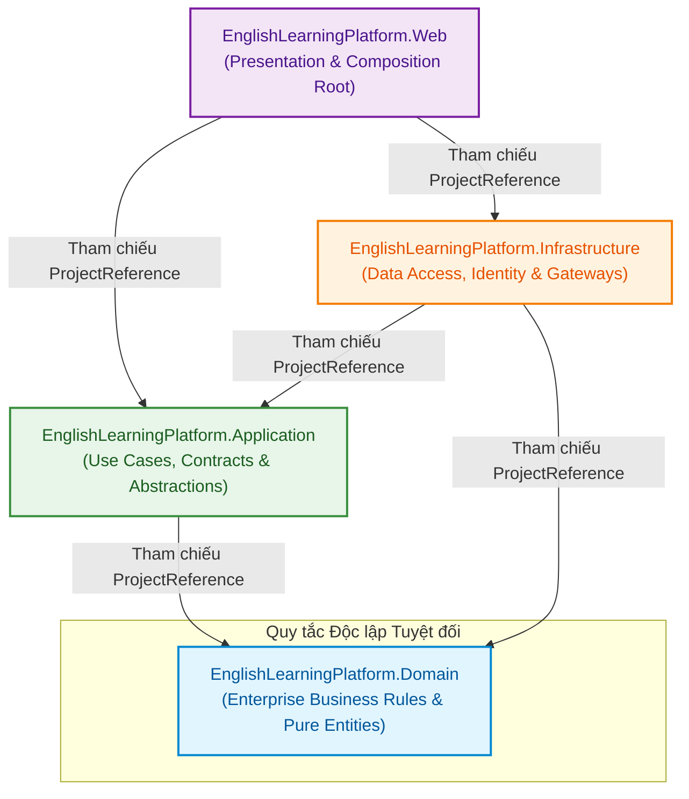
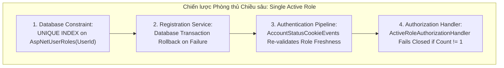
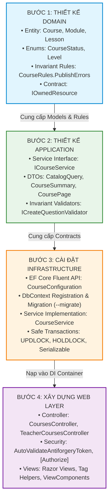
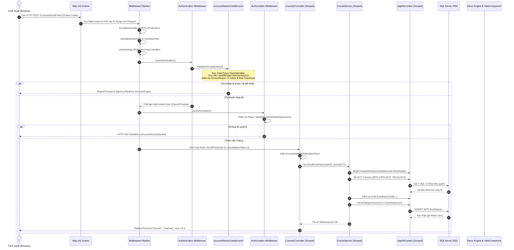
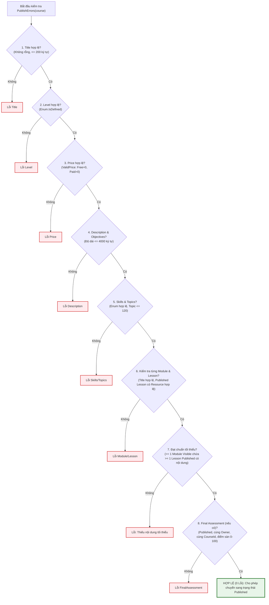
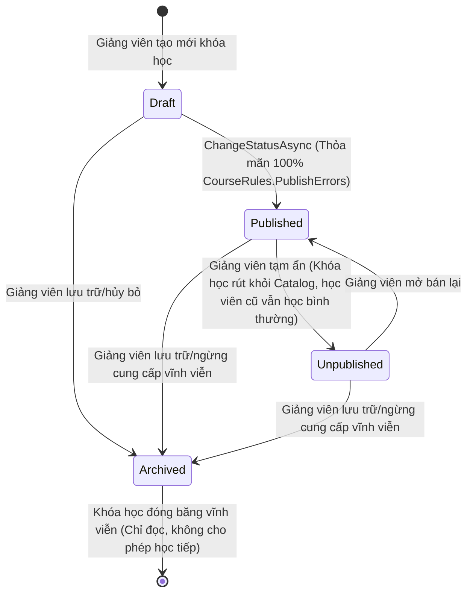
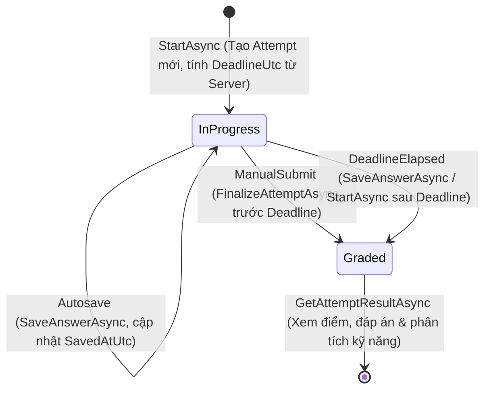
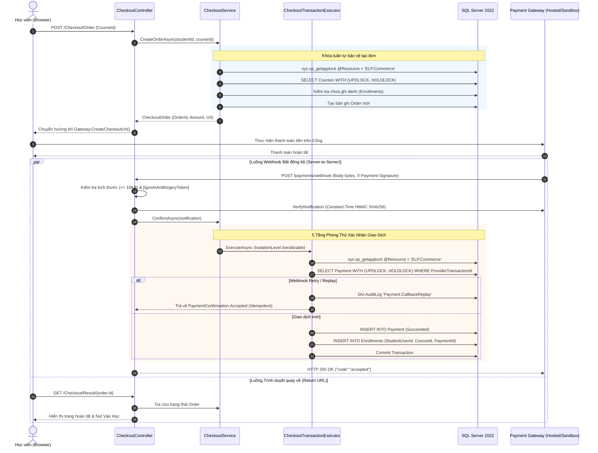

# GIÁO TRÌNH KỸ THUẬT & CẨM NANG KIẾN TRÚC HỆ THỐNG: ENGLISH LEARNING PLATFORM

> **Tài liệu Kỹ thuật Toàn diện & Bài giảng Chuyên sâu dành cho Kỹ sư Phần mềm và Sinh viên Chuyên ngành Công nghệ Thông tin**  
> **Nền tảng công nghệ**: ASP.NET Core (.NET 10.0), Entity Framework Core 10, SQL Server 2022, ASP.NET Core Identity, Razor Views.  
> **Phương pháp tiếp cận**: Khái quát (Overview) — Phân tích (In-depth Analysis) — Tổng hợp (Synthesis).  
> **Độ trung thực mã nguồn**: 100% đối chiếu trực tiếp từ thư mục mã nguồn thực tế `src/`.

---

## MỤC LỤC

- [MỤC LỤC](#mục-lục)
- [PHẦN 1: KHÁI QUÁT TOÀN BỘ DỰ ÁN VÀ NỀN TẢNG CÔNG NGHỆ (R1)](#phần-1-khái-quát-toàn-bộ-dự-án-và-nền-tảng-công-nghệ-r1)
  - [1.1 Tổng quan bài toán và nền tảng công nghệ](#11-tổng-quan-bài-toán-và-nền-tảng-công-nghệ)
  - [1.2 Kiến trúc Modular Monolith & Clean Architecture](#12-kiến-trúc-modular-monolith--clean-architecture)
  - [1.3 Ma trận phân quyền và 4 Actor](#13-ma-trận-phân-quyền-và-4-actor)
  - [1.4 Danh mục 7 phân hệ chức năng](#14-danh-mục-7-phân-hệ-chức-năng)
- [PHẦN 2: PHÂN TÍCH CHUYÊN SÂU THEO GÓC NHÌN LẬP TRÌNH VIÊN .NET (BÀI GIẢNG KỸ THUẬT) (R2)](#phần-2-phân-tích-chuyên-sâu-theo-góc-nhìn-lập-trình-viên-net-bài-giảng-kỹ-thuật-r2)
  - [2.1 Quy trình phát triển một tính năng chuẩn từ con số 0 trong Clean Architecture](#21-quy-trình-phát-triển-một-tính-năng-chuẩn-từ-con-số-0-trong-clean-architecture)
  - [2.2 Luồng di chuyển dữ liệu (Data Flow) và Dependency Injection (DI) Lifecycle](#22-luồng-di-chuyển-dữ-liệu-data-flow-và-dependency-injection-di-lifecycle)
  - [2.3 Cẩm nang Debug và xử lý sự cố thực chiến trong dự án](#23-cẩm-nang-debug-và-xử-lý-sự-cố-thực-chiến-trong-dự-án)
- [PHẦN 3: CODE WALKTHROUGH CHI TIẾT QUA 4 PHÂN HỆ CỐT LÕI (R3)](#phần-3-code-walkthrough-chi-tiết-qua-4-phân-hệ-cốt-lõi-r3)
  - [3.1 Phân hệ 1 — Identity & Multi-Role Authentication/Authorization](#31-phân-hệ-1--identity--multi-role-authenticationauthorization)
  - [3.2 Phân hệ 2 — Learning & Course Lifecycle](#32-phân-hệ-2--learning--course-lifecycle)
  - [3.3 Phân hệ 3 — Assessment & Scoring Engine](#33-phân-hệ-3--assessment--scoring-engine)
  - [3.4 Phân hệ 4 — Commerce & Giao dịch an toàn (Safe Transactions)](#34-phân-hệ-4--commerce--giao-dịch-an-toàn-safe-transactions)
- [PHẦN 4: TỔNG HỢP KIẾN THỨC, BEST PRACTICES VÀ LƯU Ý SỐNG CÒN (R4)](#phần-4-tổng-hợp-kiến-thức-best-practices-và-lưu-ý-sống-còn-r4)
  - [4.1 Tổng kết tư duy kiến trúc và các nguyên lý thiết kế (SOLID thực chiến)](#41-tổng-kết-tư-duy-kiến-trúc-và-các-nguyên-lý-thiết-kế-solid-thực-chiến)
  - [4.2 Checklist các lưu ý quan trọng khi lập trình .NET](#42-checklist-các-lưu-ý-quan-trọng-khi-lập-trình-net)
  - [4.3 Lời khuyên định hướng học tập và chuẩn bị bảo vệ đồ án .NET cho sinh viên](#43-lời-khuyên-định-hướng-học-tập-và-chuẩn-bị-bảo-vệ-đồ-án-net-cho-sinh-viên)

---

# PHẦN 1: KHÁI QUÁT TOÀN BỘ DỰ ÁN VÀ NỀN TẢNG CÔNG NGHỆ (R1)

## 1.1 Tổng quan bài toán và nền tảng công nghệ

### 1.1.1 Bối cảnh và Bài toán Nghiệp vụ
Trong bối cảnh chuyển đổi số giáo dục, việc xây dựng một hệ thống học tập và khảo thí tiếng Anh trực tuyến đòi hỏi sự kết hợp chặt chẽ giữa tính tương tác học thuật, độ chính xác tuyệt đối trong đánh giá năng lực, và sự an toàn nghiêm ngặt trong giao dịch tài chính. Hệ thống **English Learning Platform (ELP)** được thiết kế để giải quyết trọn vẹn chu trình đào tạo trực tuyến bao gồm:
1. **Soạn thảo và Quản trị Nội dung Học thuật (Course Authoring & Management)**: Giảng viên có thể xây dựng các khóa học phân cấp đa tầng (Khóa học $\to$ Học phần/Module $\to$ Bài học/Lesson $\to$ Học liệu/Resource) kèm các ràng buộc sư phạm chặt chẽ trước khi phát hành.
2. **Ngân hàng Đề thi & Khảo thí Thích ứng (Question Bank & Adaptive Assessment)**: Hệ thống quản lý câu hỏi trắc nghiệm gắn với ngữ liệu văn bản hoặc âm thanh (Stimulus: Passage / Audio), hỗ trợ 3 hình thức bài thi theo `AssessmentType`: kiểm tra phân loại (`PlacementTest`), đánh giá kỹ năng chuyên biệt (`SkillAssessment`), và bài thi luyện tập (`PracticeExam`).
3. **Đánh giá Năng lực Thời gian thực & Phân tích Điểm yếu (Scoring Engine & Skill Analysis)**: Cơ chế kiểm soát thời gian làm bài chống gian lận, tự động lưu câu trả lời tuần tự (autosave), chấm điểm theo trọng số, và thuật toán phân tích kỹ năng yếu để cá nhân hóa lộ trình học tập trên Bảng điều khiển (Student Dashboard).
4. **Thương mại Điện tử & Ghi danh An toàn (Safe Commerce & Enrollment)**: Cơ chế mua khóa học trực tiếp, tích hợp cổng thanh toán bảo mật với mã hóa HMAC-SHA256, và giải pháp phòng thủ 5 lớp ở mức cơ sở dữ liệu ngăn chặn hoàn toàn hiện tượng thanh toán trùng hoặc ghi danh lặp (Double-Enrollment).

### 1.1.2 Nền tảng Công nghệ Chủ đạo
Hệ thống được phát triển hoàn toàn trên nền tảng công nghệ doanh nghiệp hiện đại nhất của Microsoft:
- **Ngôn ngữ & Runtime**: **C# 14 / .NET 10.0** (`net10.0`). Toàn bộ solution áp dụng cấu hình tập trung tại `Directory.Build.props`:
  ```xml
  <Project>
    <PropertyGroup>
      <TargetFramework>net10.0</TargetFramework>
      <Nullable>enable</Nullable>
      <ImplicitUsings>enable</ImplicitUsings>
      <TreatWarningsAsErrors>false</TreatWarningsAsErrors>
      <AnalysisLevel>latest</AnalysisLevel>
    </PropertyGroup>
  </Project>
  ```
  - `Nullable: enable`: Kích hoạt trình phân tích kiểm soát con trỏ rỗng (Null Safety Analysis) tại thời điểm biên dịch, giảm thiểu tối đa lỗi kinh điển `NullReferenceException` trong thời gian chạy.
  - `ImplicitUsings: enable`: Giảm thiểu mã lặp khai báo thư viện cơ bản trong C#.
- **Cơ sở Dữ liệu Quan hệ (RDBMS)**: **Microsoft SQL Server 2022**. Khai thác triệt để các tính năng nâng cao như Khóa phân tán ứng dụng (`sys.sp_getapplock`), Khóa dòng và phạm vi (`UPDLOCK, HOLDLOCK`), Chỉ mục duy nhất có điều kiện (Filtered Unique Index), Cấp độ cô lập giao dịch `SERIALIZABLE`, và các ràng buộc toàn vẹn bảng (Table Check Constraints).
- **Object-Relational Mapping (ORM)**: **Entity Framework Core 10.0.12** (`Microsoft.EntityFrameworkCore.SqlServer`, `Microsoft.EntityFrameworkCore.Design`). Áp dụng mô hình Fluent API phân tách theo từng Entity Configuration, kỹ thuật thực thi cập nhật hàng loạt không qua theo dõi bộ nhớ (`ExecuteUpdateAsync`, `ExecuteDeleteAsync`), phân tách truy vấn quan hệ (`AsSplitQuery()`), và tối ưu hóa hiệu năng truy vấn chỉ đọc (`AsNoTracking()`).
- **Bảo mật & Định danh (Identity & Security)**: **ASP.NET Core Identity 10.0.12** (`Microsoft.AspNetCore.Identity.EntityFrameworkCore`) kết hợp cơ chế kiểm thực cookie tùy biến (`AccountStatusCookieEvents`) và phân quyền dựa trên tài nguyên (`Resource-Based Authorization`).
- **Tầng Trình diễn (Presentation Layer)**: **ASP.NET Core MVC với Razor Views**. Sử dụng mô hình xử lý mỏng (Thin Controller), kiểm soát chống tấn công giả mạo yêu cầu chéo trang (`AutoValidateAntiforgeryTokenAttribute`), và các khối giao diện độc lập (ViewComponent).

---

## 1.2 Kiến trúc Modular Monolith & Clean Architecture

### 1.2.1 Tại sao lựa chọn Modular Monolith kết hợp Clean Architecture?
Trong kỹ nghệ phần mềm hiện đại, kiến trúc vi dịch vụ (Microservices) thường được nhắc đến như một trào lưu. Tuy nhiên, đối với một hệ thống đào tạo có tính gắn kết dữ liệu cao (như quan hệ giữa Khóa học, Bài thi, Ghi danh, và Thanh toán), vi dịch vụ sẽ gây ra gánh nặng lớn về chi phí vận hành, độ trễ mạng, vấn đề tính nhất quán cuối cùng (Eventual Consistency), và phức tạp hóa bài toán giao dịch phân tán (Distributed Transactions - Saga / 2PC).

Dự án English Learning Platform lựa chọn kiến trúc **Modular Monolith** kết hợp nguyên lý **Clean Architecture** (còn gọi là Onion Architecture hay Hexagonal Architecture). Mô hình này mang lại "điều tuyệt vời nhất của cả hai thế giới":
1. **Dễ triển khai và vận hành (Single Deployment Unit)**: Toàn bộ hệ thống đóng gói thành một tiến trình Web duy nhất, giảm thiểu tối đa hạ tầng máy chủ và rủi ro mạng.
2. **Ranh giới module tường minh (Strict Boundaries)**: Các phân hệ (Identity, Learning, Question Bank, Assessment, Commerce) được tổ chức cô lập qua các thư mục chức năng, giao tiếp thông qua hợp đồng dữ liệu (DTO) và interface dịch vụ.
3. **Độc lập công nghệ và Dễ kiểm thử (Testability & Maintainability)**: Tách rời tuyệt đối giữa quy tắc nghiệp vụ cốt lõi và chi tiết kỹ thuật của cơ sở dữ liệu hay giao diện người dùng.

### 1.2.2 Cấu trúc 4 Project và Quy tắc Phụ thuộc (Dependency Rule)

Solution được chia thành 4 project vật lý nằm trong thư mục `src/`, tuân thủ nghiêm ngặt **Quy tắc Phụ thuộc (Dependency Rule)**: *Mã nguồn ở các tầng bên ngoài chỉ được phép phụ thuộc vào mã nguồn ở các tầng bên trong; tầng bên trong tuyệt đối không được biết bất kỳ điều gì về tầng bên ngoài.*

```
src/
├── EnglishLearningPlatform.Domain/          # Tầng 1: Lõi nghiệp vụ (Domain Entities & Invariants)
├── EnglishLearningPlatform.Application/     # Tầng 2: Use Cases, Interfaces, DTOs & Validation
├── EnglishLearningPlatform.Infrastructure/  # Tầng 3: EF Core, Identity, DB Transactions & Gateways
└── EnglishLearningPlatform.Web/             # Tầng 4: MVC Controllers, Razor Views & Composition Root
```

#### Sơ đồ Phụ thuộc Giữa các Tầng (Dependency Graph):



#### Bảng Đối chiếu Chi tiết Tham chiếu Project và Package:

| Project | File Định Nghĩa | Tham chiếu Dự Án (`ProjectReference`) | Gói Thư Viện Chính (`PackageReference`) | Trách Nhiệm Thiết Kế Kiến Trúc |
| :--- | :--- | :--- | :--- | :--- |
| **Domain** | `EnglishLearningPlatform.Domain.csproj` | **HOÀN TOÀN KHÔNG CÓ** | **Không có gói ngoài** (Chỉ dùng BCL) | Chứa các thực thể cốt lõi (`Course`, `Assessment`, `Order`), các Enum trạng thái, hợp đồng sở hữu `IOwnedResource`, và các quy tắc nghiệp vụ bất biến (`CourseRules`). |
| **Application** | `EnglishLearningPlatform.Application.csproj` | `..\EnglishLearningPlatform.Domain\` | `Microsoft.AspNetCore.Authorization`<br>`Microsoft.Extensions.DependencyInjection.Abstractions` | Chứa giao diện dịch vụ (`ICourseService`, `IAttemptService`, `ICheckoutService`), DTO/Records, Validators nghiệp vụ (`CreateQuestionValidator`), và thuật toán chấm điểm thuần túy (`ExamScoringService`). |
| **Infrastructure** | `EnglishLearningPlatform.Infrastructure.csproj` | `..\EnglishLearningPlatform.Application\`<br>`..\EnglishLearningPlatform.Domain\` | `Microsoft.AspNetCore.Identity.EntityFrameworkCore`<br>`Microsoft.EntityFrameworkCore.SqlServer`<br>`Microsoft.EntityFrameworkCore.Design`<br>`Microsoft.Extensions.Diagnostics.HealthChecks.EntityFrameworkCore`<br>`System.Security.Cryptography.Pkcs` | Hiện thực truy xuất CSDL qua `AppDbContext`, 26 cấu hình Fluent API, ASP.NET Core Identity (`ApplicationUser`, `AccountStatusCookieEvents`), điều phối Transaction, và tích hợp cổng thanh toán. |
| **Web** | `EnglishLearningPlatform.Web.csproj` | `..\EnglishLearningPlatform.Application\`<br>`..\EnglishLearningPlatform.Infrastructure\` | `Microsoft.EntityFrameworkCore.Design` | Điểm tiếp nhận HTTP Request, Razor Views UI, ViewComponents, Model Binding, CSRF Protection, và đóng vai trò **Composition Root** trong `Program.cs`. |

### 1.2.3 Phân Tích Hai Quyết Định Thiết Kế Sống Còn

#### 1. Tại sao tầng `Domain` không được phép phụ thuộc vào EF Core hay ASP.NET Core Identity?
Trong mã nguồn `EnglishLearningPlatform.Domain.csproj`, phần cấu hình hoàn toàn sạch bóng các dependency:
```xml
<Project Sdk="Microsoft.NET.Sdk">
  <PropertyGroup>
    <RootNamespace>EnglishLearningPlatform.Domain</RootNamespace>
  </PropertyGroup>
</Project>
```
*Lý giải chuyên sâu*:
- **Chống rò rỉ chi tiết hạ tầng (Persistence Ignorance)**: Thực thể nghiệp vụ (`Course`, `Assessment`, `Attempt`) thể hiện các khái niệm của thế giới thực. Nếu đặt các thuộc tính của EF Core (như Data Annotations `[Table]`, `[Key]`, `[ForeignKey]`) hoặc kế thừa từ `IdentityUser` vào Domain, mô hình nghiệp vụ sẽ bị "ô nhiễm" bởi công nghệ lưu trữ. Khi muốn chuyển từ SQL Server sang PostgreSQL, CosmosDB, hoặc đổi nhà cung cấp Identity, tầng Domain sẽ bị phá vỡ.
- **Khả năng kiểm thử đơn vị thuần khiết (Pure Unit Testing)**: Vì Domain chỉ chứa C# thuần túy (POCO - Plain Old CLR Objects), các kỹ sư có thể viết hàng trăm bài kiểm thử đơn vị cho `CourseRules.cs` hay `ValidPrice` chạy trong vài phần nghìn giây mà không cần khởi tạo DbContext, In-Memory DB hay bất kỳ thư viện mock nào.
- **Bảo vệ tính toàn vẹn (Invariants Protection)**: Các quy tắc như "Khóa học Free phải có giá 0", "Resource URL phải có scheme HTTP/HTTPS" thuộc về bản chất của giáo dục trực tuyến. Đặt các quy tắc này trong Domain đảm bảo không một tầng nào có thể tạo ra dữ liệu không hợp lệ mà vượt qua được tầng Domain.

#### 2. Tại sao tầng `Application` định nghĩa Service Interfaces mà không viết thẳng class ở Web?
Trong Clean Architecture, tầng `Application` định nghĩa `ICourseService`, `IAttemptService`, `ICheckoutService`, trong khi phần hiện thực (`CourseService`, `AssessmentAttemptService`, `CheckoutService`) lại nằm ở `Infrastructure`:
- **Nguyên lý Đảo ngược Phụ thuộc (Dependency Inversion Principle - DIP)**: Module cấp cao (Web Controllers) không nên phụ thuộc trực tiếp vào module cấp thấp (Infrastructure Data Access). Cả hai phải cùng phụ thuộc vào sự trừu tượng (Abstractions / Interfaces).
- **Phân tách trách nhiệm (Separation of Concerns)**: Controller trong tầng Web chỉ đóng vai trò nhận HTTP Request, chuyển đổi dữ liệu, gọi Interface và trả về View/JSON. Controller không cần và không được phép biết đằng sau `ICourseService.SaveContentAsync` là câu lệnh SQL gì, dùng transaction mức độ nào, hay khóa dòng bằng table hint nào.
- **Hỗ trợ Mocking trong Integration Testing**: Khi viết kiểm thử giao diện hoặc luồng người dùng ở tầng Web, lập trình viên có thể dễ dàng thay thế implementation thực tế bằng một Mock/Stub implementation của Interface mà không cần dựng cơ sở dữ liệu thật.

---

## 1.3 Ma trận phân quyền và 4 Actor

Hệ thống quản lý chặt chẽ 4 tác nhân tương tác (Actors) với các ranh giới quyền hạn được rào chắn nhiều tầng:

### 1.3.1 Bảng Ma trận Phân quyền Toàn diện (Actor Access Matrix)

| Khu vực Chức năng / Đường dẫn Endpoint | Guest (Chưa đăng nhập) | Student (Học viên) | Teacher (Giảng viên) | Admin (Quản trị viên) | Cơ chế Kiểm soát & Ghi chú Kỹ thuật |
| :--- | :---: | :---: | :---: | :---: | :--- |
| **Xem Catalog Khóa học** (`/Courses/Index`, `Details`) | Cho phép | Cho phép | Cho phép | Cho phép | Endpoint công khai `[AllowAnonymous]`. |
| **Đăng ký tài khoản Student** (`/Account/Register`) | Cho phép | Từ chối | Từ chối | Từ chối | Gán mặc định duy nhất vai trò `Student`. |
| **Ghi danh khóa học Free** (`/Courses/EnrollFree`) | Từ chối | **Cho phép** | Từ chối | Từ chối | Yêu cầu Policy: `AuthorizationPolicies.Student`. |
| **Mua khóa học có phí** (`/Checkout/Order`, Webhook) | Từ chối | **Cho phép** | Từ chối | Từ chối | Yêu cầu Policy: `AuthorizationPolicies.Student`. |
| **Học bài, xem học liệu** (`/Learning/Course/...`) | Từ chối | **Cho phép** | **Theo quyền sở hữu** | Từ chối | `LearningAccessService` kiểm tra Enrollment hợp lệ đối với Student. |
| **Đánh dấu hoàn thành bài** (`/Learning/Completion`) | Từ chối | **Cho phép** | Từ chối | Từ chối | Chỉ Student có ghi danh mới được ghi nhận tiến độ (`POST /Learning/Completion/{id}`). |
| **Làm bài luyện tập & thi** (`/Practice/...`, `/Assessment/...`) | Từ chối | **Cho phép** | Từ chối | Từ chối | Chặn Teacher và Admin làm bài thi để bảo đảm tính khách quan. |
| **Xem Dashboard cá nhân** (`/Learning/Dashboard`) | Từ chối | **Cho phép** | Từ chối | Từ chối | Tổng hợp tiến độ, phân tích kỹ năng yếu `SkillAnalysisRules`. |
| **Soạn thảo Khóa học** (`/TeacherCourses/Manage`, `Content`) | Từ chối | Từ chối | **Chính chủ (Owner)** | Từ chối | Policy: `AuthorizationPolicies.Teacher` kết hợp `IOwnedResource`. |
| **Xuất bản Khóa học** (`/TeacherCourses/Publish`) | Từ chối | Từ chối | **Chính chủ (Owner)** | Từ chối | Kiểm tra điều kiện ngặt nghèo qua `CourseRules.PublishErrors`. |
| **Quản lý Ngân hàng câu hỏi** (`/TeacherQuestionBank/...`) | Từ chối | Từ chối | **Chính chủ (Owner)** | Từ chối | Giáo viên chỉ xem/sửa các câu hỏi do chính mình tạo ra. |
| **Xem báo cáo doanh thu & học viên** (`/TeacherCourses/Students`)| Từ chối | Từ chối | **Chính chủ (Owner)** | Từ chối | Báo cáo tiến độ học viên trong khóa học của giảng viên. |
| **Tra cứu Người dùng** (`/Admin/Users`) | Từ chối | Từ chối | Từ chối | **Cho phép** | Policy: `AuthorizationPolicies.Admin`. |
| **Tra cứu trạng thái tài khoản** (`/Admin/Users`) | Từ chối | Từ chối | Từ chối | **Cho phép** | Lọc theo `AccountStatus` (`Active`/`Locked`/`Disabled`) qua `IAdminQueryService.UsersAsync` (AdminController chỉ có action truy vấn read-only, không có ToggleStatus). |
| **Tra cứu Lịch sử Giao dịch** (`/Admin/Transactions`) | Từ chối | Từ chối | Từ chối | **Cho phép** | Xem toàn bộ nhật ký thanh toán toàn hệ thống. |
| **Chỉnh sửa Nội dung Khóa học / Câu hỏi** | **BỊ CẤM** | **BỊ CẤM** | **Theo quyền sở hữu** | **BỊ CẤM TUYỆT ĐỐI** | **Nguyên tắc Phân tách Trách nhiệm (Separation of Concerns)**. |
| **Xem đáp án đúng (`IsCorrect`) trong Khảo thí** | **BỊ CẤM** | **BỊ CẤM** | **Chính chủ (Owner)** | **BỊ CẤM TUYỆT ĐỐI** | Tránh rò rỉ lộ đề thi từ cấp quản trị viên. |

### 1.3.2 Phân Quyền Dựa Trên Tài Nguyên (Resource-Based Authorization)
Hệ thống không chỉ phân quyền theo vai trò (Role-based) mà áp dụng sâu sắc phân quyền theo tài nguyên (Resource-based Authorization):
- **Hợp đồng `IOwnedResource`** (`src/EnglishLearningPlatform.Domain/Authorization/IOwnedResource.cs`):
  ```csharp
  namespace EnglishLearningPlatform.Domain.Authorization;

  public interface IOwnedResource
  {
      Guid OwnerUserId { get; }
  }
  ```
  Thực thể `Course` hiện thực giao diện này bằng cách trỏ tới giảng viên sở hữu:
  ```csharp
  // Course.cs:29
  Guid IOwnedResource.OwnerUserId => OwnerTeacherUserId;
  ```
- **Bộ thẩm định quyền sở hữu `ResourceOwnerAuthorizationHandler`** (`src/EnglishLearningPlatform.Infrastructure/Authorization/ResourceOwnerAuthorizationHandler.cs`):
  ```csharp
  public sealed class ResourceOwnerAuthorizationHandler
      : AuthorizationHandler<ResourceOwnerRequirement, IOwnedResource>
  {
      protected override Task HandleRequirementAsync(
          AuthorizationHandlerContext context,
          ResourceOwnerRequirement requirement,
          IOwnedResource resource)
      {
          var userIdValue = context.User.FindFirstValue(ClaimTypes.NameIdentifier);

          if (context.User.Identity?.IsAuthenticated == true
              && Guid.TryParse(userIdValue, out var userId)
              && userId == resource.OwnerUserId)
          {
              context.Succeed(requirement);
          }

          return Task.CompletedTask;
      }
  }
  ```
- **Phân cấp truy vết quyền (Hierarchy Traversal) trong `LearningAccessService`**:
  Đối với các tài nguyên con như Module, Lesson hay LessonResource, bảng cơ sở dữ liệu không lưu trùng cột `OwnerTeacherUserId` (tránh dư thừa chuẩn hóa dữ liệu). Thay vào đó, `LearningAccessService.GetResourceAsync` truy vết ngược theo cây quan hệ:
  $$\text{LessonResource} \longrightarrow \text{Lesson} \longrightarrow \text{Module} \longrightarrow \text{Course.OwnerTeacherUserId}$$
  Nếu một giáo viên cố tình sửa URL để chỉnh sửa một Lesson hoặc Resource của giáo viên khác, hệ thống sẽ đối chiếu `Course.OwnerTeacherUserId != currentUserId` và lập tức trả về mã lỗi `403 Forbidden` (`LearningAccessResult.Forbidden`).

### 1.3.3 Nguyên tắc Phòng thủ Chiều sâu: "Single Active Role"
Hệ thống thiết lập một luật bất biến trong kiến trúc: **Một tài khoản chỉ có đúng một vai trò hoạt động tại một thời điểm**. Để ngăn chặn triệt để lỗ hổng leo thang đặc quyền (Privilege Escalation) hoặc xung đột trạng thái (ví dụ: một tài khoản vừa là Teacher vừa là Student tự ghi danh và tự chấm bài cho chính mình), nguyên tắc này được bảo vệ qua 4 tầng phòng thủ:



1. **Tầng 1 — Cơ sở dữ liệu vật lý (Physical Schema Constraint)**:
   Tại `src/EnglishLearningPlatform.Infrastructure/Persistence/Configurations/IdentityUserRoleConfiguration.cs`:
   ```csharp
   public sealed class IdentityUserRoleConfiguration : IEntityTypeConfiguration<IdentityUserRole<Guid>>
   {
       public void Configure(EntityTypeBuilder<IdentityUserRole<Guid>> e)
       {
           e.HasIndex(x => x.UserId).IsUnique();
       }
   }
   ```
   Trong thiết kế mặc định của ASP.NET Core Identity, khóa chính của bảng `AspNetUserRoles` là `(UserId, RoleId)`, cho phép một người dùng có thể nhận nhiều vai trò. Dự án này chủ động đặt thêm một **Chỉ mục Duy nhất (Unique Index)** trên cột `UserId`. Điều này có nghĩa: *Ở cấp độ lưu trữ vật lý của SQL Server, không bao giờ có thể tồn tại dòng thứ hai cho cùng một UserId*. Mọi hành vi cố tình chèn role thứ hai sẽ bị SQL Server chặn đứng bằng lỗi Exception 2601/2627.
2. **Tầng 2 — Nghiệp vụ Đăng ký (Service Transaction)**:
   Trong `IdentityRegistrationService.RegisterStudentAsync`, việc tạo người dùng và gán vai trò `Student` được bao bọc trong cùng một transaction `BeginTransactionAsync()`. Nếu thao tác gán vai trò thất bại, toàn bộ tiến trình tạo tài khoản bị hủy bỏ ngay lập tức, ngăn ngừa việc sinh ra tài khoản "mồ côi" không có vai trò.
3. **Tầng 3 — Xác thực Phiên làm việc (Cookie Events)**:
   Lớp `AccountStatusCookieEvents` đọc lại danh sách vai trò từ CSDL trên mỗi HTTP Request. Nếu phát hiện số vai trò khác 1 hoặc vai trò trong CSDL khác với Claim trong Cookie, phiên làm việc sẽ bị hủy ngay tức khắc.
4. **Tầng 4 — Thẩm tra Chính sách (Authorization Handler)**:
   `ActiveRoleAuthorizationHandler` kiểm tra nếu người dùng sở hữu số lượng vai trò $\neq 1$ hoặc vai trò không thuộc danh mục `AppRoles.All`, yêu cầu sẽ bị từ chối theo nguyên tắc "Fail-Closed" (Mặc định chặn nếu có bất thường).

---

## 1.4 Danh mục 7 phân hệ chức năng

Hệ thống được tổ chức thành 7 phân hệ nghiệp vụ có tính gắn kết nội tại cao:

```
┌──────────────────────────────────────────────────────────────────────────────────┐
│                      ENGLISH LEARNING PLATFORM ARCHITECTURE                      │
├────────────────────┬────────────────────┬───────────────────┬────────────────────┤
│ 1. Identity &      │ 2. Learning        │ 3. Question Bank  │ 4. Practice        │
│    Profile         │    Subsystem       │    Subsystem      │    Subsystem       │
│ • IdentityUser     │ • Course/Module/   │ • MC Question     │ • Free practice    │
│ • SingleActiveRole │   Lesson/Resource  │ • Stimulus Audio/ │ • Instant score    │
│ • Cookie Realtime  │ • PublishErrors    │   Passage         │ • Re-attempt       │
│ • Profile update   │ • Progress/Recon   │ • Pure Validator  │ • Answer reveal    │
├────────────────────┴────────────────────┼───────────────────┴────────────────────┤
│ 5. Assessment & Scoring Engine          │ 6. Commerce & Safe Checkout            │
│ • Placement, Skill, Practice Exams      │ • Direct Course Purchase (No Cart)     │
│ • Server-driven Countdown (Zero-Trust)  │ • 5-Layer Concurrency Defense          │
│ • Promise-chained Autosave (Ordered)    │ • Hosted HMAC-SHA256 & Local Sandbox   │
│ • Weighted Scoring & Weak Skill Engine  │ • Idempotent Webhook & Replay-Safe     │
├─────────────────────────────────────────┴────────────────────────────────────────┤
│ 7. Administration & Audit Log                                                    │
│ • Read-Only Content Governance (No Test Tampering, No IsCorrect Leak)            │
│ • User Management & Instant Account Lockout                                      │
│ • System-Wide Transaction Audit & Querying                                       │
└──────────────────────────────────────────────────────────────────────────────────┘
```

1. **Phân hệ Định danh & Hồ sơ (Identity & Profile)**:
   - Quản lý người dùng mở rộng từ `IdentityUser<Guid>` (`ApplicationUser`).
   - Duy trì thông tin họ tên, email, ngày tạo, và trạng thái tài khoản `AccountStatus` (`Active`, `Locked`, `Disabled`).
   - Cung cấp dịch vụ đăng ký học viên (`IRegistrationService`), đăng nhập (`ILoginService`), đăng xuất (`ILogoutService`), và quản lý hồ sơ cá nhân (`IProfileService`).
2. **Phân hệ Học tập (Learning Subsystem)**:
   - Quản lý thực thể gốc `Course` và cấu trúc bài học phân cấp (`Module`, `Lesson`, `LessonResource`).
   - Đảm bảo các quy tắc kiểm tra điều kiện xuất bản khóa học qua `CourseRules.PublishErrors`.
   - Theo dõi tiến độ học tập của từng học viên qua `LessonProgress` và tự động kích hoạt tính năng công nhận hoàn thành khóa học qua `CourseCompletion.ReconcileAsync`.
3. **Phân hệ Ngân hàng Câu hỏi (Question Bank)**:
   - Quản lý câu hỏi trắc nghiệm khách quan chuẩn hóa (`Question`, `QuestionOption`).
   - Hỗ trợ ngữ liệu kèm theo (`Stimulus`) gồm văn bản đọc hiểu (`Passage`) hoặc tệp nghe âm thanh (`Audio`).
   - Bộ thẩm tra câu hỏi độc lập `CreateQuestionValidator` đảm bảo mỗi câu hỏi có ít nhất hai lựa chọn và bắt buộc có **chính xác một đáp án đúng**.
4. **Phân hệ Luyện tập (Practice Subsystem)**:
   - Cho phép học viên làm các bài tập củng cố kiến thức theo từng module hoặc bài học.
   - Khi trả đề thi (`GetSheetAsync`), toàn bộ cờ `IsCorrect` của các đáp án bị xóa sạch.
   - Hỗ trợ học viên làm lại nhiều lần và xem lại bài giải kèm giải thích chi tiết (`Explanation`).
5. **Phân hệ Khảo thí & Chấm điểm (Assessment & Scoring Engine)**:
   - Quản lý các kỳ thi đánh giá năng lực độc lập hoặc bài thi tốt nghiệp cuối khóa học.
   - Cơ chế đếm ngược thời gian kiểm soát độc quyền từ máy chủ UTC kết hợp bộ đếm đơn điệu `performance.now()` phía trình duyệt.
   - Hệ thống tự động lưu đáp án tuần tự bằng hàng đợi Promise JavaScript.
   - Động cơ chấm điểm trọng số `ExamScoringService` và thuật toán trích xuất kỹ năng yếu `SkillAnalysisRules`.
6. **Phân hệ Thương mại & Thanh toán An toàn (Commerce & Safe Checkout)**:
   - Mô hình mua khóa học trực tiếp qua `Order`, `Payment`, và `Enrollment`.
   - Chiến lược bảo vệ giao dịch 5 lớp: Khóa ứng dụng phân tán `sys.sp_getapplock`, Khóa dòng `WITH (UPDLOCK, HOLDLOCK)`, Cấp độ cô lập `SERIALIZABLE`, Ràng buộc duy nhất `UNIQUE INDEX`, và Quản lý vòng đời `CheckoutTransactionExecutor`.
   - Tích hợp cổng thanh toán bảo mật với mã hóa HMAC-SHA256 so sánh thời gian hằng số (`CryptographicOperations.FixedTimeEquals`) và môi trường giả lập cục bộ (`LocalSandboxGateway`).
7. **Phân hệ Quản trị & Nhật ký Kiểm toán (Administration & Audit Log)**:
   - Tra cứu người dùng và quản lý trạng thái tài khoản.
   - Tra cứu giao dịch và lịch sử thanh toán toàn hệ thống.
   - **Nguyên lý Phân tách Trách nhiệm Quản trị**: Admin có quyền quản trị vận hành nhưng bị cấm tuyệt đối can thiệp vào nội dung học thuật, không được xem đáp án đề thi, và không được sửa đổi bài làm của học viên.

---

# PHẦN 2: PHÂN TÍCH CHUYÊN SÂU THEO GÓC NHÌN LẬP TRÌNH VIÊN .NET (BÀI GIẢNG KỸ THUẬT) (R2)

## 2.1 Quy trình phát triển một tính năng chuẩn từ con số 0 trong Clean Architecture

Trong quá trình đào tạo và phỏng vấn kỹ sư .NET, câu hỏi phổ biến nhất là: *"Khi nhận một yêu cầu tính năng mới từ khách hàng, bạn sẽ bắt đầu viết code từ đâu?"* 
Một lập trình viên nghiệp dư thường bắt đầu từ việc tạo bảng trong SQL Server, hoặc mở ngay Controller để viết mã. Ngược lại, một kỹ sư Clean Architecture chuẩn mực sẽ tiếp cận từ **Tâm của Kiến trúc (Core Domain)** đi dần ra các lớp vỏ bên ngoài:
$$\text{Bước 1: Domain} \longrightarrow \text{Bước 2: Application} \longrightarrow \text{Bước 3: Infrastructure} \longrightarrow \text{Bước 4: Web (UI)}$$

Chúng ta hãy cùng phân tích quy trình 4 bước chuẩn mực này thông qua tính năng thực tế của hệ thống: **Quản lý Vòng đời và Xuất bản Khóa học (Course Authoring & Publishing)**.



### Bước 1: Thiết Kế Tầng `Domain` (Lõi Nghiệp Vụ Độc Lập)
Mục tiêu của bước này là định hình mô hình dữ liệu và các luật bất biến của doanh nghiệp mà không bận tâm đến cơ sở dữ liệu hay giao diện.
1. **Xác định Thực thể & Định danh**:
   Tạo lớp `Course.cs` kế thừa từ `BaseEntity` (sử dụng kiểu khóa chính `Guid` để hỗ trợ phân tán và sinh ID tại ứng dụng mà không cần chờ DB roundtrip):
   ```csharp
   // src/EnglishLearningPlatform.Domain/Entities/Course.cs
   public sealed class Course : BaseEntity, IOwnedResource
   {
       public Guid OwnerTeacherUserId { get; set; }
       public Guid? FinalAssessmentId { get; set; }
       public Assessment? FinalAssessment { get; set; }
       public string Title { get; set; } = string.Empty;
       public string? Description { get; set; }
       public string? Objectives { get; set; }
       public CourseLevel Level { get; set; } = CourseLevel.Beginner;
       public CourseStatus Status { get; set; } = CourseStatus.Draft;
       public bool IsPaid { get; set; }
       public decimal Price { get; set; }
       public ICollection<Module> Modules { get; set; } = new List<Module>();
       // ...
       Guid IOwnedResource.OwnerUserId => OwnerTeacherUserId;
   }
   ```
2. **Định nghĩa Quy tắc Bất biến (Business Invariants) tại `CourseRules.cs`**:
   Toàn bộ logic xác thực nghiệp vụ được đóng gói dưới dạng các hàm static thuần túy:
   ```csharp
   // src/EnglishLearningPlatform.Domain/Entities/CourseRules.cs
   public static class CourseRules
   {
       public static bool ValidPrice(bool paid, decimal price) =>
           price <= 9999999999999999.99m && decimal.Round(price, 2) == price && (paid ? price > 0 : price == 0);

       public static IReadOnlyList<string> PublishErrors(Course course)
       {
           var errors = new List<string>();
           if (string.IsNullOrWhiteSpace(course.Title) || course.Title.Trim().Length > 200) 
               errors.Add("Title: tên khóa học không hợp lệ.");
           if (!ValidPrice(course.IsPaid, course.Price)) 
               errors.Add("Price: Free phải có giá 0; Paid phải có giá dương, tối đa 2 chữ số thập phân.");
           // Kiểm tra Module và Lesson...
           return errors;
       }
   }
   ```
   *Tại sao làm như vậy?* Việc tách biệt logic nghiệp vụ vào `CourseRules` đảm bảo rằng: Dù tính năng xuất bản được gọi từ Web MVC, Web API, hay tiến trình chạy ngầm CLI, cùng một tập luật duy nhất được áp dụng, không bao giờ xảy ra tình trạng "trên Web cấm mà dưới ngầm lại cho qua".

### Bước 2: Thiết Kế Tầng `Application` (Use Cases & Hợp Đồng Dữ Liệu)
Tầng Application đóng vai trò chỉ huy (Orchestrator). Tại đây ta định nghĩa:
1. **Hợp đồng Giao diện Dịch vụ (Service Interface)**:
   Tại `src/EnglishLearningPlatform.Application/Learning/CourseModels.cs` (dòng 90-110):
   ```csharp
   public interface ICourseService
   {
       Task<CatalogPage> CatalogAsync(CatalogQuery query, CancellationToken ct = default);
       Task<CoursePage?> PublicDetailAsync(Guid id, Guid? userId, CancellationToken ct = default);
       Task<WriteOutcome> SaveCourseAsync(Guid userId, Guid? id, CourseInput input, CancellationToken ct = default);
       Task<WriteOutcome> ChangeStatusAsync(Guid userId, Guid id, CourseStatus status, CancellationToken ct = default);
       Task<WriteOutcome> EnrollFreeAsync(Guid userId, Guid id, CancellationToken ct = default);
   }
   ```
2. **Mô hình Truyền Dữ liệu (DTO / Records)**:
   Sử dụng C# `record` để tạo các đối tượng dữ liệu bất biến (Immutable Data Transfers) tối ưu cho việc đọc:
   ```csharp
   public sealed record CourseSummary(Guid Id, Guid OwnerId, string Title, string? Description, string? Objectives,
       string Teacher, CourseLevel Level, CourseStatus Status, bool IsPaid, decimal Price,
       IReadOnlyList<EnglishSkill> Skills, IReadOnlyList<string> Topics, int ModuleCount, int LessonCount)
   {
       public CourseProgress? Progress { get; init; }
   }
   ```
   *Tại sao làm như vậy?* DTO ngăn chặn hiện tượng rò rỉ cấu trúc cơ sở dữ liệu ra bên ngoài và loại bỏ nguy cơ over-posting/circular reference khi truyền qua View hoặc API.

### Bước 3: Cài Đặt Tầng `Infrastructure` (Truy Xuất Dữ Liệu & Giao Dịch)
Đây là nơi công nghệ cụ thể (EF Core, SQL Server) được kết nối với các khái niệm trừu tượng của hệ thống.
1. **Cấu hình Fluent API Tách biệt (`IEntityTypeConfiguration<T>`)**:
   Thay vì nhồi nhét vào `OnModelCreating`, tạo tệp riêng `CourseConfiguration.cs`:
   ```csharp
   // src/EnglishLearningPlatform.Infrastructure/Persistence/Configurations/CourseConfiguration.cs
   public sealed class CourseConfiguration : IEntityTypeConfiguration<Course>
   {
       public void Configure(EntityTypeBuilder<Course> e)
       {
           e.ToTable("Courses");
           e.Property(x => x.Title).HasMaxLength(200).IsRequired();
           e.Property(x => x.Level).HasConversion<string>().HasMaxLength(32);
           e.Property(x => x.Status).HasConversion<string>().HasMaxLength(16);
           e.Property(x => x.Price).HasPrecision(18, 2);

           e.HasOne<ApplicationUser>().WithMany()
               .HasForeignKey(x => x.OwnerTeacherUserId).OnDelete(DeleteBehavior.NoAction);
       }
   }
   ```
2. **Hiện thực Dịch vụ & Quản lý Giao dịch CSDL**:
   Trong `src/EnglishLearningPlatform.Infrastructure/Learning/CourseService.cs`:
   Triển khai `ICourseService`. Khi cập nhật trạng thái khóa học (`ChangeStatusAsync`), dịch vụ sử dụng giao dịch `IsolationLevel.Serializable` kết hợp khóa dòng:
   ```csharp
   await using var tx = await db.Database.BeginTransactionAsync(IsolationLevel.Serializable, ct);
   var course = await db.Courses.FromSqlInterpolated(
       $"SELECT * FROM Courses WITH (UPDLOCK, HOLDLOCK) WHERE Id = {courseId}"
   ).SingleOrDefaultAsync(ct);

   if (targetStatus == CourseStatus.Published)
   {
       var errors = CourseRules.PublishErrors(course);
       if (errors.Count > 0) return WriteOutcome.ValidationFailed(errors);
   }
   course.Status = targetStatus;
   await db.SaveChangesAsync(ct);
   await tx.CommitAsync(ct);
   ```
3. **Quản lý Migration Chuẩn Production**:
   Không dùng `db.Database.Migrate()` khi chạy ứng dụng thông thường. Sử dụng cờ dòng lệnh `--migrate` trong `Program.cs`:
   ```bash
   dotnet run --project src/EnglishLearningPlatform.Web -- --migrate
   ```

### Bước 4: Cài Đặt Tầng `Web` (Controllers, UI & Phân Quyền)
Tầng cuối cùng kết nối người dùng với hệ thống thông qua giao thức HTTP:
1. **Xây dựng MVC Controller Mỏng**:
   Trong `src/EnglishLearningPlatform.Web/Controllers/CoursesController.cs`:
   ```csharp
   public sealed class CoursesController(ICourseService courses) : Controller
   {
       private Guid? UserId => Guid.TryParse(User.FindFirstValue(ClaimTypes.NameIdentifier), out var id) ? id : null;

       [HttpGet, AllowAnonymous]
       public async Task<IActionResult> Index(CatalogQuery query, CancellationToken ct)
       {
           var result = await courses.CatalogAsync(query, ct);
           return View(result);
       }

       [HttpPost, ValidateAntiForgeryToken, Authorize(Policy = AuthorizationPolicies.Student)]
       public async Task<IActionResult> EnrollFree(Guid id, CancellationToken ct)
       {
           if (!UserId.HasValue) return Challenge();
           var result = await courses.EnrollFreeAsync(UserId.Value, id, ct);
           return result.Access switch
           {
               LearningAccessResult.Allowed => RedirectToAction("Course", "Learning", new { id }),
               LearningAccessResult.NotFound => NotFound(),
               _ => Forbid()
           };
       }
   }
   ```
2. **Giao diện Razor View**:
   Sử dụng Tag Helpers mạnh mẽ của ASP.NET Core (`asp-controller`, `asp-action`, `asp-route-id`) để liên kết dữ liệu tự động và sinh Antiforgery Token cho các thẻ `<form>`.

---

## 2.2 Luồng di chuyển dữ liệu (Data Flow) và Dependency Injection (DI) Lifecycle

### 2.2.1 Sơ đồ Chi tiết Vòng Đời HTTP Request
Một HTTP Request trong dự án trải qua chuỗi hành trình từ lúc Kestrel lắng nghe cổng mạng cho đến khi Razor View hoàn tất render HTML:



### 2.2.2 Bảng Danh Mục Vòng Đời Dependency Injection (DI Lifetimes)

Trong ASP.NET Core, việc lựa chọn sai vòng đời dịch vụ (Lifetime) là nguyên nhân hàng đầu gây ra lỗi rò rỉ bộ nhớ (Memory Leak), lỗi dùng chung trạng thái giữa các người dùng (State Pollution), hoặc lỗi truy vấn đồng thời trên DbContext (`InvalidOperationException`). Hệ thống phân bổ vòng đời theo các nguyên tắc kỹ thuật chặt chẽ:

| Tên Dịch Vụ / Lớp | Vòng Đời (DI Lifetime) | Nơi Đăng Ký Trong Mã Nguồn | Lý Do Kiến Trúc & Căn Cứ Kỹ Thuật |
| :--- | :--- | :--- | :--- |
| **`AppDbContext`** | **Scoped** | `Infrastructure/DependencyInjection.cs:35` | Quản lý kết nối SQL Server và Change Tracker. Cần tạo mới theo mỗi HTTP Request và giải phóng (Dispose) ngay khi kết thúc request để hoàn trả connection về Pool. |
| **`UserManager<ApplicationUser>`** | **Scoped** | `Infrastructure/DependencyInjection.cs:38` | Thành phần của Identity, phụ thuộc trực tiếp vào `AppDbContext` nên bắt buộc phải có cùng vòng đời Scoped. |
| **`AccountStatusCookieEvents`** | **Scoped** | `Infrastructure/DependencyInjection.cs:68` | Interceptor chặn bắt sự kiện xác thực cookie trên từng request, cần inject `UserManager` để tra cứu CSDL thời gian thực. |
| **`ActiveRoleAuthorizationHandler`** | **Scoped** | `Infrastructure/AuthorizationServiceExtensions` | Thẩm tra policy quyền hạn của người dùng hiện hành theo từng request. |
| **`ResourceOwnerAuthorizationHandler`**| **Scoped** | `Infrastructure/AuthorizationServiceExtensions` | So sánh ID của người dùng trong HttpContext với `IOwnedResource.OwnerUserId`. |
| **`CourseService`** | **Scoped** | `Infrastructure/DependencyInjection.cs:72` | Chứa logic nghiệp vụ khóa học, inject `AppDbContext` để thực thi truy vấn và quản lý transaction. |
| **`AssessmentAttemptService`** | **Scoped** | `Infrastructure/DependencyInjection.cs:83` | Lớp hiện thực đặt tại `src/EnglishLearningPlatform.Infrastructure/AssessmentAttempts/` (triển khai interface `IAttemptService` của tầng Application, không nằm ở Application vì trực tiếp quản lý transaction `Serializable`, khóa bảng SQL `UPDLOCK, HOLDLOCK` và `AppDbContext`). Điều phối vòng đời bài thi, chấm điểm và lưu đáp án. Bắt buộc là Scoped để quản lý transaction riêng biệt. |
| **`CheckoutService`** | **Scoped** | `Infrastructure/DependencyInjection.cs:82` | Xử lý thanh toán, điều phối transaction tài chính. |
| **`CheckoutTransactionExecutor`** | **Scoped** | `Infrastructure/DependencyInjection.cs:81` | Quản lý vòng đời commit/rollback và làm sạch ChangeTracker của `AppDbContext` hiện hành. |
| **`CreateQuestionValidator`** | **Scoped** | `Application/DependencyInjection.cs:12` | Lớp thẩm định dữ liệu câu hỏi. Đăng ký Scoped (hoặc Transient) phù hợp với vòng lặp xử lý use case. |
| **`ExamScoringService`** | **Scoped** | `Application/DependencyInjection.cs:11` | Động cơ chấm điểm thuần túy không chứa trạng thái (Stateless Service). |
| **`HostedPaymentGateway`** | **Singleton** | `Infrastructure/DependencyInjection.cs:78` | Adapter cổng thanh toán ngoài: Cấu hình URL và SigningSecret không thay đổi trong suốt vòng đời ứng dụng, không chứa trạng thái người dùng. Khởi tạo một lần duy nhất cho toàn ứng dụng. |
| **`LocalSandboxGateway`** | **Singleton** | `Infrastructure/DependencyInjection.cs:79` | Cổng thanh toán giả lập: Lưu trữ khóa ký sinh ngẫu nhiên 32-byte trong bộ nhớ RAM (`_key = RandomNumberGenerator.GetBytes(32)`). Bắt buộc phải là Singleton để khóa này được bảo toàn giữa các request tạo đơn và xác nhận webhook. |
| **`TimeProvider.System`** | **Singleton** | `Infrastructure/DependencyInjection.cs:84` | Lớp trừu tượng hóa thời gian của .NET, dùng chung cho toàn bộ hệ thống để phục vụ tính thời gian và hỗ trợ mocking thời gian khi viết unit test. |

---

## 2.3 Cẩm nang Debug và xử lý sự cố thực chiến trong dự án

### 2.3.1 Kỹ thuật Soi Câu Truy Vấn SQL EF Core (SQL Inspection & Profiling)

Khi ứng dụng chạy chậm hoặc ném lỗi vi phạm dữ liệu, kỹ năng quan trọng nhất của lập trình viên .NET là nhìn thấu câu lệnh SQL thực sự chạy dưới SQL Server.

#### Phương pháp 1: Sử dụng `ToQueryString()` trong Debugger
Đối với bất kỳ biến `IQueryable<T>` nào trong mã nguồn, ta có thể gọi `ToQueryString()` để trích xuất câu lệnh T-SQL mà EF Core biên dịch từ biểu thức LINQ:
```csharp
var query = db.Courses
    .AsNoTracking()
    .Where(c => c.Status == CourseStatus.Published && c.Price > 0)
    .OrderByDescending(c => c.CreatedAtUtc);

// Cách 1: Đặt breakpoint tại đây, mở cửa sổ "Immediate Window" trong Visual Studio / Rider:
// Gõ: query.ToQueryString()
// Kết quả hiển thị tức thì toàn bộ câu lệnh SELECT...
string debugSql = query.ToQueryString();
```
*Lưu ý*: `ToQueryString()` chỉ xem được câu lệnh truy vấn `SELECT`, không dùng được cho các thao tác ghi dữ liệu (`SaveChanges`).

#### Phương pháp 2: Cấu hình Logging mức `Information` trong `appsettings.json`
Trong tệp `src/EnglishLearningPlatform.Web/appsettings.json`:
```json
{
  "Logging": {
    "LogLevel": {
      "Default": "Information",
      "Microsoft.AspNetCore": "Warning",
      "Microsoft.EntityFrameworkCore.Database.Command": "Information"
    }
  }
}
```
Khi cấu hình `"Microsoft.EntityFrameworkCore.Database.Command": "Information"`, mọi câu lệnh SQL (kể cả SELECT, INSERT, UPDATE, DELETE, BEGIN TRAN, COMMIT) kèm theo thời gian thực thi (execution time ms) và tham số đều được hiển thị trực tiếp trên cửa sổ Terminal:
```text
info: Microsoft.EntityFrameworkCore.Database.Command[20101]
      Executed DbCommand (8ms) [Parameters=[@__id_0='...'], CommandType='Text']
      SELECT * FROM Courses WITH (UPDLOCK, HOLDLOCK) WHERE Id = @__id_0
```

#### Phương pháp 3: Bật `EnableSensitiveDataLogging()` trong môi trường Development
Mặc định, vì lý do an toàn bảo mật, EF Core sẽ ẩn giá trị các tham số bằng `@__p_0 = '?'`. Để xem được giá trị thực tế của biến truyền vào trong lúc debug:
```csharp
services.AddDbContext<AppDbContext>((sp, options) =>
{
    options.UseSqlServer(connectionString);
    var env = sp.GetRequiredService<IHostEnvironment>();
    if (env.IsDevelopment())
    {
        options.EnableSensitiveDataLogging(); // Hiển thị chi tiết giá trị tham số
        options.EnableDetailedErrors();       // Thông báo lỗi chi tiết khi chuyển đổi kiểu dữ liệu
    }
});
```

---

### 2.3.2 Phân tích 5 Lỗi Kinh Điển và Giải Pháp Khắc Phục Chuẩn Mực

#### Lỗi 1: Vi Phạm Ràng Buộc Khóa Ngoại & Xung Đột `DeleteBehavior.NoAction`
- **Triệu chứng lỗi**:
  ```text
  Microsoft.Data.SqlClient.SqlException (0x80131904): The DELETE statement conflicted with the REFERENCE constraint "FK_Enrollments_Courses_CourseId". The conflict occurred in database "EnglishLearningDb", table "dbo.Enrollments", column 'CourseId'.
  ```
- **Bản chất nguyên nhân trong kiến trúc**:
  Trong thư mục `src/EnglishLearningPlatform.Infrastructure/Persistence/Configurations/`, **100% các cấu hình quan hệ giữa các bảng đều thiết lập `.OnDelete(DeleteBehavior.NoAction)`** (ví dụ: `CourseConfiguration.cs:21`, `EnrollmentConfiguration.cs:17-21`, `AttemptConfiguration.cs:35-37`).
  *Tại sao hệ thống không sử dụng `DeleteBehavior.Cascade`?*
  Bởi vì trong một hệ thống giáo dục phức tạp, một người dùng có thể là Giảng viên tạo khóa học, đồng thời có thể là Học viên tham gia khóa khác, làm bài thi, và có lịch sử giao dịch thanh toán. Nếu bật xóa tầng (Cascade Delete), SQL Server Engine sẽ từ chối tạo bảng với lỗi **SQL Server Error 1785**: *"Introducing FOREIGN KEY constraint may cause cycles or multiple cascade paths"*.
  *Hệ quả*: Lập trình viên không thể gọi `db.Courses.Remove(course)` nếu khóa học đó đã có học viên ghi danh (`Enrollment`) hoặc bài thi (`Assessment`).
- **Giải pháp khắc phục**:
  1. **Tuyệt đối không dùng Xóa vật lý (Hard-Delete)** cho các thực thể gốc. Chuyển đổi trạng thái nghiệp vụ (Soft-Delete / Status Lifecycle):
     - Không xóa User $\longrightarrow$ Chuyển `user.AccountStatus = AccountStatus.Disabled`.
     - Không xóa Course $\longrightarrow$ Chuyển `course.Status = CourseStatus.Archived`.
  2. Nếu cần xóa dữ liệu phục vụ dọn dẹp kiểm thử, bắt buộc phải xóa theo **thứ tự phân cấp từ lá về gốc (Bottom-Up Deletion)**: Xóa `AttemptAnswers` $\to$ Xóa `AttemptSkillResults` $\to$ Xóa `Attempts` $\to$ Xóa `Assessments` $\to$ Xóa `Courses`.

#### Lỗi 2: Vòng Lặp Tham Chiếu Tuần Hoàn khi Tuần Tự Hóa JSON (Circular Reference Serialization)
- **Triệu chứng lỗi**:
  ```text
  System.Text.Json.JsonException: A possible object cycle was detected. This can either be due to a cycle or if the object depth is larger than the maximum allowed depth of 64. Path: $.Payments.Order.Payments.Order...
  ```
- **Bản chất nguyên nhân**:
  Các Entity trong EF Core có các Navigation Property hai chiều để thuận tiện cho việc truy vấn quan hệ:
  - `Order` chứa `public ICollection<Payment> Payments { get; set; }`
  - `Payment` chứa `public Order Order { get; set; }`
  Nếu lập trình viên vô tình trả về trực tiếp đối tượng Entity từ Controller (`return Json(order)` hoặc `return Ok(order)`), bộ tuần tự hóa `System.Text.Json` sẽ duyệt theo cây: `Order` $\to$ `Payments` $\to$ `Order` $\to$ `Payments` liên tục cho đến khi làm tràn ngăn xếp (Stack Overflow) hoặc vượt quá độ sâu cho phép 64 tầng.
- **Giải pháp khắc phục**:
  1. **Nguyên tắc bất di bất dịch của Clean Architecture: Tuyệt đối không trả Domain Entity trực tiếp ra ngoài Controller**.
  2. Luôn luôn ánh xạ (Project) sang DTOs hoặc ViewModels trước khi trả về. Quan sát cách `CheckoutService.cs:139` giải quyết vấn đề:
     ```csharp
     var items = orders.Select(o => new TransactionHistoryItem(
         o.Id, 
         o.Course.Title,
         o.Amount, 
         o.Currency, 
         o.CreatedAtUtc, 
         ResolveStatus(o.Payments)
     )).ToList();
     ```
     Đối tượng `TransactionHistoryItem` là một C# record phẳng, chỉ chứa các kiểu dữ liệu cơ bản (`Guid`, `string`, `decimal`, `DateTimeOffset`), triệt tiêu 100% khả năng xảy ra vòng lặp tuần tự hóa.

#### Lỗi 3: Xung Đột Đọc Dữ Liệu Đồng Thời (Multiple Active Result Sets - MARS Conflict)
- **Triệu chứng lỗi**:
  ```text
  System.InvalidOperationException: There is already an open DataReader associated with this Connection which must be closed first.
  ```
- **Bản chất nguyên nhân**:
  Theo cơ chế mặc định của ADO.NET, một kết nối `SqlConnection` chỉ cho phép một luồng đọc dữ liệu (`SqlDataReader`) hoạt động tại một thời điểm. Lỗi này xuất hiện kinh điển khi lập trình viên duyệt vòng lặp trên một truy vấn LINQ chưa được nạp vào bộ nhớ (Unbuffered Streaming), rồi bên trong thân vòng lặp lại tiếp tục gọi một truy vấn EF Core khác trên cùng một instance `DbContext`:
  ```csharp
  // ĐOẠN CODE SAI LẦM:
  foreach (var course in db.Courses) // DataReader đang mở để stream từng dòng!
  {
      // Lỗi sập ngay tại đây: DataReader thứ hai cố tình mở trên cùng connection
      var studentCount = await db.Enrollments.CountAsync(e => e.CourseId == course.Id);
  }
  ```
- **Giải pháp khắc phục**:
  1. **Hiện thực hóa dữ liệu (Materialize) trước khi xử lý lặp**: Luôn gọi `.ToListAsync(ct)` để nạp toàn bộ kết quả vào bộ nhớ RAM trước khi bắt đầu vòng lặp:
     ```csharp
     var courses = await db.Courses.AsNoTracking().ToListAsync(ct);
     foreach (var course in courses) { ... }
     ```
  2. **Tối ưu hóa câu truy vấn bằng phép chiếu (Projection) hoặc JOIN**: Thay vì lặp $N+1$ lần, thực hiện gom nhóm trực tiếp dưới SQL Server trong một lần gọi duy nhất:
     ```csharp
     var stats = await db.Courses.AsNoTracking()
         .Select(c => new { c.Id, StudentCount = c.Enrollments.Count() })
         .ToListAsync(ct);
     ```

#### Lỗi 4: Tương Tranh Race Condition khi Nộp Bài Thi hoặc Thanh Toán Đồng Thời
- **Triệu chứng lỗi**:
  - Học viên nộp bài thi vào đúng tích tắc cuối cùng bị chấm điểm 2 lần khác nhau.
  - Cổng thanh toán gửi webhook retry làm phát sinh 2 bản ghi `Enrollment` cho cùng một khóa học.
- **Bản chất nguyên nhân**:
  Khi hai HTTP Request cùng đến từ một người dùng trong cùng một mili-giây, nếu ứng dụng kiểm tra theo logic thông thường:
  ```csharp
  if (!db.Enrollments.Any(e => e.CourseId == courseId && e.StudentUserId == userId))
  {
      db.Enrollments.Add(new Enrollment { ... });
      await db.SaveChangesAsync();
  }
  ```
  Tại thời điểm cả 2 luồng cùng chạy lệnh kiểm tra `Any()`, chưa có bản ghi nào được ghi xuống, cả hai luồng đều thấy điều kiện là `true` và cùng thực hiện lệnh `INSERT`.
- **Giải pháp khắc phục đã chứng minh trong codebase**:
  1. **Áp dụng Chỉ mục Lọc Duy Nhất (Filtered Unique Index) tại Database**:
     Tại `AttemptConfiguration.cs:31`:
     ```csharp
     e.HasIndex(x => new { x.StudentUserId, x.AssessmentId })
         .IsUnique().HasFilter("[Status] = N'InProgress'");
     ```
     SQL Server sẽ từ chối ngay lập tức bản ghi thứ hai ở mức vật lý.
  2. **Thứ tự khóa phân tầng nghiêm ngặt (Strict Lock Hierarchy)**:
     Toàn bộ các tác vụ khảo thí và thanh toán đều tuân thủ khóa bằng `WITH (UPDLOCK, HOLDLOCK)` theo đúng một chiều thứ tự duy nhất: **`Courses` $\to$ `Assessments` $\to$ `Attempts`**, loại trừ 100% khả năng xảy ra Deadlock vòng tròn.
  3. **Xử lý Idempotency khi Chấm Điểm**:
     Trong `src/EnglishLearningPlatform.Infrastructure/AssessmentAttempts/AssessmentAttemptService.cs` (dòng 426-439, hàm nội bộ `FinalizeLockedAsync`), phương thức kiểm tra nếu `attempt.Status == AttemptStatus.Graded` thì lập tức trả về `AttemptFinalizeStatus.AlreadyGraded` kèm điểm số và trạng thái `Passed` ban đầu (đồng thời tái đồng bộ `CourseCompletion.ReconcileAsync` nếu cần) mà không tính toán lại lần hai. Tại dòng 260-263 (`SubmitAsync`), kết quả `AlreadyGraded` này kích hoạt `tx.CommitAsync(ct)` và trả về cho client một cách an toàn và bình thản (Idempotent).

#### Lỗi 5: Trễ Xác Thực Phiên Làm Việc (Cookie Expiration vs Locked/Disabled Account)
- **Triệu chứng lỗi**:
  Quản trị viên đã bấm nút **Khóa tài khoản** (`AccountStatus = Locked`) của một người dùng vi phạm trong cơ sở dữ liệu, nhưng người dùng đó vẫn ung dung sử dụng tài khoản, nộp bài thi, xem tài liệu thêm suốt 30 phút sau đó!
- **Bản chất nguyên nhân**:
  Trong ASP.NET Core Identity mặc định, thông tin đăng nhập được đóng gói thành Authentication Cookie gửi về trình duyệt. Cơ chế xác thực mặc định chỉ kiểm tra lại Security Stamp của người dùng định kỳ mỗi 30 phút thông qua cấu hình `SecurityStampValidationInterval`. Suốt 30 phút đó, ứng dụng hoàn toàn tin tưởng vào Cookie mà không hề hay biết rằng trạng thái tài khoản dưới cơ sở dữ liệu đã bị khóa.
- **Giải pháp khắc phục độc đáo của hệ thống qua `AccountStatusCookieEvents`**:
  Hệ thống viết đè phương thức `ValidatePrincipal` trong lớp `AccountStatusCookieEvents`:
  ```csharp
  // src/EnglishLearningPlatform.Infrastructure/Identity/AccountStatusCookieEvents.cs
  public override async Task ValidatePrincipal(CookieValidatePrincipalContext context)
  {
      await SecurityStampValidator.ValidatePrincipalAsync(context);
      if (context.Principal is null) return;

      // Truy vấn DB thực tế trên TỪNG REQUEST:
      var user = await userManager.GetUserAsync(context.Principal);

      if (user is not null && user.AccountStatus == AccountStatus.Active)
      {
          var currentRoles = await userManager.GetRolesAsync(user);
          var claimedRoles = context.Principal.FindAll(ClaimTypes.Role).ToList();
          if (currentRoles.Count == 1 && claimedRoles.Count == 1 &&
              string.Equals(currentRoles[0], claimedRoles[0].Value, StringComparison.Ordinal))
              return; // Tài khoản hợp lệ, cho phép tiếp tục
      }

      // Tài khoản bị Khóa/Vô hiệu hóa hoặc Role bị thay đổi: TIÊU HỦY PHIÊN NGAY LẬP TỨC!
      context.RejectPrincipal();
      await context.HttpContext.SignOutAsync(IdentityConstants.ApplicationScheme);
  }
  ```
  *Kết quả*: Ngay trong HTTP Request tiếp theo sau khi Admin bấm khóa tài khoản, cookie của người dùng bị từ chối ngay lập tức và người dùng bị chuyển hướng thẳng về màn hình đăng nhập.

---

# PHẦN 3: CODE WALKTHROUGH CHI TIẾT QUA 4 PHÂN HỆ CỐT LÕI (R3)

## 3.1 Phân hệ 1 — Identity & Multi-Role Authentication/Authorization

Phân hệ Identity và Phân quyền đóng vai trò là "người gác cổng" của toàn bộ hệ thống. Mọi tương tác của người dùng đều phải qua sự kiểm duyệt chặt chẽ về danh tính, trạng thái tài khoản và quyền hạn tài nguyên.

### 3.1.1 Cấu Hình Xác Thực Cookie & Tích Hợp ASP.NET Core Identity
Trong tệp `src/EnglishLearningPlatform.Infrastructure/DependencyInjection.cs` (dòng 37-63), ASP.NET Core Identity được tích hợp chặt chẽ với EF Core:
```csharp
services
    .AddIdentity<ApplicationUser, IdentityRole<Guid>>(options =>
    {
        options.Password.RequiredLength = 8;
        options.Password.RequireDigit = true;
        options.Password.RequireUppercase = true;
        options.Password.RequireLowercase = true;
        options.User.RequireUniqueEmail = true;
        options.Lockout.MaxFailedAccessAttempts = 5;
    })
    .AddEntityFrameworkStores<AppDbContext>()
    .AddDefaultTokenProviders();

services.ConfigureApplicationCookie(options =>
{
    options.LoginPath = "/Account/Login";
    options.AccessDeniedPath = "/Account/AccessDenied";
    options.Cookie.HttpOnly = true;
    options.Cookie.SameSite = SameSiteMode.Lax;
    options.SlidingExpiration = true;
    options.EventsType = typeof(AccountStatusCookieEvents);
});

services.AddOptions<CookieAuthenticationOptions>(IdentityConstants.ApplicationScheme)
    .Configure<IHostEnvironment>((options, environment) =>
        options.Cookie.SecurePolicy = environment.IsDevelopment() ? CookieSecurePolicy.SameAsRequest : CookieSecurePolicy.Always);
```

#### Phân Tích Thiết Kế Kỹ Thuật:
1. **Khóa Chính Đồng Nhất là kiểu `Guid`**:
   `ApplicationUser` và `IdentityRole<Guid>` đều sử dụng `Guid`. Việc này đảm bảo tính tương thích và đồng bộ 100% với kiểu khóa chính `BaseEntity.Id` xuyên suốt toàn bộ Domain Model, xóa bỏ việc phải chuyển đổi kiểu giữa `string` (mặc định của Identity) và `Guid`.
2. **Bảo Mật Cookie Cấp Doanh Nghiệp**:
   - `HttpOnly = true`: Ngăn chặn mã độc JavaScript phía trình duyệt đọc được Authentication Cookie, triệt tiêu nguy cơ tấn công đánh cắp phiên qua XSS.
   - `SameSiteMode.Lax`: Cân bằng giữa trải nghiệm người dùng (cho phép giữ đăng nhập khi chuyển hướng từ liên kết ngoài) và phòng chống tấn công giả mạo yêu cầu chéo trang (CSRF).
   - `Cookie.SecurePolicy`: Trong môi trường Production, cookie chỉ được truyền qua kênh mã hóa HTTPS (`CookieSecurePolicy.Always`).

### 3.1.2 Custom `AccountStatusCookieEvents` — Xóa Bỏ Hoàn Toàn Lỗ Hổng Cookie 30 Phút
Như đã phân tích tại Phần 2, điểm yếu cố hữu lớn nhất của ASP.NET Core Identity là độ trễ 30 phút trong việc nhận biết tài khoản bị khóa hoặc bị hạ quyền. Dự án giải quyết triệt để vấn đề này bằng việc cài đặt `AccountStatusCookieEvents` (`src/EnglishLearningPlatform.Infrastructure/Identity/AccountStatusCookieEvents.cs`):

```csharp
public sealed class AccountStatusCookieEvents(
    UserManager<ApplicationUser> userManager) : CookieAuthenticationEvents
{
    public override async Task ValidatePrincipal(
        CookieValidatePrincipalContext context)
    {
        // 1. Giữ nguyên kiểm tra Security Stamp mặc định của ASP.NET Core Identity
        await SecurityStampValidator.ValidatePrincipalAsync(context);

        if (context.Principal is null)
            return;

        // 2. Tra cứu trực tiếp trạng thái tài khoản từ Cơ sở dữ liệu trên TỪNG REQUEST
        var user = await userManager.GetUserAsync(context.Principal);

        if (user is not null && user.AccountStatus == AccountStatus.Active)
        {
            // 3. Kiểm tra độ mới của vai trò (Role Freshness):
            // Ngay cả khi security stamp chưa kịp đổi, nếu quyền trong DB thay đổi
            // thì phải có hiệu lực lập tức ở request tiếp theo.
            var currentRoles = await userManager.GetRolesAsync(user);
            var claimedRoles = context.Principal.FindAll(ClaimTypes.Role).ToList();

            if (currentRoles.Count == 1 && claimedRoles.Count == 1 &&
                AppRoles.All.Contains(currentRoles[0], StringComparer.Ordinal) &&
                string.Equals(currentRoles[0], claimedRoles[0].Value, StringComparison.Ordinal))
            {
                return; // Tài khoản hợp lệ, cho phép request đi tiếp
            }
        }

        // 4. Nếu tài khoản bị Khóa (Locked) / Vô hiệu hóa (Disabled) hoặc Role bị thay đổi:
        // Hủy bỏ quyền (Reject) và thực hiện Đăng xuất (SignOut) ngay lập tức
        context.RejectPrincipal();
        await context.HttpContext.SignOutAsync(
            IdentityConstants.ApplicationScheme);
    }
}
```

*Cơ chế vận hành*:
- Mỗi khi trình duyệt gửi request kèm cookie, trước khi Controller kịp thực thi, phương thức `ValidatePrincipal` được gọi.
- Hệ thống gọi `userManager.GetUserAsync` để đọc dòng dữ liệu của user trong bảng `AspNetUsers`.
- Điều kiện để cho phép truy cập tiếp:
  1. `user.AccountStatus == AccountStatus.Active`.
  2. Số lượng vai trò trong CSDL phải chính xác là 1 (`currentRoles.Count == 1`).
  3. Vai trò đó phải trùng khớp hoàn toàn với claim `ClaimTypes.Role` chứa trong Cookie.
- Nếu người dùng vừa bị Admin bấm nút Khóa tài khoản (`AccountStatus = Locked`), lập tức `user.AccountStatus != AccountStatus.Active`. Lệnh `context.RejectPrincipal()` và `SignOutAsync()` được kích hoạt, tiêu hủy phiên làm việc ngay tức khắc!

### 3.1.3 Phân Quyền Sở Hữu Tài Nguyên (ResourceOwnerAuthorizationHandler)
Khi giảng viên truy cập trang quản lý hoặc chỉnh sửa khóa học, hệ thống áp dụng cơ chế xác thực tài nguyên:
- **Đăng ký dịch vụ** (`src/EnglishLearningPlatform.Infrastructure/Authorization/AuthorizationServiceCollectionExtensions.cs`):
  ```csharp
  services.AddScoped<IAuthorizationHandler, ResourceOwnerAuthorizationHandler>();
  services.AddScoped<IAuthorizationHandler, ActiveRoleAuthorizationHandler>();
  ```
- **Sử dụng trong Controller**:
  Trước khi cho phép giảng viên thao tác trên một `Course`, dịch vụ hoặc controller kiểm tra:
  ```csharp
  var authResult = await authorizationService.AuthorizeAsync(User, course, new ResourceOwnerRequirement());
  if (!authResult.Succeeded) return Forbid();
  ```
  `ResourceOwnerAuthorizationHandler` giải nén `ClaimTypes.NameIdentifier` từ ClaimsPrincipal của người dùng đang đăng nhập và so sánh trực tiếp với `((IOwnedResource)course).OwnerUserId`. Nếu khác biệt, trả về mã lỗi 403 Forbidden. Giảng viên A không bao giờ có thể can thiệp vào khóa học của Giảng viên B.

---

## 3.2 Phân hệ 2 — Learning & Course Lifecycle

### 3.2.1 Cấu Trúc Khóa Học Phân Cấp Đa Tầng
Nội dung học tập được tổ chức theo mô hình cây thực thể (Hierarchical Aggregate Graph):
```
[Course] (Aggregate Root - IOwnedResource)
   │
   ├── [CourseSkill] (Kỹ năng mục tiêu: Listening, Reading, Vocabulary, Grammar)
   ├── [CourseTopic] (Chủ đề bài học)
   └── [Module] (OrderIndex, Visibility: Visible / Hidden)
          │
          └── [Lesson] (OrderIndex, Status: Draft / Published / Hidden)
                 │
                 ├── [LessonResource] (ResourceType: Text / Link / Audio / Video)
                 └── [LessonProgress] (IsCompleted: bool, liên kết với Enrollment)
```

### 3.2.2 Quy Trình Kiểm Tra Tính Hợp Lệ Khi Xuất Bản: `CourseRules.PublishErrors`
Khóa học ở trạng thái `Draft` không thể được học viên tìm thấy hoặc mua. Để chuyển sang `Published`, phương thức `CourseRules.PublishErrors(Course course)` (`src/EnglishLearningPlatform.Domain/Entities/CourseRules.cs`) thực hiện quét toàn bộ cây dữ liệu với 8 điều kiện tiên quyết:



#### Phân tích chi tiết quy tắc kiểm tra Resource URL an toàn:
Trong `CourseRules.ValidResource` (dòng 10-13):
```csharp
public static bool ValidResource(LessonResourceType type, string? text, string? url) =>
    Enum.IsDefined(type) && (type == LessonResourceType.Text ? !string.IsNullOrWhiteSpace(text) :
        url?.Length <= 2048 && Uri.TryCreate(url, UriKind.Absolute, out var uri) &&
        (uri.Scheme == Uri.UriSchemeHttp || uri.Scheme == Uri.UriSchemeHttps));
```
- Nếu là tài nguyên văn bản (`LessonResourceType.Text`): Thuộc tính `text` bắt buộc không được để trống.
- Nếu là tài nguyên liên kết / media (`Link`, `Audio`, `Video`):
  - Chiều dài URL tối đa 2048 ký tự.
  - Phải tạo được URI tuyệt đối (`UriKind.Absolute`).
  - **Kiểm soát Scheme nghiêm ngặt**: Chỉ chấp nhận `http` hoặc `https`. Ngăn chặn triệt để các cuộc tấn công tiêm mã JavaScript độc hại qua URI scheme giả mạo như `javascript:alert(1)`, `file:///etc/passwd`, hoặc `data:text/html`.

### 3.2.3 Máy Trạng Thái Của Khóa Học (Course State Machine)



- **Draft (1)**: Bản nháp ban đầu, chỉ giảng viên sở hữu mới thấy. Có thể tự do sửa đổi cấu trúc.
- **Published (2)**: Khóa học công khai trên Catalog, cho phép học viên ghi danh hoặc mua.
- **Unpublished (3)**: Khóa học bị tạm ẩn khỏi trang Catalog công khai (ngừng tiếp nhận học viên mới). Tuy nhiên, **học viên đã ghi danh từ trước vẫn được tiếp tục học bình thường** (`CourseCompletion.ReconcileAsync` vẫn hỗ trợ trạng thái này).
- **Archived (4)**: Khóa học đóng băng hoàn toàn. Mọi thao tác ghi nhận tiến độ học tập (`RecordProgress`) đều bị từ chối.

### 3.2.4 Thuật Toán Tính Tiến Độ & Hoàn Thành Khóa Học

#### A. Thuật Toán Tính Tiến Độ `CourseProgress`
File: `src/EnglishLearningPlatform.Infrastructure/Learning/CourseProgress.cs`
- **Khái niệm Bài học Hiệu lực (Effective Lesson)**:
  Chỉ những bài học có `Status == LessonStatus.Published` nằm trong các Module có `Visibility == ModuleVisibility.Visible` mới được đưa vào danh sách tính tiến độ. Các bài học đang nháp (`Draft`) hoặc module bị ẩn (`Hidden`) của giáo viên sẽ không làm giảm tỷ lệ phần trăm tiến độ của học viên.
- **Tính toán bài học tiếp theo (`ContinueLessonId`)**:
  1. Nếu học viên có `LastAccessedLessonId` và bài học này vẫn còn hiệu lực $\longrightarrow$ Chọn bài học này.
  2. Nếu không $\longrightarrow$ Duyệt danh sách bài học theo thứ tự `OrderIndex`, chọn bài học đầu tiên chưa hoàn thành (`!completed.Contains(lessonId)`).
  3. Nếu toàn bộ bài học đã hoàn thành $\longrightarrow$ Quay lại bài học đầu tiên của khóa.

#### B. Thuật Toán Công Nhận Hoàn Thành: `CourseCompletion.ReconcileAsync`
File: `src/EnglishLearningPlatform.Infrastructure/Learning/CourseCompletion.cs` (dòng 11-30)
```csharp
internal static Task<int> ReconcileAsync(AppDbContext db, Guid courseId, CancellationToken ct)
{
    var now = DateTimeOffset.UtcNow;
    var effective = db.Lessons.Where(l => l.Module.CourseId == courseId).Effective();

    return db.Enrollments.Valid().Where(e => e.CourseId == courseId && e.CompletedAtUtc == null &&
        (e.Course.Status == CourseStatus.Published || e.Course.Status == CourseStatus.Unpublished) &&
        effective.Any() && !effective.Any(l => !db.LessonProgressEntries.Any(p =>
            p.EnrollmentId == e.Id && p.LessonId == l.Id && p.IsCompleted)) &&
        (!e.Course.FinalAssessmentId.HasValue || (e.Course.FinalAssessment!.CourseId == courseId &&
            e.Course.FinalAssessment.OwnerTeacherUserId == e.Course.OwnerTeacherUserId &&
            e.Course.FinalAssessment.Status == AssessmentStatus.Published &&
            (e.Course.FinalAssessment.AssessmentType == AssessmentType.SkillAssessment ||
             e.Course.FinalAssessment.AssessmentType == AssessmentType.PracticeExam) &&
            e.Course.FinalAssessment.PassingScore != null &&
            e.Course.FinalAssessment.PassingScore >= 0 && e.Course.FinalAssessment.PassingScore <= 100 &&
            db.Attempts.Any(a => a.StudentUserId == e.StudentUserId &&
                a.AssessmentId == e.Course.FinalAssessmentId && a.Status == AttemptStatus.Graded &&
                a.Passed == true && a.OverallScore >= e.Course.FinalAssessment.PassingScore))))
        .ExecuteUpdateAsync(setters => setters.SetProperty(e => e.CompletedAtUtc, (DateTimeOffset?)now), ct);
}
```

*Phân tích kỹ thuật chuyên sâu*:
1. **Thực thi trực tiếp trong Database bằng EF Core 10 `ExecuteUpdateAsync`**:
   Toàn bộ biểu thức LINQ phức tạp trên được EF Core biên dịch thành một câu lệnh `UPDATE Enrollments SET CompletedAtUtc = @now WHERE ...` duy nhất chạy trực tiếp trong SQL Server. Hệ thống **không cần tải hàng nghìn đối tượng Enrollment lên bộ nhớ web server**, tiết kiệm tối đa CPU và RAM.
2. **Điều kiện hoàn thành khóa học**:
   - Chưa hoàn thành trước đó (`CompletedAtUtc == null`).
   - Khóa học ở trạng thái `Published` hoặc `Unpublished`.
   - Có ít nhất một bài học hiệu lực và **100% bài học hiệu lực** đều có bản ghi `LessonProgress.IsCompleted == true`.
   - Nếu khóa học có bài thi cuối khóa (`FinalAssessmentId.HasValue`): Học viên bắt buộc phải có ít nhất 1 lượt thi `Attempt` đạt trạng thái `Graded`, cờ `Passed == true` và `OverallScore >= PassingScore`.
3. **Tính Bất Biến Lịch Sử (Historical Completion)**:
   Khi `CompletedAtUtc` đã được ghi nhận mốc thời gian, nó **không bao giờ bị xóa bỏ hoặc thu hồi**, kể cả khi sau đó giảng viên bổ sung thêm bài học mới vào khóa học. Điều này bảo vệ quyền lợi hợp pháp và giá trị chứng nhận hoàn thành của học viên.

---

## 3.3 Phân hệ 3 — Assessment & Scoring Engine

Khảo thí là phân hệ đòi hỏi tính chính xác, công bằng và khả năng chống gian lận ở mức cao nhất.

### 3.3.1 Vòng Đời Lượt Thi (Attempt Lifecycle & State Machine)



#### Các Trạng Thái Của Lượt Thi (`AttemptStatus`):
- `InProgress (1)`: Học viên đang làm bài thi.
- `Submitted (2)`: Học viên chủ động nộp bài đúng hạn (`AttemptFinalizationReason.ManualSubmit`).
- `AutoSubmitted (3)`: Hệ thống cưỡng chế nộp bài do hết giờ (`AttemptFinalizationReason.DeadlineElapsed`).
- `Graded (4)`: Điểm số, trạng thái đạt (`Passed`), và bảng phân tích kỹ năng (`AttemptSkillResults`) đã được tính toán và lưu vĩnh viễn vào CSDL.

### 3.3.2 Cơ Chế Đếm Ngược Phía Server & Chống Gian Lận Đồng Hồ (Zero-Trust Client Clock)
Một trong những lỗi thiết kế phổ biến nhất của sinh viên khi làm đồ án trắc nghiệm trực tuyến là sử dụng JavaScript `setInterval` với `new Date()` để đếm ngược và gửi thời gian còn lại lên máy chủ khi nộp bài. Lỗ hổng này cho phép học viên mở DevTools chỉnh lùi đồng hồ máy tính để có thêm hàng giờ làm bài.

Dự án English Learning Platform triển khai **mô hình Zero-Trust Client Clock** độc đáo:

```
┌────────────────────────────────────────────────────────────────────────┐
│ MÁY CHỦ (SERVER UTC)                                                  │
│ • Khi bắt đầu: DeadlineUtc = UtcNow + DurationMinutes                  │
│ • Khi lưu đáp án (SaveAnswerAsync):                                   │
│   if (UtcNow >= DeadlineUtc) {                                         │
│       HỦY ĐÁP ÁN MỚI;                                                  │
│       CƯỠNG CHẾ CHẤM BÀI (Reason = DeadlineElapsed);                   │
│       return Expired;                                                  │
│   }                                                                    │
└────────────────────────────────────────────────────────────────────────┘
                                    ▲
                                    │ HTTP Request (Không gửi client timestamp)
                                    │
┌────────────────────────────────────────────────────────────────────────┐
│ TRÌNH DUYỆT (BROWSER CLIENT)                                          │
│ • HTML nhận mốc: data-deadline & data-server-now                       │
│ • Đếm thời gian trôi qua bằng bộ đếm phần cứng:                        │
│   const opened = performance.now();                                    │
│   const remaining = (deadline - serverNow - (performance.now() - opened))│
│ • Không dùng new Date(), không bị ảnh hưởng bởi đồng hồ OS             │
└────────────────────────────────────────────────────────────────────────┘
```

1. **Phía Trình duyệt (`src/EnglishLearningPlatform.Web/wwwroot/js/assessment.js`)**:
   Trang `Take.cshtml` kết xuất mốc thời gian ISO 8601 từ server:
   ```html
   <div data-assessment-clock 
        data-deadline="@sheet.DeadlineUtc.ToString("O")" 
        data-server-now="@DateTimeOffset.UtcNow.ToString("O")">
   ```
   JavaScript tính toán thời gian trôi qua bằng `performance.now()`:
   ```javascript
   const deadline = Date.parse(clock.dataset.deadline);
   const serverNow = Date.parse(clock.dataset.serverNow);
   const opened = performance.now(); // Mốc thời gian đơn điệu tính bằng mili-giây

   const updateClock = () => {
       const elapsed = performance.now() - opened;
       const remaining = Math.max(0, Math.ceil((deadline - serverNow - elapsed) / 1000));
       // Cập nhật giao diện...
       if (remaining === 0 && !submitting) {
           expired = true;
           form.requestSubmit(form.querySelector('[data-submit-button]'));
       }
   };
   ```
   *Bản chất kỹ thuật*: `performance.now()` là đồng hồ đơn điệu (Monotonic Clock) đo chu kỳ xung nhịp phần cứng từ lúc trang web được tải. Người dùng dù có chỉnh đồng hồ Windows/macOS lùi lại bao nhiêu năm, `performance.now()` vẫn tăng tuyến tính.
2. **Phía Máy chủ (`AssessmentAttemptService.cs:331-348`)**:
   Server hoàn toàn không tin cậy client. Khi nhận request lưu đáp án (`SaveAnswerAsync`):
   ```csharp
   var now = DateTimeOffset.UtcNow;
   if (now >= attempt.DeadlineUtc)
   {
       // Không ghi nhận đáp án mới đã đến muộn. Cưỡng chế kết thúc bài thi ngay!
       var finalized = await FinalizeLockedAsync(attempt, assessment, now, ct);
       if (finalized.Status != AttemptFinalizeStatus.Graded)
           return AttemptSaveStatus.Unavailable;

       await tx.CommitAsync(ct);
       return AttemptSaveStatus.Expired;
   }
   ```
   Nếu request đến khi đồng hồ UTC của server đã vượt qua `DeadlineUtc`, đáp án mới bị hủy bỏ, lượt thi bị đóng băng ngay lập tức và chuyển sang trạng thái đã chấm điểm với lý do `DeadlineElapsed`.

### 3.3.3 Cơ Chế Tự Động Lưu Đáp Án (Autosave Mechanism)
Để học viên không bị mất bài làm khi rớt mạng hoặc mất điện, hệ thống kích hoạt tự động lưu đáp án ngay khi học viên tích chọn một lựa chọn:
- **Chuỗi Promise Tuần Tự Hóa Phía Trình Duyệt (`assessment.js:32-60`)**:
  ```javascript
  let saving = Promise.resolve();
  form.addEventListener('change', event => {
      if (!event.target.matches('input[type="radio"]') || submitting) return;
      const data = new FormData(form);
      status.textContent = 'Đang lưu đáp án…';
      saving = saving.then(async () => {
          if (submitting) return;
          try {
              const response = await fetch(form.dataset.saveUrl, {
                  method: 'POST', body: data, credentials: 'same-origin',
                  headers: { Accept: 'application/json' }, signal: AbortSignal.timeout(10000)
              });
              if (response.ok) status.textContent = 'Đã lưu đáp án.';
          } catch {
              status.textContent = 'Chưa lưu được đáp án. Dùng nút Lưu đáp án hoặc Nộp bài để thử lại.';
          }
      });
  });
  ```
  *Ý nghĩa*: Việc nối chuỗi `saving = saving.then(...)` đảm bảo toàn bộ các thao tác autosave được gửi tuần tự theo đúng thứ tự học viên click. Khi học viên bấm nút "Nộp bài", hàm nộp bài đợi chuỗi `saving` hoàn tất (`saving.finally(() => form.submit())`), ngăn chặn triệt để tình trạng request autosave đến sau đè bẹp kết quả nộp bài chính thức.

### 3.3.4 Thuật Toán Chấm Điểm Theo Trọng Số & Phân Tích Kỹ Năng Yếu

#### A. Thuật Toán Chấm Điểm Trọng Số: `ExamScoringService`
Tệp: `src/EnglishLearningPlatform.Application/Assessment/ExamScoringService.cs`
- Mỗi câu hỏi trong đề thi có một hệ số điểm trọng số riêng biệt (`AssessmentQuestion.Points`, mặc định là `1.0m`).
- Điểm phần trăm tổng kết được tính theo công thức:
  $$\text{Percentage} = \operatorname{Round}\left(\frac{\sum_{\text{câu đúng}} \text{Points}}{\sum_{\text{tất cả câu}} \text{Points}} \times 100, 2\right)$$
- **Chống lỗi làm tròn khi đánh giá Đạt/Không đạt (`Passed`)**:
  Trong `AssessmentAttemptService.cs:483`:
  ```csharp
  attempt.Passed = assessment.PassingScore.HasValue
      ? result.Score * 100m >= assessment.PassingScore.Value * result.MaxScore
      : null;
  ```
  *Lý giải*: Hệ thống so sánh dựa trên điểm thô nguyên bản trước khi chia tỷ lệ phần trăm (`result.Score * 100m >= PassingScore * result.MaxScore`). Điều này tránh trường hợp điểm sàn là 60%, học viên đạt 59.995% bị làm tròn thành 60.00% hiển thị nhưng thực chất chưa đủ điểm đỗ.

#### B. Phân Tích Kỹ Năng & Phát Hiện Điểm Yếu: `SkillAnalysisRules`
Tệp: `src/EnglishLearningPlatform.Application/Learning/StudentDashboardModels.cs` (dòng 39-48)
```csharp
public static class SkillAnalysisRules
{
    public const decimal WeakSkillThreshold = 60m; // Ngưỡng kỹ năng yếu: dưới 60%
    public const int MinimumQuestionCount = 3;      // Số câu tối thiểu để đủ độ tin cậy thống kê

    public static bool IsWeak(decimal earnedPoints, decimal maximumPoints, int questionCount) =>
        questionCount >= MinimumQuestionCount && maximumPoints > 0m &&
        earnedPoints * 100m < maximumPoints * WeakSkillThreshold;
}
```

*Quy tắc nghiệp vụ và Căn cứ Thống kê*:
1. **Độ Tin Cậy Thống Kê (`MinimumQuestionCount = 3`)**: Nếu trong bài thi chỉ có 1 hoặc 2 câu hỏi về một kỹ năng (ví dụ Listening), hệ thống xem cỡ mẫu này là không đủ độ tin cậy để kết luận học viên yếu kỹ năng đó.
2. **Quy tắc BR11.1 — Lượt Thi Đại Diện (Representative Attempt)**: Khi tổng hợp kết quả lên Student Dashboard, hệ thống chọn ra lượt thi có điểm số cao nhất của từng đề thi (`OrderByDescending(t => t.Score)`). Cả điểm tổng quan và điểm phân rã theo từng kỹ năng đều được trích xuất từ cùng một lượt thi tốt nhất này để đảm bảo tính nhất quán khoa học.
3. **Động cơ Gợi ý Cá nhân hóa (Recommendation Engine)**: Hàm `RecommendationsAsync` trong `StudentLearningService` dựa vào danh sách các kỹ năng bị đánh dấu `IsWeak == true` để tự động truy vấn các bài học, bài tập luyện tập (`Practice`) và đề thi khảo thí phù hợp nhất, hiển thị lên trang chủ của học viên để định hướng ôn luyện.

---

## 3.4 Phân hệ 4 — Commerce & Giao dịch an toàn (Safe Transactions)

Thương mại điện tử trong giáo dục đòi hỏi sự an toàn và độ tin cậy tối thượng: tiền học phí của người dùng phải được bảo toàn, khóa học phải được cấp đúng người, và hệ thống phải miễn nhiễm với các lỗi mạng chập chờn hay tấn công tương tranh.

### 3.4.1 Mô Hình Đặt Hàng Trực Tiếp (Direct Course Purchase)
Khác với các sàn thương mại giỏ hàng phức tạp (Cart $\to$ Order $\to$ OrderItem), phân hệ Commerce trong dự án tối ưu hóa theo mô hình **giao dịch trực tiếp theo khóa học (Direct Course Purchase)**:
- `Order` (`src/EnglishLearningPlatform.Domain/Entities/Order.cs`): Đại diện cho một giao dịch mua một khóa học (`CourseId`).
- `Payment` (`src/EnglishLearningPlatform.Domain/Entities/Payment.cs`): Lưu trữ trạng thái thanh toán từ cổng giao dịch (`ProviderTransactionId`).
- `Enrollment` (`src/EnglishLearningPlatform.Domain/Entities/Enrollment.cs`): Bản ghi học viên tham gia khóa học, liên kết với `PaymentId` đối với khóa có phí hoặc `PaymentId = null` đối với khóa miễn phí.

### 3.4.2 Sơ đồ Luồng Đặt hàng, Thanh toán và Xử lý Webhook



### 3.4.3 Chiến Lược Phòng Thủ 5 Tầng Chống Double-Enrollment và Xung Đột Dữ Liệu

1. **Tầng 1 — Khóa Ứng Dụng Phân Tán (`sys.sp_getapplock`)**:
   Trong `CheckoutService.cs:26-31`:
   ```csharp
   private Task LockCommerce(CancellationToken ct) => db.Database.ExecuteSqlRawAsync("""
       DECLARE @result int;
       EXEC @result = sys.sp_getapplock @Resource = N'ELP.Commerce',
           @LockMode = 'Exclusive', @LockOwner = 'Transaction', @LockTimeout = 10000;
       IF @result < 0 THROW 51000, 'Commerce lock unavailable.', 1;
       """, ct);
   ```
   *Bản chất*: Tạo một mutex độc quyền có phạm vi toàn cơ sở dữ liệu. Mọi thao tác ghi đơn hàng hay xác nhận thanh toán đều phải xếp hàng tuần tự qua khóa `ELP.Commerce`, ngăn chặn triệt để xung đột giữa các máy chủ web trong cụm Load Balancer.
2. **Tầng 2 — Khóa Dòng Dữ Liệu Tường Minh (`WITH (UPDLOCK, HOLDLOCK)`)**:
   Khi xác nhận thanh toán, hệ thống khóa trước dòng `Payment` theo `ProviderTransactionId` (`CheckoutService.cs:206`) và dòng `Courses` theo `CourseId`. Cờ `UPDLOCK` xin Update Lock ngay từ lúc đọc, cờ `HOLDLOCK` giữ lock tới cuối transaction, loại trừ hoàn toàn nguy cơ deadlock nâng cấp khóa.
3. **Tầng 3 — Cấp Độ Cô Lập Giao Dịch `IsolationLevel.Serializable`**:
   `CheckoutTransactionFactory` khởi tạo giao dịch với mức cô lập cao nhất của chuẩn ANSI SQL. SQL Server áp dụng các khóa phạm vi (Key-Range Locks), ngăn chặn hiện tượng đọc bóng ma (Phantom Reads).
4. **Tầng 4 — Khóa Duy Nhất Ở Tầng Cơ Sở Dữ Liệu Vật Lý (Database Constraints)**:
   - **Chống ghi danh trùng lặp**:
     Tại `EnrollmentConfiguration.cs:13`:
     ```csharp
     e.HasIndex(x => new { x.StudentUserId, x.CourseId }).IsUnique();
     ```
     Kể cả khi ứng dụng bị tấn công bypass, SQL Server vẫn kiên quyết từ chối tạo bản ghi thứ 2 bằng lỗi Unique Key Violation (2601/2627).
   - **Chống xử lý lặp mã giao dịch cổng thanh toán**:
     Tại `PaymentConfiguration.cs:22`:
     ```csharp
     e.HasIndex(x => x.ProviderTransactionId).IsUnique();
     ```
     Đảm bảo một mã giao dịch từ ngân hàng/cổng thanh toán chỉ được phép ghi nhận đúng một lần duy nhất vào hệ thống.
5. **Tầng 5 — Xử Lý Idempotency & Quản Lý Vòng Đời `CheckoutTransactionExecutor`**:
   Tệp `src/EnglishLearningPlatform.Infrastructure/Commerce/CheckoutTransactions.cs`:
   - **Xử lý Replay an toàn**: Khi cổng thanh toán gửi lại webhook trùng `ProviderTransactionId`, hệ thống kiểm tra đối chiếu dữ liệu cũ. Nếu khớp toàn bộ, ghi log kiểm toán `"Payment.CallbackReplay"`, bù quyền ghi danh nếu thiếu, và trả về HTTP 200 `Accepted` thay vì báo lỗi.
   - **Rollback an toàn với `CancellationToken.None`**: Khi HTTP request bị hủy bởi người dùng, `RollbackAsync` luôn được truyền `CancellationToken.None` để đảm bảo thao tác hoàn tác CSDL diễn ra trọn vẹn, không bị bỏ dở gây treo khóa.
   - **Dọn sạch ChangeTracker (`db.ChangeTracker.Clear()`)**: Khi giao dịch thất bại, lệnh `Clear()` xóa bỏ toàn bộ các Entity bị lỗi ra khỏi bộ nhớ theo dõi của DbContext, bảo vệ các truy vấn tiếp theo không bị "nhiễm độc" dữ liệu bẩn.
   - **Bảo mật thông tin lỗi (Sensitive Data Stripping)**: Phương thức `LogFailure` chỉ ghi log mã lỗi phân loại, `SqlNumber`, và `HResult`; tuyệt đối không ghi `ex.ToString()` để tránh rò rỉ payload hoặc thông tin thẻ ra log hệ thống.

### 3.4.4 Tích Hợp Cổng Thanh Toán: Hosted HMAC-SHA256 vs Local Sandbox

#### A. Cổng Hosted HMAC (`HostedPaymentGateway.cs`)
- Sử dụng thuật toán băm mã hóa có chữ ký HMAC-SHA256.
- **So Sánh Thời Gian Hằng Số (Constant-Time Comparison) Chống Tấn Công Kênh Kề (Timing Attacks)**:
  Trong `HostedPaymentGateway.VerifyNotification` (dòng 61-62):
  ```csharp
  var expected = HMACSHA256.HashData(Encoding.UTF8.GetBytes(settings.SigningSecret), body);
  if (!CryptographicOperations.FixedTimeEquals(expected, supplied)) 
      return null;
  ```
  *Ý nghĩa bảo mật*: Phép so sánh chuỗi thông thường (`string == string` hoặc `SequenceEqual`) sẽ dừng ngay ở ký tự sai đầu tiên. Kẻ tấn công có thể đo thời gian phản hồi (chênh lệch vài nano-giây) để dò tìm từng byte của chữ ký bí mật. Hàm `CryptographicOperations.FixedTimeEquals` luôn duyệt qua toàn bộ mảng byte với thời gian không đổi, triệt tiêu hoàn toàn nguy cơ bị tấn công Timing Attack.

#### B. Cổng Local Sandbox Giả Lập (`LocalSandboxGateway.cs`)
- Phục vụ việc phát triển và kiểm thử tự động độc lập mà không cần kết nối internet hay tài khoản ngân hàng thực tế.
- **Nguyên Tắc An Toàn Sinh Khóa Ngẫu Nhiên**:
  Khóa ký 32-byte được sinh ngẫu nhiên trong bộ nhớ RAM bằng `RandomNumberGenerator.GetBytes(32)` khi ứng dụng khởi động. Khóa không lưu vào file cấu hình hay git, và cổng này chỉ được kích hoạt khi `environment.IsDevelopment()` là `true`.

---

# PHẦN 4: TỔNG HỢP KIẾN THỨC, BEST PRACTICES VÀ LƯU Ý SỐNG CÒN (R4)

## 4.1 Tổng kết tư duy kiến trúc và các nguyên lý thiết kế (SOLID thực chiến)

Kiến trúc phần mềm không phải là những định lý trừu tượng nằm trong sách giáo khoa, mà là tập hợp các quyết định kỹ thuật nhằm giải quyết các bài toán đánh đổi (trade-offs) về hiệu năng, bảo mật và khả năng bảo trì. Trong dự án English Learning Platform, 5 nguyên lý SOLID được thể hiện sinh động qua từng dòng mã:

### 4.1.1 Nguyên Lý Đơn Trách Nhiệm (Single Responsibility Principle - SRP)
> *"Một lớp chỉ nên có một và chỉ một lý do để thay đổi."*
- **Thực tế trong dự án**:
  - `ExamScoringService.cs` (`src/EnglishLearningPlatform.Application/Assessment/`): Chỉ làm đúng một nhiệm vụ duy nhất là nhận vào danh sách câu hỏi đề thi và câu trả lời của học viên để tính toán điểm số và tỷ lệ phần trăm (Stateless Service). Lớp này hoàn toàn không biết gì về HTTP Request, Razor View, hay câu lệnh SQL nào.
  - `AssessmentAttemptService.cs` (`src/EnglishLearningPlatform.Infrastructure/AssessmentAttempts/`): Tách biệt hoàn toàn với logic tính toán điểm số của `ExamScoringService`. Lớp này nằm tại tầng **Infrastructure** (thực thi interface `IAttemptService` của Application, không nằm ở tầng Application) vì mang trách nhiệm điều phối trạng thái lượt thi, quản lý kết nối CSDL, kiểm soát giao dịch `IsolationLevel.Serializable` và áp dụng gợi ý khóa `WITH (UPDLOCK, HOLDLOCK)` chống Race Condition.
  - `CourseRules.cs` (`src/EnglishLearningPlatform.Domain/Entities/`): Chỉ tập trung thẩm định các quy tắc nghiệp vụ bất biến của khóa học (giá, điều kiện xuất bản, tính hợp lệ của học liệu). Khi quy định sư phạm thay đổi, ta chỉ sửa `CourseRules`.
  - `CheckoutTransactions.cs` (`src/EnglishLearningPlatform.Infrastructure/Commerce/`): Đóng gói toàn bộ logic quản lý transaction, phân chia pha (`begin`, `operation`, `commit`), rollback an toàn và dọn dẹp bộ nhớ đệm `ChangeTracker.Clear()`.

### 4.1.2 Nguyên Lý Đóng / Mở (Open / Closed Principle - OCP)
> *"Phần mềm nên mở cho việc mở rộng (Extension), nhưng đóng cho việc sửa đổi (Modification)."*
- **Thực tế trong dự án**:
  Phân hệ thanh toán định nghĩa giao diện trừu tượng `IPaymentGateway` (`Application/Commerce/PaymentModels.cs`). Khi doanh nghiệp muốn mở rộng tích hợp thêm các cổng thanh toán mới như **VNPay**, **MoMo**, hay **ZaloPay**:
  - Kỹ sư chỉ cần tạo một lớp mới (ví dụ `VnPayPaymentGateway : IPaymentGateway`) nằm trong tầng Infrastructure.
  - **Không cần sửa đổi bất kỳ dòng mã nào** trong bảng `Order`, `Payment`, `Enrollment`, hay logic cốt lõi của `CheckoutService`.

### 4.1.3 Nguyên Lý Thay Thế Liskov (Liskov Substitution Principle - LSP)
> *"Các đối tượng của lớp con phải có khả năng thay thế các đối tượng của lớp cha mà không làm thay đổi tính đúng đắn của chương trình."*
- **Thực tế trong dự án**:
  Cả `HostedPaymentGateway` (cổng thực tế có ký HMAC) và `LocalSandboxGateway` (cổng giả lập trong môi trường Dev) đều thực thi trọn vẹn hợp đồng `IPaymentGateway`. Trong `CheckoutService`, việc chuyển đổi giữa cổng thật và cổng giả lập diễn ra hoàn toàn trong suốt thông qua hàm ánh xạ:
  ```csharp
  private IPaymentGateway PurchaseGateway =>
      localSandbox.IsEnabled ? localSandbox : hostedGateway;
  ```
  Hệ thống xử lý đơn hàng vận hành hoàn hảo với cả hai loại cổng mà không cần bất kỳ câu lệnh `if (gateway is LocalSandboxGateway)` phân nhánh đặc biệt nào.

### 4.1.4 Nguyên Lý Phân Tách Giao Diện (Interface Segregation Principle - ISP)
> *"Khách hàng không nên bị ép buộc phải phụ thuộc vào các giao diện mà họ không sử dụng."*
- **Thực tế trong dự án**:
  Thay vì tạo ra một giao diện "toàn năng" `IUserService` khổng lồ chứa hàng chục phương thức (gây ô nhiễm dependency cho các Controller), hệ thống chia nhỏ thành các hợp đồng độc lập:
  - `ILoginService`: Chỉ phục vụ đăng nhập và kiểm tra mật khẩu.
  - `ILogoutService`: Chỉ phục vụ đăng xuất và hủy phiên cookie.
  - `IRegistrationService`: Chỉ phục vụ đăng ký học viên mới.
  - `IProfileService`: Chỉ phục vụ xem và sửa thông tin cá nhân.
  Controller nào cần chức năng nào thì chỉ inject đúng interface đó.

### 4.1.5 Nguyên Lý Đảo Ngược Phụ Thuộc (Dependency Inversion Principle - DIP)
> *"Các module cấp cao không nên phụ thuộc vào các module cấp thấp. Cả hai nên phụ thuộc vào sự trừu tượng."*
- **Thực tế trong dự án**:
  - `CoursesController` (Web) không phụ thuộc vào `CourseService` (Infrastructure) mà phụ thuộc vào `ICourseService` (Application).
  - Tầng `Application` không phụ thuộc vào SQL Server mà định nghĩa các giao diện.
  - Điểm kết nối (Wiring) duy nhất là **Composition Root** trong `Program.cs` thông qua các phương thức mở rộng `AddApplication()` và `AddInfrastructure()`.

---

## 4.2 Checklist các lưu ý quan trọng khi lập trình .NET

Dưới đây là cẩm nang các quy tắc sống còn mà mọi lập trình viên .NET từ cấp độ sinh viên đến kỹ sư doanh nghiệp bắt buộc phải nắm vững:

### 4.2.1 An Toàn Bảo Mật (Security Best Practices)
- [x] **Phòng chống CSRF toàn diện**: Luôn sử dụng bộ lọc tự động `AutoValidateAntiforgeryTokenAttribute` trên toàn bộ ứng dụng MVC thay vì gắn thủ công từng Action. Các endpoint webhook của bên thứ ba phải có cờ `[IgnoreAntiforgeryToken]` kèm kiểm tra chữ ký số nghiêm ngặt.
- [x] **Phòng chống XSS**:
  - Dựa vào cơ chế tự động mã hóa HTML của Razor Engine (`@Model.Title`).
  - Đối với các tài nguyên do người dùng nhập URL (`VideoUrl`, `ResourceUrl`), bắt buộc kiểm tra giao thức tuyệt đối `Uri.Scheme == Uri.UriSchemeHttp || Uri.Scheme == Uri.UriSchemeHttps` để ngăn chặn tấn công thực thi mã qua scheme giả mạo (`javascript:`).
- [x] **Phòng chống SQL Injection**:
  - Sử dụng LINQ to Entities cho 100% các câu truy vấn thông thường (EF Core tự động tham số hóa tham số).
  - Khi bắt buộc phải viết câu lệnh SQL thô có khóa (`UPDLOCK, HOLDLOCK`), **luôn dùng `FromSqlInterpolated`**:
    ```csharp
    // AN TOÀN TUYỆT ĐỐI (Tham số hóa tự động):
    db.Courses.FromSqlInterpolated($"SELECT * FROM Courses WHERE Id = {courseId}");

    // NGUY HIỂM CHẾT NGƯỜI (Cấm tuyệt đối - Bị SQL Injection):
    db.Courses.FromSqlRaw("SELECT * FROM Courses WHERE Id = '" + courseId + "'");
    ```
- [x] **Chống Tấn Công Kênh Kề (Timing Attacks)**: Khi so sánh chữ ký mật mã (HMAC, Token, Hash), luôn dùng `CryptographicOperations.FixedTimeEquals()` thay vì phép so sánh chuỗi `==`.

### 4.2.2 Tối Ưu Hóa Entity Framework Core (EF Core Performance)
- [x] **Kỷ luật `.AsNoTracking()`**: Áp dụng `.AsNoTracking()` cho **tất cả** các truy vấn chỉ đọc (Catalog, Details, Dashboard, Search, Export). Chỉ giữ tracking khi thực sự có nhu cầu cập nhật thực thể qua `SaveChangesAsync()`.
- [x] **Tuyệt đối không dùng Lazy Loading**: Không cài đặt `Microsoft.EntityFrameworkCore.Proxies`. Luôn nạp dữ liệu tường minh bằng:
  - Eager Loading có kiểm soát: `.Include(c => c.Modules).ThenInclude(m => m.Lessons)`
  - Phép chiếu LINQ trực tiếp sang DTO: `.Select(c => new CourseSummary(...))`
- [x] **Cập nhật hàng loạt trực tiếp (Batch Operations)**: Sử dụng `ExecuteUpdateAsync` và `ExecuteDeleteAsync` của EF Core để cập nhật hoặc xóa hàng loạt dữ liệu trực tiếp dưới SQL Server mà không cần nạp Entity vào bộ nhớ (như trong `CourseCompletion.ReconcileAsync`).
- [x] **Cấu hình `DeleteBehavior.NoAction`**: Chủ động thiết lập `NoAction` trên các mối quan hệ đa tầng để tránh lỗi SQL Server 1785 (Circular Cascade Paths) và chuyển sang áp dụng Soft-Delete / Status Transitions.

### 4.2.3 Lập Trình Bất Đồng Bộ Chuẩn Mực (Async / Await Disciplines)
- [x] **Lan truyền `CancellationToken` xuyên suốt (End-to-End)**: Mọi Action method trong Controller đều nhận `CancellationToken ct` và truyền vào tất cả các lời gọi async của EF Core (`ToListAsync(ct)`, `SaveChangesAsync(ct)`).
- [x] **Tuyệt đối không chặn luồng (No Sync-over-Async)**:
  - Nghiêm cấm sử dụng `.Result`, `.Wait()`, hoặc `.GetAwaiter().GetResult()`.
  - Việc chặn luồng đồng bộ trên tác vụ bất đồng bộ sẽ gây cạn kiệt tài nguyên ThreadPool (Thread Pool Starvation) và dẫn đến Deadlock ứng dụng.
- [x] **Rollback không thể hủy**: Trong các khối xử lý ngoại lệ giao dịch, luôn truyền `CancellationToken.None` vào `transaction.RollbackAsync(CancellationToken.None)` để đảm bảo giao dịch được hoàn tác trọn vẹn kể cả khi người dùng đã ngắt kết nối trình duyệt.

---

## 4.3 Lời khuyên định hướng học tập và chuẩn bị bảo vệ đồ án .NET cho sinh viên

Đối với sinh viên chuẩn bị bước vào hội đồng bảo vệ đồ án tốt nghiệp hoặc phỏng vấn vị trí Kỹ sư Phần mềm .NET, việc sở hữu một tư duy kiến trúc bài bản là yếu tố quyết định phân biệt bạn với hàng nghìn ứng viên khác.

### 4.3.1 Chuyển Dịch Từ "Tư Duy Viết Code Chạy Được" Sang "Tư Duy Kỹ Sư Doanh Nghiệp"
1. **Hiểu rõ câu hỏi "Tại sao?" (Why) quan trọng hơn "Làm thế nào?" (How)**:
   Khi giới thiệu một tính năng, đừng chỉ trình bày: *"Em tạo bảng này, rồi em viết hàm này..."*. Hãy thuyết trình bằng góc nhìn kỹ sư:
   - *"Tại sao em chọn Clean Architecture mà không viết thẳng vào Controller?"* $\to$ Để cô lập quy tắc nghiệp vụ, dễ kiểm thử đơn vị độc lập và không phụ thuộc công nghệ lưu trữ.
   - *"Tại sao em dùng `UPDLOCK, HOLDLOCK` và `Serializable` khi học viên nộp bài?"* $\to$ Để triệt tiêu hoàn toàn Race Condition và Deadlock khi hàng nghìn học viên cùng nộp bài ở giây cuối cùng.
   - *"Tại sao em không dùng Cascade Delete?"* $\to$ Để tránh lỗi SQL Server 1785 và bảo toàn tính toàn vẹn dữ liệu lịch sử tài chính và học thuật.
2. **Tư Duy Phòng Thủ Chiều Sâu (Defense-in-Depth)**:
   Không bao giờ tin tưởng một tầng phòng thủ duy nhất. Một tính năng bảo mật chuẩn mực phải được chốt chặn ở cả 4 tầng:
   - Tầng CSDL (Unique Index, Check Constraints)
   - Tầng Nghiệp vụ (Domain Invariants, Transactions)
   - Tầng Phiên làm việc (Cookie Events, Role Freshness)
   - Tầng Ứng dụng (Authorization Handlers, Policy Filters)

### 4.3.2 Cẩm Nang Trả Lời Các Câu Hỏi Phản Biện Kinh Điển Của Hội Đồng

#### Câu hỏi 1: *"Kiến trúc Clean Architecture có quá cồng kềnh cho một dự án web không? Tại sao phải tạo nhiều project như vậy?"*
- **Cách trả lời thuyết phục**:
  *"Thưa Hội đồng, với các bài tập nhỏ chỉ gồm các thao tác CRUD đơn giản, Clean Architecture có thể tạo cảm giác nhiều tệp tin. Tuy nhiên, với một hệ thống giáo dục có tính liên kết nghiệp vụ phức tạp như English Learning Platform (nơi một khóa học liên quan đến cấu trúc bài học, tiến độ học viên, khảo thí, chấm điểm theo trọng số, và giao dịch tài chính), Clean Architecture mang lại giá trị sống còn:
  1. Giúp tách rời 100% quy tắc nghiệp vụ khỏi công nghệ cơ sở dữ liệu.
  2. Cho phép kiểm thử đơn vị thuần túy trên `CourseRules` và `ExamScoringService` chạy tức thì mà không cần database.
  3. Đảm bảo tính mở rộng cao theo nguyên lý SOLID: khi cần đổi cổng thanh toán từ Sandbox sang VNPay hay tích hợp Mobile App, toàn bộ tầng Domain và Application được tái sử dụng nguyên vẹn mà không cần thay đổi."*

#### Câu hỏi 2: *"Tại sao trong dự án của bạn, Admin lại không thể sửa nội dung khóa học hay câu hỏi của giáo viên?"*
- **Cách trả lời thuyết phục**:
  *"Thưa Thầy/Cô, đây là một quyết định kiến trúc có chủ đích nhằm tuân thủ **Nguyên tắc Phân tách Trách nhiệm (Separation of Concerns)** và **Đặc quyền Tối thiểu (Principle of Least Privilege)**:
  1. Admin là vai trò quản trị vận hành hệ thống (quản lý người dùng, khóa tài khoản vi phạm, xem nhật ký kiểm toán giao dịch).
  2. Giảng viên (Teacher) là người chịu trách nhiệm về chuyên môn học thuật. Khóa học và câu hỏi được bảo vệ bởi giao diện `IOwnedResource` và `ResourceOwnerAuthorizationHandler`.
  3. Nếu cho phép Admin can thiệp vào câu hỏi đề thi, hệ thống sẽ đối mặt với nguy cơ lộ đề thi và vi phạm tính khách quan sư phạm. Đặc biệt, trong mã nguồn, hệ thống cấm cả Admin xem đáp án đúng (`IsCorrect`) của câu hỏi để bảo đảm tính bảo mật tuyệt đối cho các kỳ thi đánh giá năng lực."*

#### Câu hỏi 3: *"Nếu có hai sinh viên cùng mở một bài thi và cùng bấm nộp bài vào đúng tích tắc cuối cùng, hệ thống của bạn xử lý ra sao để không bị lỗi?"*
- **Cách trả lời thuyết phục**:
  *"Hệ thống của em giải quyết bài toán này thông qua 3 chốt chặn:
  1. **Khóa phân tầng thứ tự**: Dịch vụ `AssessmentAttemptService` luôn khóa dữ liệu theo một thứ tự nghiêm ngặt bằng `WITH (UPDLOCK, HOLDLOCK)`: `Courses` $\to$ `Assessments` $\to$ `Attempts`. Thứ tự này loại trừ hoàn toàn nguy cơ Deadlock vòng tròn.
  2. **Filtered Unique Index ở Database**: Chỉ mục duy nhất trên bảng `Attempts` với điều kiện lọc `[Status] = 'InProgress'` ngăn chặn một học viên có hai lượt thi đồng thời.
  3. **Xử lý Idempotent khi Chấm Điểm**: Khi một tiến trình đã chấm bài xong và chuyển trạng thái sang `Graded`, tiến trình thứ hai đến sau sẽ nhận diện `attempt.Status == AttemptStatus.Graded` (tại `AssessmentAttemptService.cs:426-439`) và lập tức trả về `AttemptFinalizeStatus.AlreadyGraded`, bảo toàn kết quả chấm ban đầu mà không tính lại lần hai."*

---

## TỔNG KẾT

Hệ thống **English Learning Platform** là minh chứng rõ nét cho việc ứng dụng chuẩn mực các nguyên lý kỹ nghệ phần mềm hiện đại vào một bài toán thực tế quy mô lớn. Bằng cách kết hợp hài hòa giữa kiến trúc **Modular Monolith**, nguyên tắc **Clean Architecture**, sức mạnh của **.NET 10** và **Entity Framework Core 10**, hệ thống không chỉ đạt được hiệu năng cao, khả năng mở rộng linh hoạt mà còn đảm bảo tính an toàn, bảo mật và sự tin cậy tuyệt đối trong từng giao dịch và bài thi.

Hi vọng tài liệu này sẽ trở thành nguồn tư liệu kỹ thuật giá trị, đóng vai trò như một bài giảng thực chiến giúp các bạn sinh viên và kỹ sư phần mềm vững bước trên con đường làm chủ công nghệ phát triển phần mềm doanh nghiệp với .NET!
