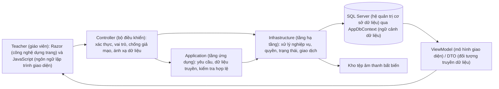
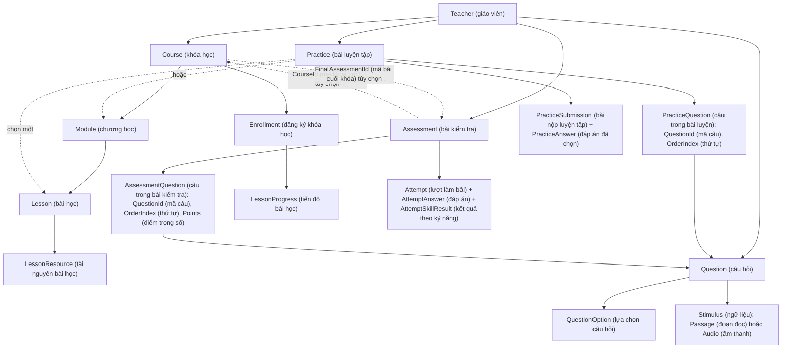

# Teacher (giáo viên): luồng nghiệp vụ, dữ liệu và hợp đồng giao diện

Ngày rà soát: **23/10/2026**. Mã nguồn gốc: commit (mốc lưu thay đổi mã nguồn) `68086dd`.

**Tên hiển thị Stimulus:** giao diện gọi là **Bài đọc và âm thanh**, với hai loại **Bài đọc** và **Âm thanh**. Trang tạo có phần xem trước nội dung, nghe thử tệp tải lên và nút lưu để tiếp tục soạn câu hỏi. Tên `Stimulus` vẫn dùng trong hợp đồng kỹ thuật và các phân tích bên dưới.

**Cập nhật giao diện ngân hàng câu hỏi:** danh sách đã chuyển sang dạng bảng theo ảnh tham khảo. Nhãn kỹ năng, trạng thái, biểu mẫu và ngữ liệu dùng tiếng Việt. Trình độ khi tạo/sửa bắt buộc chọn A1, A2, B1, B2, C1 hoặc C2; đã bỏ trường độ khó khỏi giao diện và các bộ chọn câu hỏi. Trình độ cũ chưa thuộc sáu mức này hiển thị “Chưa phân loại” cho đến khi được giáo viên chọn lại. Thuộc tính `Difficulty` đã được bỏ khỏi mã nguồn; migration `20261023165551_RemoveQuestionDifficulty` xóa riêng cột độ khó. Xem [hướng dẫn áp dụng và rollback](remove-question-difficulty.md) trước khi cập nhật database. Các mô tả bên dưới là bản phân tích nền trước thay đổi giao diện này.

Tài liệu phục vụ thiết kế/làm lại giao diện Teacher (giáo viên) trên backend (phần xử lý phía máy chủ) hiện tại. Các mục “hiện có” được đối chiếu từ controller (bộ điều khiển), DTO (đối tượng truyền dữ liệu), service (dịch vụ xử lý nghiệp vụ), entity (thực thể dữ liệu) và test (kiểm thử); các gợi ý bố cục được ghi riêng. Không thay đổi nghiệp vụ, schema (cấu trúc cơ sở dữ liệu) hay giao diện trong lần phân tích này.

Quy ước đọc: nghĩa tiếng Việt được đặt trong ngoặc ngay cạnh thuật ngữ tiếng Anh. Tên tệp, đường dẫn và các khối mã yêu cầu/lệnh chạy giữ nguyên để bạn đối chiếu và sao chép; tên trường dữ liệu được giải nghĩa bên ngoài dấu mã.

## 1. Bản đồ chức năng

Teacher Studio (không gian giảng dạy) hiện có **5 nhóm nghiệp vụ**, cùng đăng nhập và hồ sơ dùng chung:

| Nhóm | Chức năng đã có | Điểm vào |
| --- | --- | --- |
| Khóa học | Danh sách, tạo/sửa thông tin và giá, cấu trúc Module (chương học)/Lesson (bài học)/Resource (tài nguyên), sắp xếp, xuất bản/ngừng xuất bản/lưu trữ, xem trước | `/TeacherCourses` |
| Ngân hàng câu hỏi | Tìm/lọc/phân trang, tạo/sửa/xem chi tiết, đáp án đúng, giải thích, lưu trữ; tạo ngữ liệu đọc/nghe | `/TeacherQuestionBank` |
| Luyện tập | Danh sách, tạo Draft (bản nháp), chọn/bỏ/sắp xếp câu hỏi, chọn Lesson (bài học)/Module (chương học) khi Publish (xuất bản), Preview (xem trước), Publish (xuất bản)/Unpublish (ngừng xuất bản) | `/TeacherPractices` |
| Bài kiểm tra | Danh sách, cấu hình, chọn câu và trọng số, Preview (xem trước), phạm vi Independent (độc lập)/Course (khóa học), Publish (xuất bản)/Unpublish (ngừng xuất bản)/Archive (lưu trữ), Clone (tạo bản sao) | `/TeacherAssessments` |
| Học viên và thống kê | Báo cáo theo từng Course (khóa học): học viên, tiến độ, lịch sử hoàn thành, số đơn và tiền thanh toán thành công | `/TeacherCourses/Students/{courseId}` |
| Hồ sơ | Xem thông tin tài khoản; sửa họ tên | `/Profile` |

**Chưa có màn hình/API (giao diện lập trình ứng dụng) Teacher (giáo viên) xem bảng điểm từng học viên của Practice (bài luyện tập)/Assessment (bài kiểm tra).** Database (cơ sở dữ liệu) đã có kết quả Student (học viên), nhưng báo cáo Teacher (giáo viên) hiện chỉ cung cấp tiến độ Course (khóa học) và số liệu giao dịch. Không thể dùng trực tiếp trang Result (kết quả) của Student (học viên) cho Teacher (giáo viên).

Sidebar (thanh điều hướng bên) hiện nằm trong [`_LayoutTeacher.cshtml`](../../src/EnglishLearningPlatform.Web/Views/Shared/_LayoutTeacher.cshtml). Mục “Học viên và thống kê” đang dẫn về `/TeacherCourses#statistics`, là thống kê nhanh khóa học; muốn xem học viên phải chọn một Course (khóa học).

## 2. Cách dữ liệu chạy qua hệ thống



- Đây là **ASP.NET Core MVC/Razor (nền tảng web và công nghệ dựng trang của dự án)**, chưa có bộ REST API (giao diện lập trình theo kiến trúc REST) JSON (định dạng trao đổi dữ liệu) đầy đủ cho Teacher (giáo viên). Phần lớn GET (yêu cầu đọc dữ liệu) trả HTML (ngôn ngữ đánh dấu trang web); POST (yêu cầu gửi dữ liệu) form (biểu mẫu) trả lại view (trang hiển thị) khi lỗi hoặc redirect (chuyển hướng) sau khi lưu.
- Hai endpoint (điểm truy cập chức năng) lưu danh sách câu hỏi trả JSON (định dạng trao đổi dữ liệu): Practice (bài luyện tập) nhận **form (biểu mẫu)**, Assessment (bài kiểm tra) nhận **JSON body (phần nội dung yêu cầu ở định dạng JSON)**. Không dùng chung một kiểu request (yêu cầu) cho hai màn hình.
- Route (tuyến đường truy cập) mặc định: `/{controller}/{action}/{id?}`; `/TeacherCourses` tương đương `/TeacherCourses/Index`.
- Identity (hệ thống quản lý tài khoản và xác thực) dùng cookie (dữ liệu phiên lưu trên trình duyệt) cùng origin (nguồn truy cập). Teacher (giáo viên) phải có tài khoản `Active` (đang hoạt động), đúng một role (vai trò) `Teacher` (giáo viên); cookie (dữ liệu phiên lưu trên trình duyệt) bị từ chối nếu trạng thái/role (vai trò) trong DB (cơ sở dữ liệu) thay đổi.
- `actorUserId` (mã người đang thực hiện thao tác) lấy từ claim (thông tin định danh đã xác thực) đăng nhập. Owner (chủ sở hữu) không phải input (dữ liệu đầu vào) của Teacher (giáo viên). Mỗi truy vấn/ghi dữ liệu kiểm tra lại quyền sở hữu.
- Mọi POST (yêu cầu gửi dữ liệu) cần antiforgery (cơ chế chống giả mạo yêu cầu); layout (bố cục dùng chung) và controller (bộ điều khiển) không biến nút ẩn/disabled (bị vô hiệu hóa) thành cơ chế phân quyền.
- GET (yêu cầu đọc dữ liệu) mở form (biểu mẫu), tìm kiếm, Preview (xem trước) không tạo bản nháp, Attempt (lượt làm bài kiểm tra) hay kết quả.
- Owner (chủ sở hữu) Course (khóa học) được kế thừa xuống Module (chương học) → Lesson (bài học) → Resource (tài nguyên). Question (câu hỏi), Stimulus (ngữ liệu), Practice (bài luyện tập), Assessment (bài kiểm tra) có `OwnerTeacherUserId` (mã giáo viên sở hữu) riêng và phải khớp với các tài nguyên liên quan.

Nguồn: [`Program.cs`](../../src/EnglishLearningPlatform.Web/Program.cs), [`DependencyInjection.cs`](../../src/EnglishLearningPlatform.Infrastructure/DependencyInjection.cs), [`AccountStatusCookieEvents.cs`](../../src/EnglishLearningPlatform.Infrastructure/Identity/AccountStatusCookieEvents.cs), [`LearningAccessService.cs`](../../src/EnglishLearningPlatform.Infrastructure/Learning/LearningAccessService.cs).

## 3. Quan hệ dữ liệu cần hiểu trước khi dựng UI (giao diện người dùng)



| Dữ liệu | Trường/quan hệ quan trọng | Ý nghĩa đối với UI (giao diện người dùng) |
| --- | --- | --- |
| Course (khóa học) | `Id` (mã định danh), `OwnerTeacherUserId` (mã giáo viên sở hữu), `FinalAssessmentId` (mã bài kiểm tra cuối khóa), metadata (thông tin mô tả), giá, status (trạng thái) | Final (bài kiểm tra cuối khóa) là một Assessment (bài kiểm tra) được chọn cho Course (khóa học), không phải loại Assessment (bài kiểm tra) thứ tư |
| Module (chương học) / Lesson (bài học) / Resource (tài nguyên) | FK (khóa ngoại) về parent (thành phần cha), `OrderIndex` (thứ tự hiển thị); Module (chương học) có `Visibility` (trạng thái hiển thị), Lesson (bài học) có `Status` (trạng thái) | Trạng thái Course (khóa học), Module (chương học), Lesson (bài học) là ba lớp riêng |
| Question (câu hỏi) | Nội dung, `PrimarySkill` (kỹ năng chính), `Level` (trình độ), `Explanation` (giải thích đáp án), `StimulusId` (mã ngữ liệu), status (trạng thái), `ContentLockedAtUtc` (thời điểm khóa nội dung theo giờ UTC) | Status (trạng thái) và khóa nội dung là hai khái niệm khác nhau |
| QuestionOption (lựa chọn của câu hỏi) | `Id` (mã định danh), `QuestionId` (mã câu hỏi), `Content` (nội dung), `IsCorrect` (là đáp án đúng), `OrderIndex` (thứ tự hiển thị) | Trắc nghiệm chọn một đáp án đúng |
| Practice (bài luyện tập) | `LessonId` (mã bài học) hoặc `ModuleId` (mã chương học), có thể chưa chọn ở Draft (bản nháp) | Không có `CourseId` (mã khóa học) trực tiếp; Course (khóa học) suy ra từ parent (thành phần cha) |
| PracticeQuestion (câu hỏi trong bài luyện tập) | `Id` (mã định danh), `PracticeId` (mã bài luyện tập), `QuestionId` (mã câu hỏi), `OrderIndex` (thứ tự hiển thị) | Không có Points (điểm trọng số); điểm chia đều theo số câu |
| Assessment (bài kiểm tra) | `CourseId?` (mã khóa học, tùy chọn), loại, kỹ năng mục tiêu, thời lượng, lượt tối đa, điểm đạt | `CourseId = null` (chưa gắn khóa học) là bài độc lập |
| AssessmentQuestion (câu hỏi trong bài kiểm tra) | `Id` (mã định danh), `AssessmentId` (mã bài kiểm tra), `QuestionId` (mã câu hỏi), `OrderIndex` (thứ tự hiển thị), `Points` (điểm trọng số) | Điểm nằm trên liên kết vào đề, không nằm trên Question (câu hỏi) |
| Enrollment (đăng ký tham gia khóa học) / LessonProgress (tiến độ bài học) | Một Enrollment (đăng ký tham gia khóa học) cho mỗi Student (học viên)–Course (khóa học); một progress (tiến độ) cho mỗi Enrollment (đăng ký tham gia khóa học)–Lesson (bài học) | Teacher (giáo viên) chỉ xem báo cáo; Student (học viên) ghi tiến độ |
| PracticeSubmission (kết quả nộp bài luyện tập) | Một bản ghi cho mỗi Student (học viên)–Practice (bài luyện tập) | Là kết quả gần nhất; làm lại thay đáp án/điểm cũ |
| Attempt (lượt làm bài kiểm tra) | `DeadlineUtc` (hạn nộp theo giờ UTC), trạng thái, điểm, đạt/rớt, lý do kết thúc | Assessment (bài kiểm tra) có lịch sử nhiều lượt; một lượt đang làm cho mỗi Student (học viên)–Assessment (bài kiểm tra) |
| AttemptSkillResult (kết quả theo kỹ năng của lượt làm bài) | `Skill` (kỹ năng), `Score` (điểm), `QuestionCount` (số câu hỏi) theo Attempt (lượt làm bài kiểm tra) | Có dữ liệu theo kỹ năng nhưng chưa có DTO (đối tượng truyền dữ liệu) báo cáo Teacher (giáo viên) |
| Order (đơn hàng) / Payment (thanh toán) | Giá tại lúc tạo đơn, trạng thái thanh toán | Tên bảng SQL (ngôn ngữ truy vấn cơ sở dữ liệu) là `[Order]` (bảng đơn hàng), `[Payment]` (bảng thanh toán); DbSet (tập thực thể ánh xạ với bảng dữ liệu) C# (ngôn ngữ lập trình C thăng) là `Orders` (các đơn hàng), `Payments` (các khoản thanh toán) |

**Không nhầm ID (mã định danh):** trình soạn đề gửi `QuestionId` (mã câu hỏi). `PracticeQuestionSheet.Id` (mã liên kết câu hỏi trong bài luyện tập) là `PracticeQuestion.Id` (mã liên kết câu hỏi trong bài luyện tập). Mô hình làm Assessment (bài kiểm tra) trả riêng cả `AssessmentQuestionId` (mã liên kết câu hỏi trong bài kiểm tra) và `QuestionId` (mã câu hỏi); form (biểu mẫu) lưu đáp án Student (học viên) dùng ID (mã định danh) liên kết `AssessmentQuestionId` (mã liên kết câu hỏi trong bài kiểm tra). Không thay lẫn hai loại ID (mã định danh).

Nguồn: [`Entities` (các thực thể dữ liệu)](../../src/EnglishLearningPlatform.Domain/Entities), [`AppDbContext.cs`](../../src/EnglishLearningPlatform.Infrastructure/Persistence/AppDbContext.cs), [`Configurations` (cấu hình ánh xạ dữ liệu)](../../src/EnglishLearningPlatform.Infrastructure/Persistence/Configurations).

## 4. Luồng đăng nhập và hồ sơ

1. GET (yêu cầu đọc dữ liệu) `/Account/Login` → nhập `Email` (địa chỉ thư điện tử), `Password` (mật khẩu), `RememberMe` (ghi nhớ đăng nhập), `ReturnUrl?` (địa chỉ quay lại sau đăng nhập, tùy chọn).
2. POST (yêu cầu gửi dữ liệu) Login (đăng nhập) → xác thực Identity (hệ thống quản lý tài khoản và xác thực), trạng thái tài khoản và role (vai trò).
3. Nếu có ReturnUrl (địa chỉ quay lại sau đăng nhập) local (trên máy cục bộ) hợp lệ thì trở về URL (địa chỉ tài nguyên) đó; mặc định Teacher (giáo viên) đến `/TeacherCourses`.
4. GET (yêu cầu đọc dữ liệu) `/Profile` trả `FullName` (họ và tên), `Email` (địa chỉ thư điện tử), `Role` (vai trò), `AccountStatus` (trạng thái tài khoản), `CreatedAtUtc` (thời điểm tạo theo giờ UTC).
5. POST (yêu cầu gửi dữ liệu) `/Profile` chỉ cập nhật `FullName` (họ và tên) bắt buộc, tối đa 200 ký tự. Email (địa chỉ thư điện tử)/role (vai trò)/status (trạng thái) không sửa ở đây.
6. POST (yêu cầu gửi dữ liệu) `/Account/Logout` đăng xuất rồi về Login (đăng nhập).

Teacher (giáo viên) không tự đăng ký qua `/Account/Register`: trang đó tạo Student (học viên). Teacher (giáo viên) được Admin (quản trị viên) tạo hoặc có từ demo (dữ liệu trình diễn) seed (tạo dữ liệu mẫu). Hiện chưa có flow (luồng xử lý) Teacher (giáo viên) đổi mật khẩu, tải avatar (ảnh đại diện) hay viết tiểu sử.

Nguồn: [`AccountController.cs`](../../src/EnglishLearningPlatform.Web/Controllers/AccountController.cs), [`RoleNavigation.cs`](../../src/EnglishLearningPlatform.Web/Infrastructure/RoleNavigation.cs), [`ProfileController.cs`](../../src/EnglishLearningPlatform.Web/Controllers/ProfileController.cs).

## 5. Khóa học và nội dung

### 5.1. Danh sách và thông tin khóa học

GET (yêu cầu đọc dữ liệu) `/TeacherCourses` gọi `MyCoursesAsync(userId, true)` (lấy khóa học do người dùng giáo viên sở hữu): lấy tất cả khóa do Teacher (giáo viên) sở hữu, mới tạo trước. Hiện không nhận search (tìm kiếm)/filter (lọc)/paging (phân trang) server (máy chủ).

Model (mô hình dữ liệu): `IReadOnlyList<CourseSummary>` (danh sách thông tin tóm tắt khóa học chỉ đọc) gồm `Id` (mã định danh), `OwnerId` (mã chủ sở hữu), `Title` (tiêu đề), `Description` (mô tả), `Objectives` (mục tiêu học tập), `Teacher` (giáo viên), `Level` (trình độ), `Status` (trạng thái), `IsPaid` (là khóa học có phí), `Price` (giá), `Skills[]` (các kỹ năng), `Topics[]` (các chủ đề), `ModuleCount` (số chương học), `LessonCount` (số bài học). Số Module (chương học)/Lesson (bài học) của Teacher (giáo viên) gồm cả nội dung ẩn/nháp; không phải số bài Student (học viên) đang được học.

KPI (chỉ số thống kê) trên trang hiện tại được tính từ model (mô hình dữ liệu): tổng khóa, số Published (đã xuất bản), số Draft (bản nháp), tổng Lesson (bài học). Không có dữ liệu tổng học viên/doanh thu toàn Teacher (giáo viên) trong model (mô hình dữ liệu) này.

GET (yêu cầu đọc dữ liệu) `/TeacherCourses/Edit` mở form (biểu mẫu) mới. Có `id` (mã định danh) thì tải khóa cũ. POST (yêu cầu gửi dữ liệu) dùng tên trường **`Input.*` (các trường thuộc dữ liệu đầu vào)**:

| Trường | Ràng buộc hiện tại |
| --- | --- |
| `Input.Title` (tiêu đề) | Bắt buộc, trim (bỏ khoảng trắng đầu/cuối), tối đa 200 ký tự |
| `Input.Description` (mô tả), `Input.Objectives` (mục tiêu học tập) | Tùy chọn, mỗi trường tối đa 4.000 |
| `Input.Level` (trình độ) | Một giá trị CourseLevel (cấp độ khóa học) hợp lệ |
| `Input.Skills` (các kỹ năng) | Mảng EnglishSkill (kỹ năng tiếng Anh) hợp lệ, loại trùng; được phép rỗng |
| `Input.Topics` (các chủ đề) | Chuỗi phân cách dấu phẩy, tổng tối đa 4.000; mỗi topic (chủ đề) tối đa 120; bỏ rỗng và trùng không phân biệt hoa/thường |
| `Input.IsPaid` (là khóa học có phí) | Boolean (kiểu đúng/sai) |
| `Input.Price` (giá) | Free (miễn phí) = 0; Paid (có phí) > 0; tối đa 2 số thập phân, giới hạn decimal(18,2) |

Lưu mới tạo Course (khóa học) `Draft` (bản nháp), chưa tự Publish (xuất bản); thành công redirect (chuyển hướng) `/TeacherCourses/Manage/{id}`. Sửa khóa đang có giữ status (trạng thái) hiện tại. Course (khóa học) chưa có field (trường dữ liệu) ảnh bìa: cover (ảnh bìa) hiện dựng theo kỹ năng bằng partial (thành phần giao diện dùng lại)/CSS (mã định dạng giao diện).

### 5.2. Quản lý cấu trúc

GET (yêu cầu đọc dữ liệu) `/TeacherCourses/Manage/{id}` ghép `AuthoringModel(Page, Resources)` (mô hình soạn nội dung, gồm thông tin trang và tài nguyên):

- `Page` (trang): `CourseSummary` (thông tin tóm tắt khóa học), cây `Modules[].Lessons[]` (các bài học trong từng chương học), `IsOwner` (là chủ sở hữu), `EnrollmentCount` (số lượt đăng ký khóa học), `PublishErrors[]` (các lỗi ngăn xuất bản), `FinalAssessmentId` (mã bài kiểm tra cuối khóa).
- `Resources` (các tài nguyên): dictionary (cấu trúc ánh xạ theo khóa) `LessonId → ResourceContent[]` (mã bài học ánh xạ tới danh sách nội dung tài nguyên), gồm `Id` (mã định danh), `Title` (tiêu đề), `Type` (loại), `Text` (văn bản), `Url` (địa chỉ tài nguyên).
- Toàn bộ cây của owner (chủ sở hữu) được nạp, bao gồm Hidden (ẩn)/Draft (bản nháp).

Form (biểu mẫu) thêm/sửa nội dung dùng chung `/TeacherCourses/Content` với `courseId` (mã khóa học), `kind` (loại nội dung), `parentId` (mã thành phần cha), `id?` (mã định danh tùy chọn). `id` (mã định danh) trống là thêm mới.

| `kind` (loại nội dung) | `parentId` (mã thành phần cha) | Trường thực sự sử dụng |
| --- | --- | --- |
| `Module` (chương học) (= 0) | CourseId (mã khóa học) | `Input.Title` (tiêu đề), `Input.Description` (mô tả), `Input.Visibility` (trạng thái hiển thị) |
| `Lesson` (bài học) (= 1) | ModuleId (mã chương học) | `Input.Title` (tiêu đề), `Input.Status` (trạng thái) |
| `Resource` (tài nguyên) (= 2) | LessonId (mã bài học) | `Input.Title?` (tiêu đề, tùy chọn), `Input.ResourceType` (loại tài nguyên), `Input.ContentText` (nội dung văn bản) hoặc `Input.ResourceUrl` (địa chỉ tài nguyên) |

- Title (tiêu đề) Module (chương học)/Lesson (bài học) bắt buộc, tối đa 200; mô tả Module (chương học) tối đa 4.000. Lesson (bài học) chưa có mô tả riêng trong form (biểu mẫu)/entity (thực thể dữ liệu).
- Resource (tài nguyên) Text (văn bản) cần nội dung. Link (liên kết)/Audio (âm thanh)/Video (đoạn phim) cần URL (địa chỉ tài nguyên) HTTP (giao thức truyền tải web)/HTTPS (giao thức truyền tải web bảo mật) tuyệt đối, tối đa 2.048 ký tự. Đây là URL (địa chỉ tài nguyên) media (âm thanh/hình ảnh)/link (liên kết), chưa có upload (tải tệp lên) file (tệp) cho LessonResource (tài nguyên bài học).
- Tạo Lesson (bài học) nên đi theo Draft (bản nháp) → thêm Resource (tài nguyên) → sửa Lesson (bài học) thành Published (đã xuất bản). Lesson (bài học) mới chưa có resource (tài nguyên) không thể lưu trực tiếp Published (đã xuất bản).
- POST (yêu cầu gửi dữ liệu) Reorder (sắp xếp lại) cần **đầy đủ** `ids` (danh sách mã định danh) của cùng parent (thành phần cha), mỗi ID (mã định danh) đúng một lần; lưu thành thứ tự 0, 1, 2… Không gửi riêng ID (mã định danh) đang kéo.
- Có xóa Resource (tài nguyên); chưa có action (hành động xử lý) xóa Course (khóa học)/Module (chương học)/Lesson (bài học). Không xóa resource (tài nguyên) cuối của Lesson (bài học) Published (đã xuất bản): phải đổi Lesson (bài học) sang Draft (bản nháp)/Hidden (ẩn) trước.

### 5.3. Publish (xuất bản), Unpublish (ngừng xuất bản), Archive (lưu trữ) và Preview (xem trước)

| Thao tác | Điều kiện / kết quả |
| --- | --- |
| Publish (xuất bản) Course (khóa học) | Metadata (thông tin mô tả)/giá hợp lệ; ít nhất một Module (chương học) Visible (hiển thị) chứa Lesson (bài học) Published (đã xuất bản) có resource (tài nguyên) hợp lệ; mọi Lesson (bài học) Published (đã xuất bản) trong cây phải có resource (tài nguyên) hợp lệ; Final (bài kiểm tra cuối khóa) nếu có phải hợp lệ |
| Unpublish (ngừng xuất bản) Course (khóa học) | Rời catalog (danh mục khóa học) công khai, chặn enroll (đăng ký tham gia) mới; Student (học viên) đã enroll (đăng ký tham gia) hợp lệ vẫn học và ghi progress (tiến độ); bài Published (đã xuất bản) còn có thể làm |
| Archive (lưu trữ) Course (khóa học) | Student (học viên) đã enroll (đăng ký tham gia) được đọc nội dung khả dụng, không ghi progress (tiến độ) hoặc bắt đầu bài mới; Attempt (lượt làm bài kiểm tra) đang làm vẫn xử lý theo deadline (hạn nộp bài) gốc |
| Preview (xem trước) Course (khóa học)/Lesson (bài học) | Dùng `/Learning/Course/{id}`, `/Learning/Module/{id}`, `/Learning/Lesson/{id}`, `/Learning/Resource/{id}` theo quyền owner (chủ sở hữu); không tạo progress (tiến độ)/kết quả Student (học viên) |

**Đặc điểm backend (phần xử lý phía máy chủ) cần phản ánh chính xác:** Course (khóa học) Archived (đã lưu trữ) hiện vẫn cho owner (chủ sở hữu) sửa metadata (thông tin mô tả)/nội dung và gọi Publish (xuất bản) lại nếu hợp lệ. `Manage` (quản lý) không chặn theo trạng thái; `ChangeStatusAsync` (đổi trạng thái) không khóa chuyển từ Archived (đã lưu trữ). Riêng chọn/thay/gỡ Final (bài kiểm tra cuối khóa) thì bị chặn khi Course (khóa học) Archived (đã lưu trữ). Không dùng một quy tắc “Archived (đã lưu trữ) luôn chỉ đọc với Teacher (giáo viên)” cho mọi màn hình.

Preview (xem trước) Course (khóa học) của Teacher (giáo viên) xem được Hidden (ẩn)/Draft (bản nháp) nhưng không nạp các hoạt động Student (học viên) như Practice (bài luyện tập)/Assessment (bài kiểm tra) trong `ViewData` (dữ liệu bổ sung truyền cho giao diện). Muốn xem đề phải dùng trang Preview (xem trước) riêng tương ứng.

Nguồn: [`TeacherCoursesController.cs`](../../src/EnglishLearningPlatform.Web/Controllers/TeacherCoursesController.cs), [`CourseModels.cs`](../../src/EnglishLearningPlatform.Application/Learning/CourseModels.cs), [`CourseService.cs`](../../src/EnglishLearningPlatform.Infrastructure/Learning/CourseService.cs), [`CourseRules.cs`](../../src/EnglishLearningPlatform.Domain/Entities/CourseRules.cs), [`LearningController.cs`](../../src/EnglishLearningPlatform.Web/Controllers/LearningController.cs).

## 6. Ngân hàng câu hỏi và ngữ liệu

### 6.1. Danh sách và tạo/sửa câu hỏi

GET (yêu cầu đọc dữ liệu) `/TeacherQuestionBank` nhận `Search` (tìm kiếm), `PrimarySkill?` (kỹ năng chính, tùy chọn), `Level?` (trình độ, tùy chọn), `Status?` (trạng thái, tùy chọn), `PageNumber=1` (bắt đầu từ trang 1), `PageSize=10` (10 mục mỗi trang) (1–100). Search (tìm kiếm) tìm trong Content (nội dung); Level (trình độ) lọc bằng giá trị bằng nhau sau trim (bỏ khoảng trắng đầu/cuối). Thứ tự: ngày tạo giảm dần, rồi Id (mã định danh). Trang vượt kết quả trả danh sách rỗng, không tự đổi số trang.

`QuestionListItem` (dữ liệu một câu hỏi trên danh sách): `Id` (mã định danh), `Content` (nội dung), `PrimarySkill` (kỹ năng chính), `Level` (trình độ), `Status` (trạng thái), `OptionCount` (số lựa chọn), `CreatedAtUtc` (thời điểm tạo theo giờ UTC). Danh sách không chứa đáp án đúng; Details (chi tiết) riêng chứa `Options[].IsCorrect` (cờ đáp án đúng của từng lựa chọn), explanation (giải thích đáp án) và stimulus (ngữ liệu).

POST (yêu cầu gửi dữ liệu) Create (tạo mới)/Edit (chỉnh sửa) dùng tên trường **phẳng**, không có prefix (tiền tố) `Input` (dữ liệu đầu vào):

| Trường | Ràng buộc / cách gửi |
| --- | --- |
| `Content` (nội dung) | Bắt buộc, tối đa 4.000 |
| `PrimarySkill` (kỹ năng chính) | Một kỹ năng hợp lệ |
| `Level` (trình độ) | Tùy chọn ở tầng ứng dụng, tối đa 32 ký tự; chuỗi tự do, không phải CourseLevel (cấp độ khóa học) enum (kiểu liệt kê) |
| `Explanation` (giải thích đáp án) | Tùy chọn; validator (bộ kiểm tra tính hợp lệ) tạo Question (câu hỏi) hiện không đặt giới hạn độ dài riêng |
| `StimulusId` (mã ngữ liệu) | Tùy chọn ở bước tạo Question (câu hỏi); nếu có phải cùng owner (chủ sở hữu) |
| `Options[0].Content` (nội dung lựa chọn thứ nhất), `Options[1].Content` (nội dung lựa chọn thứ hai), … | Ít nhất 2 lựa chọn, mỗi lựa chọn bắt buộc và tối đa 1.000 |
| `CorrectOptionIndex` (chỉ số đáp án đúng) | Chỉ số bắt đầu 0; phải xác định đúng một đáp án |

Tạo thành công → Question (câu hỏi) `Draft` (bản nháp) → redirect (chuyển hướng) danh sách. **Không có action (hành động xử lý) Publish (xuất bản) Question (câu hỏi) riêng**. Draft (bản nháp) hợp lệ vẫn được đưa vào đề. Publish (xuất bản) Practice (bài luyện tập)/Assessment (bài kiểm tra) khóa nội dung Question (câu hỏi) nhưng không đổi `Question.Status` (trạng thái câu hỏi) thành Published (đã xuất bản).

Listening (nghe hiểu) bắt buộc có Audio (âm thanh) stimulus (ngữ liệu) **khi chọn/sử dụng/công bố bài**. Validator (bộ kiểm tra tính hợp lệ) tạo Question (câu hỏi) chủ yếu kiểm tra cấu trúc MCQ (câu hỏi trắc nghiệm nhiều lựa chọn) và owner (chủ sở hữu) stimulus (ngữ liệu), nên lưu được Draft (bản nháp) Listening (nghe hiểu) thiếu audio (âm thanh); UI (giao diện người dùng) cần phân biệt “đã lưu câu” với “đủ điều kiện đưa vào bài”. Reading (đọc hiểu) không bắt buộc có Passage (đoạn đọc) trong validator (bộ kiểm tra tính hợp lệ) dùng chung.

### 6.2. Khóa và lưu trữ

`QuestionEditor` (dữ liệu trình sửa câu hỏi) trả `ScoringContentLocked` (nội dung phục vụ chấm điểm đã bị khóa), `LockReason` (lý do bị khóa). Nội dung bị khóa nếu có dấu `ContentLockedAtUtc` (thời điểm khóa nội dung theo giờ UTC), Question (câu hỏi) Published (đã xuất bản)/Archived (đã lưu trữ), đã có liên kết vào bài từng công bố hoặc có dữ liệu làm bài.

| Khi Question (câu hỏi) đã khóa | Cho phép |
| --- | --- |
| Content (nội dung), PrimarySkill (kỹ năng chính), StimulusId (mã ngữ liệu), options (các lựa chọn)/thứ tự/đáp án đúng, Explanation (giải thích đáp án) | Không sửa |
| Level (trình độ) | Vẫn sửa được |
| Archive (lưu trữ) | Được; giữ nội dung và lịch sử |

Archived (đã lưu trữ) bị chặn khi thêm vào nội dung mới. Câu Archived (đã lưu trữ) đã thuộc đề có sẵn có thể tiếp tục được giữ/sử dụng theo kiểm tra ExistingUse (sử dụng liên kết đã có); Publish (xuất bản) lần đầu vẫn kiểm tra NewUse (sử dụng cho liên kết mới) và chặn Archived (đã lưu trữ). Không có unarchive (khôi phục khỏi lưu trữ)/delete (xóa)/clone (tạo bản sao) Question (câu hỏi) trên controller (bộ điều khiển) hiện tại.

### 6.3. Ngữ liệu

GET (yêu cầu đọc dữ liệu)/POST (yêu cầu gửi dữ liệu) `/TeacherStimuli/Create`; POST (yêu cầu gửi dữ liệu) `multipart/form-data`, gồm `StimulusType` (loại ngữ liệu), `Title` (tiêu đề), `ContentText` (nội dung văn bản), `ResourceUrl` (địa chỉ tài nguyên), `audioFile` (tệp âm thanh tải lên).

- Passage (đoạn đọc): ContentText (nội dung văn bản) bắt buộc; không gửi ResourceUrl (địa chỉ tài nguyên) hay audioFile (tệp âm thanh tải lên).
- Audio (âm thanh): chọn **file (tệp) hoặc URL (địa chỉ tài nguyên)**, không gửi cả hai; không gửi ContentText (nội dung văn bản). File (tệp) MP3 (định dạng tệp âm thanh nén)/WAV (định dạng tệp âm thanh dạng sóng)/Ogg (định dạng vùng chứa âm thanh) hợp lệ, tối đa 10 MiB (đơn vị mebibyte, bằng 1.048.576 byte); request (yêu cầu) tối đa 11 MiB (đơn vị mebibyte, bằng 1.048.576 byte). Kiểm tra nội dung file (tệp), không chỉ phần mở rộng.
- Title (tiêu đề) tùy chọn, tối đa 200; URL (địa chỉ tài nguyên) ngoài nếu dùng phải HTTP (giao thức truyền tải web)/HTTPS (giao thức truyền tải web bảo mật) tuyệt đối, tối đa 2.048.
- Audio (âm thanh) upload (tải tệp lên) được lưu trong kho file (tệp) bất biến; DB (cơ sở dữ liệu) lưu URL (địa chỉ tài nguyên) `/StimulusAudio/Play/{hash}`. Player (trình phát) lấy file (tệp) qua endpoint (điểm truy cập chức năng) có xác thực/quyền và hỗ trợ range (tải từng khoảng dữ liệu).
- Bài công bố mới dùng audio (âm thanh) phải dùng bản upload (tải tệp lên) trong kho bất biến. URL (địa chỉ tài nguyên) ngoài có thể lưu ở bước soạn nhưng bị chặn khi Publish (xuất bản) mới; dữ liệu cũ có quy tắc tương thích riêng.
- Thành công redirect (chuyển hướng) về **form (biểu mẫu) tạo Question (câu hỏi) mới**, chưa tự chọn Stimulus (ngữ liệu) vừa tạo. Hiện không có trang riêng liệt kê/sửa/xóa Stimulus (ngữ liệu).

Nguồn: [`TeacherQuestionBankController.cs`](../../src/EnglishLearningPlatform.Web/Controllers/TeacherQuestionBankController.cs), [`QuestionAuthoringService.cs`](../../src/EnglishLearningPlatform.Infrastructure/QuestionBank/QuestionAuthoringService.cs), [`QuestionCreationService.cs`](../../src/EnglishLearningPlatform.Infrastructure/QuestionBank/QuestionCreationService.cs), [`QuestionUsageValidator.cs`](../../src/EnglishLearningPlatform.Application/QuestionBank/QuestionUsageValidator.cs), [`TeacherStimuliController.cs`](../../src/EnglishLearningPlatform.Web/Controllers/TeacherStimuliController.cs), [`CreateStimulusValidator.cs`](../../src/EnglishLearningPlatform.Application/Stimuli/CreateStimulusValidator.cs).

## 7. Practice (bài luyện tập)

### 7.1. Luồng hoàn chỉnh

Danh sách → Tạo Draft (bản nháp) → Chọn câu từ ngân hàng → Lưu danh sách → Preview (xem trước) đề đã lưu → Chọn một Lesson (bài học)/Module (chương học) → Publish (xuất bản) → Student (học viên) làm → Unpublish (ngừng xuất bản)/Publish (xuất bản) lại.

GET (yêu cầu đọc dữ liệu) `/TeacherPractices` nhận `Search` (tìm kiếm), `Status?` (trạng thái, tùy chọn), `CourseId?` (mã khóa học, tùy chọn), `PageNumber=1` (bắt đầu từ trang 1), `PageSize=10` (10 mục mỗi trang) (1–100). Course (khóa học) filter (lọc) phải thuộc Teacher (giáo viên). Draft (bản nháp) chưa có parent (thành phần cha) xuất hiện khi xem tất cả, không thuộc một Course (khóa học) cụ thể. Model (mô hình dữ liệu) gồm query (truy vấn), result (kết quả), dropdown (danh sách xổ xuống) Course (khóa học); item (mục dữ liệu) có tên, trạng thái, số câu, ngày tạo và Course (khóa học)/Module (chương học)/Lesson (bài học) nullable (có thể không có giá trị). Mới tạo trước; trang vượt kết quả trả rỗng.

GET (yêu cầu đọc dữ liệu) Create (tạo mới) có `courseId?` (mã khóa học, tùy chọn), `lessonId?` (mã bài học, tùy chọn), `moduleId?` (mã chương học, tùy chọn). Chọn Course (khóa học) tải lại GET (yêu cầu đọc dữ liệu) để có dropdown (danh sách xổ xuống) parent (thành phần cha). POST (yêu cầu gửi dữ liệu) dùng `Input.Title` (tiêu đề) (bắt buộc ≤200), `Input.Description?` (mô tả, tùy chọn) (≤4.000), `Input.LessonId?` (mã bài học, tùy chọn), `Input.ModuleId?` (mã chương học, tùy chọn). Draft (bản nháp) có thể chưa chọn parent (thành phần cha); không được đồng thời có cả LessonId (mã bài học) và ModuleId (mã chương học). CourseId (mã khóa học) trên form (biểu mẫu) là ngữ cảnh chọn, không được lưu trực tiếp vào Practice (bài luyện tập).

Sau Create (tạo mới) hiện **quay về Manage (quản lý) Course (khóa học) nếu đã chọn parent (thành phần cha) trong Course (khóa học)**, trường hợp còn lại về danh sách Course (khóa học); chưa tự chuyển vào trình soạn câu hỏi. UI (giao diện người dùng) mới cần giữ hoặc chủ động điều chỉnh điều hướng này nếu sửa controller (bộ điều khiển).

### 7.2. Trình soạn và vòng đời

GET (yêu cầu đọc dữ liệu) `/TeacherPracticeQuestions/Index/{id}` ghép:

- `Editor` (trình soạn thảo): PracticeId (mã bài luyện tập), Title (tiêu đề), Status (trạng thái), UpdatedAtUtc (thời điểm cập nhật theo giờ UTC), parent (thành phần cha) hiện tại, danh sách parent (thành phần cha) cùng owner (chủ sở hữu) thuộc Course (khóa học) chưa Archived (đã lưu trữ), `CanEditQuestions` (được phép sửa danh sách câu hỏi), toàn bộ Questions (các câu hỏi) đã chọn theo thứ tự.
- `Query/Result` (truy vấn và kết quả): một trang Question Bank (ngân hàng câu hỏi) theo bộ lọc giống mục 6. Selected Questions (các câu hỏi đã chọn) luôn là toàn bộ bài, độc lập phân trang ngân hàng.

| Trạng thái / thao tác | Hành vi backend (phần xử lý phía máy chủ) |
| --- | --- |
| Draft (bản nháp) chưa có submission (bài nộp) | Thêm/bỏ/sắp xếp câu hỏi; lưu rỗng được |
| Publish (xuất bản) lần đầu | Ít nhất 1 câu hợp lệ, không trùng; đúng một Lesson (bài học) hoặc Module (chương học) cùng owner (chủ sở hữu); Course (khóa học) chưa Archived (đã lưu trữ); audio (âm thanh) hợp lệ |
| Published (đã xuất bản) | Được sửa danh sách/thứ tự câu bằng phiên bản mới; không đổi parent; Unpublish và Preview được |
| Unpublished (đã ngừng xuất bản) | Được sửa danh sách/thứ tự câu bằng phiên bản mới; Publish lại cùng parent được; không mở Preview |
| Có submission (bài nộp) | Kết quả giữ đúng phiên bản đã nộp; Teacher sửa đề không đổi kết quả cũ |

Publish khóa nội dung Question/Stimulus, nhưng cho thay danh sách câu bằng phiên bản mới. Student đang làm giữ phiên bản đã mở; làm lại nhận bản mới nhất. Unpublish giữ khóa, liên kết và kết quả, không trở về Draft. Chi tiết và migration: [phiên bản Practice](practice-versions.md). Practice hiện không có Archive, clone, xóa hoặc endpoint sửa Title/Description sau Create.

### 7.3. Dữ liệu phát sinh phía Student (học viên)

Student (học viên) làm được khi Practice (bài luyện tập) Published (đã xuất bản), đã enroll (đăng ký tham gia) hợp lệ, Course (khóa học) Published (đã xuất bản)/Unpublished (đã ngừng xuất bản); parent (thành phần cha) Module (chương học) Visible (hiển thị) và nếu gắn Lesson (bài học) thì Lesson (bài học) Published (đã xuất bản). Course (khóa học) Archived (đã lưu trữ) không nhận bài mới. Điểm = `số câu đúng / tổng số câu × 100`, làm tròn 2 số thập phân. Không có timer (bộ đếm thời gian)/MaxAttempts (số lượt làm tối đa)/PassingScore (điểm đạt yêu cầu) trong Practice (bài luyện tập).

Mỗi lần nộp cập nhật `PracticeSubmission` (kết quả nộp bài luyện tập) gần nhất và thay `PracticeAnswer` (đáp án đã chọn trong bài luyện tập); xem đáp án đúng/giải thích sau nộp. Kết quả cũ vẫn xem được sau khi bài rút công bố. Chưa có màn hình Teacher (giáo viên) đọc các submission (bài nộp) này.

Nguồn: [`TeacherPracticesController.cs`](../../src/EnglishLearningPlatform.Web/Controllers/TeacherPracticesController.cs), [`TeacherPracticeQuestionsController.cs`](../../src/EnglishLearningPlatform.Web/Controllers/TeacherPracticeQuestionsController.cs), [`TeacherPracticeQuestionService.cs`](../../src/EnglishLearningPlatform.Infrastructure/Practices/TeacherPracticeQuestionService.cs), [`PracticeService.cs`](../../src/EnglishLearningPlatform.Infrastructure/Practices/PracticeService.cs), [`StudentActivityQueries.cs`](../../src/EnglishLearningPlatform.Infrastructure/Learning/StudentActivityQueries.cs).

## 8. Assessment (bài kiểm tra)

### 8.1. Luồng hoàn chỉnh và cấu hình

Danh sách → Tạo Draft (bản nháp) → Lưu cấu hình → Chọn câu + Points (điểm trọng số) → Lưu → Chọn phạm vi → Preview (xem trước) → Publish (xuất bản) → (tùy chọn) gán Final (bài kiểm tra cuối khóa) → Student (học viên) Start (bắt đầu)/Save (lưu)/Submit (nộp bài) → khóa sửa sau Attempt (lượt làm bài kiểm tra) đầu tiên.

GET (yêu cầu đọc dữ liệu) `/TeacherAssessments` trả toàn bộ `TeacherAssessmentListItem[]` (danh sách dữ liệu bài kiểm tra của giáo viên) thuộc owner (chủ sở hữu), chưa có search (tìm kiếm)/filter (lọc)/pagination (phân trang) server (máy chủ). Item (mục dữ liệu) gồm `Id` (mã định danh), `Title` (tiêu đề), `AssessmentType` (loại bài kiểm tra), `Status` (trạng thái), `DurationMinutes` (thời lượng tính bằng phút), `MaxAttempts` (số lượt làm tối đa), `PassingScore` (điểm đạt yêu cầu), `QuestionCount` (số câu hỏi), `CourseId` (mã khóa học), `CourseTitle` (tên khóa học), `UpdatedAtUtc` (thời điểm cập nhật theo giờ UTC), `CanEditDraft` (được phép sửa bản nháp), `CanEditConfiguration` (được phép sửa cấu hình).

GET (yêu cầu đọc dữ liệu)/POST (yêu cầu gửi dữ liệu) `/TeacherAssessments/Edit/{id?}` dùng `Input.*` (các trường thuộc dữ liệu đầu vào):

| Trường | Quy tắc |
| --- | --- |
| Title (tiêu đề) / Description (mô tả) | Bắt buộc Title (tiêu đề) ≤200; Description (mô tả) tùy chọn ≤4.000 |
| AssessmentType (loại bài kiểm tra) | PlacementTest (bài kiểm tra đầu vào), SkillAssessment (bài kiểm tra kỹ năng), PracticeExam (bài thi thử) |
| TargetSkill (kỹ năng mục tiêu) | Bắt buộc với SkillAssessment (bài kiểm tra kỹ năng); hai loại còn lại phải để trống |
| DurationMinutes (thời lượng tính bằng phút) | Số nguyên >0; mặc định 15 |
| MaxAttempts (số lượt làm tối đa) | Số nguyên ≥1; mặc định 1 |
| PassingScore (điểm đạt yêu cầu) | Tùy chọn, 0–100, tối đa 2 số thập phân; PlacementTest (bài kiểm tra đầu vào) không dùng |
| ExpectedUpdatedAtUtc (phiên bản thời điểm cập nhật khi mở trang) | Version (phiên bản dữ liệu) lấy từ GET (yêu cầu đọc dữ liệu), giữ nguyên khi POST (yêu cầu gửi dữ liệu) |

Tạo mới là Draft (bản nháp) độc lập (`CourseId=null` (chưa gắn khóa học)); form (biểu mẫu) cấu hình không gắn Course (khóa học) hay Final (bài kiểm tra cuối khóa). Thành công redirect (chuyển hướng) lại Edit (chỉnh sửa) để nhận version (phiên bản dữ liệu) mới. Không có lịch thi, open/close date (ngày mở/đóng bài) hoặc deadline (hạn nộp bài) tuyệt đối do Teacher (giáo viên) nhập; deadline (hạn nộp bài) mỗi Attempt (lượt làm bài kiểm tra) được server (máy chủ) tạo từ lúc Start (bắt đầu) + DurationMinutes (thời lượng tính bằng phút).

### 8.2. Chọn câu và Publish (xuất bản)

GET (yêu cầu đọc dữ liệu) `/TeacherAssessmentQuestions/Index/{id}` trả `Editor.Items[]` (toàn bộ câu hỏi đã chọn trong trình soạn) gồm `QuestionId` (mã câu hỏi), `Content` (nội dung), `PrimarySkill` (kỹ năng chính), `Status` (trạng thái), `Points` (điểm trọng số), cùng một trang Question Bank (ngân hàng câu hỏi). SkillAssessment (bài kiểm tra kỹ năng) tự ép bộ lọc PrimarySkill (kỹ năng chính) theo TargetSkill (kỹ năng mục tiêu); server (máy chủ) kiểm tra lại khi lưu.

- Thứ tự `Items[]` (các mục dữ liệu) là thứ tự trong đề. Mỗi Points (điểm trọng số) phải 0.01–999999.99, tối đa 2 số thập phân; câu mới mặc định 1.
- Request (yêu cầu) thiếu/null (không có giá trị) Items (các mục dữ liệu) bị từ chối; `Items=[]` (danh sách câu hỏi rỗng) được lưu khi Draft (bản nháp).
- Publish (xuất bản) lần đầu chỉ từ Draft (bản nháp) chưa có Attempt (lượt làm bài kiểm tra), cần **ít nhất 5 câu khác nhau**, cấu hình/MCQ (câu hỏi trắc nghiệm nhiều lựa chọn)/skill (kỹ năng)/owner (chủ sở hữu)/ngữ liệu/Course (khóa học)/Final (bài kiểm tra cuối khóa) hợp lệ. Khóa Question (câu hỏi)/Stimulus (ngữ liệu), không đổi Question.Status (trạng thái câu hỏi).
- Publish (xuất bản) chỉ lấy dữ liệu đã lưu; không gộp các sửa đổi chưa submit (gửi biểu mẫu) trên form (biểu mẫu) cấu hình/chọn câu.
- Preview (xem trước) chỉ cho Draft (bản nháp)/Published (đã xuất bản), trả nội dung/ngữ liệu/lựa chọn và warnings (các cảnh báo); không có IsCorrect (là đáp án đúng)/Explanation (giải thích đáp án), không tạo Attempt (lượt làm bài kiểm tra), không chấm điểm. Warnings (các cảnh báo) không thay thế kết quả validator (bộ kiểm tra tính hợp lệ) Publish (xuất bản).

### 8.3. Ma trận quyền sửa và trạng thái

| Trạng thái | Cấu hình và câu hỏi/Points (điểm trọng số) | Scope (phạm vi truy cập) | Preview (xem trước) | Chuyển trạng thái |
| --- | --- | --- | --- | --- |
| Draft (bản nháp) chưa Attempt (lượt làm bài kiểm tra) | Sửa được; đề có thể chưa đủ 5 câu | Đổi được nếu chưa là Final (bài kiểm tra cuối khóa) | Có | Publish (xuất bản) |
| Published (đã xuất bản) chưa Attempt (lượt làm bài kiểm tra) | **Sửa được**, nhưng mỗi lần lưu phải giữ toàn bộ đề hợp lệ, ≥5 câu và điều kiện Final (bài kiểm tra cuối khóa) | Đổi được nếu chưa là Final (bài kiểm tra cuối khóa); kiểm tra lại định nghĩa | Có | Unpublish (ngừng xuất bản) / Archive (lưu trữ), chịu ràng buộc Final (bài kiểm tra cuối khóa) |
| Bất kỳ trạng thái đã có Attempt (lượt làm bài kiểm tra) | Không sửa cấu hình/câu/Points (điểm trọng số), kể cả Attempt (lượt làm bài kiểm tra) đang InProgress (đang làm bài) | Không đổi | Có nếu Published (đã xuất bản) | Unpublish (ngừng xuất bản)/Archive (lưu trữ) vẫn xét quy tắc lifecycle (vòng đời) |
| Unpublished (đã ngừng xuất bản) chưa Attempt (lượt làm bài kiểm tra) | Không sửa cấu hình/câu | Đổi được nếu chưa là Final (bài kiểm tra cuối khóa) | Không | Archive (lưu trữ); không có Republish (xuất bản lại) trực tiếp |
| Archived (đã lưu trữ) | Không sửa cấu hình/câu | Không đổi | Không | Không có khôi phục trực tiếp |

`CanEditConfiguration` (được phép sửa cấu hình) hiện là cờ đúng cho **cả nút sửa cấu hình lẫn nút soạn câu** ở Draft (bản nháp)/Published (đã xuất bản) chưa Attempt (lượt làm bài kiểm tra). `CanEditDraft` (được phép sửa bản nháp) chỉ true (đúng) cho Draft (bản nháp), không đủ để quyết định nút soạn câu Published (đã xuất bản). Một số comment (chú thích trong mã nguồn)/tên DTO (đối tượng truyền dữ liệu) cũ còn nhắc “Draft (bản nháp)”; căn cứ service (dịch vụ xử lý nghiệp vụ) thực thi và test (kiểm thử) `TeacherAssessmentConfigurationTests` (kiểm thử cấu hình bài kiểm tra của giáo viên).

Scope (phạm vi truy cập): `Input.CourseId=null` (để trống khóa học trong dữ liệu đầu vào) = độc lập; chọn Course (khóa học) cùng owner (chủ sở hữu), trạng thái Draft (bản nháp)/Published (đã xuất bản)/Unpublished (đã ngừng xuất bản). Có Attempt (lượt làm bài kiểm tra) hoặc đang được chọn làm Final (bài kiểm tra cuối khóa) thì không đổi scope (phạm vi truy cập). Trang vẫn đọc được `CanChangeScope` (được phép đổi phạm vi truy cập), `LockReason` (lý do bị khóa), `HasAttempt` (đã có lượt làm bài), `IsFinal` (được chọn làm bài kiểm tra cuối khóa) để giải thích.

Unpublish (ngừng xuất bản)/Archive (lưu trữ) chặn Attempt (lượt làm bài kiểm tra) mới, giữ Attempt (lượt làm bài kiểm tra)/đáp án/điểm/deadline (hạn nộp bài) cũ. Attempt (lượt làm bài kiểm tra) đang làm vẫn được resume (tiếp tục lượt đang làm)/nộp; việc hết giờ được xử lý bằng các request (yêu cầu) của luồng làm bài, không có bằng chứng về một bộ chấm nền chỉ tự chạy khi đồng hồ đến hạn.

Đề đang làm Final (bài kiểm tra cuối khóa) của Course (khóa học) chưa Archived (đã lưu trữ) không được Unpublish (ngừng xuất bản)/Archive (lưu trữ) trước khi gỡ/thay Final (bài kiểm tra cuối khóa) hợp lệ. Final (bài kiểm tra cuối khóa) của Course (khóa học) Archived (đã lưu trữ) chỉ được Archive (lưu trữ), không chuyển Unpublished (đã ngừng xuất bản).

Clone (tạo bản sao) tạo Assessment (bài kiểm tra) Draft (bản nháp) mới và liên kết AssessmentQuestion (câu hỏi trong bài kiểm tra) mới; giữ metadata (thông tin mô tả)/cấu hình/CourseId (mã khóa học), QuestionId (mã câu hỏi)/thứ tự/Points (điểm trọng số), thêm hậu tố “(bản sao)”. Không sao chép Attempt (lượt làm bài kiểm tra)/kết quả, không tự đổi Final (bài kiểm tra cuối khóa) và không nhân bản/mở khóa Question (câu hỏi)/Stimulus (ngữ liệu). Clone (tạo bản sao) chứa câu Archived (đã lưu trữ) có thể cần thay câu trước khi Publish (xuất bản) mới.

### 8.4. Attempt (lượt làm bài kiểm tra) và điểm Student (học viên) liên quan đến UI (giao diện người dùng) Teacher (giáo viên)

Start (bắt đầu) tạo `Attempt` (lượt làm bài kiểm tra) InProgress (đang làm bài) với `DeadlineUtc` (hạn nộp theo giờ UTC) do server (máy chủ); các Start (bắt đầu) tiếp theo resume (tiếp tục lượt đang làm) lượt đang làm, không tạo song song. Khi hết giờ, request (yêu cầu) xử lý finalize (chốt và chấm lượt làm bài) lượt cũ trước; không tự tạo lượt tiếp theo trong cùng request (yêu cầu).

Save (lưu) lưu lựa chọn vào AttemptAnswer (đáp án trong lượt làm bài); Submit (nộp bài)/finalize (chốt và chấm lượt làm bài) chấm theo trọng số: tổng Points (điểm trọng số) câu đúng / tổng Points (điểm trọng số) × 100. Lưu `OverallScore` (điểm tổng), `Passed?` (đã đạt yêu cầu, tùy chọn), kết quả từng kỹ năng và lý do kết thúc. `Passed` (đã đạt yêu cầu) được quyết định từ điểm chưa làm tròn; không suy ra lại từ điểm hiển thị. Student (học viên) xem điểm/kỹ năng, không được xem đáp án chi tiết như Practice (bài luyện tập). Teacher (giáo viên) hiện chưa có báo cáo tương ứng.

Nguồn: [`AssessmentDraftRequest.cs`](../../src/EnglishLearningPlatform.Application/Assessment/AssessmentDraftRequest.cs), [`TeacherAssessmentDraftService.cs`](../../src/EnglishLearningPlatform.Infrastructure/AssessmentAuthoring/TeacherAssessmentDraftService.cs), [`TeacherAssessmentQuestionService.cs`](../../src/EnglishLearningPlatform.Infrastructure/AssessmentAuthoring/TeacherAssessmentQuestionService.cs), [`AssessmentDefinitionValidator.cs`](../../src/EnglishLearningPlatform.Application/Assessment/AssessmentDefinitionValidator.cs), [`TeacherAssessmentScopeService.cs`](../../src/EnglishLearningPlatform.Infrastructure/AssessmentAuthoring/TeacherAssessmentScopeService.cs), [`TeacherAssessmentLifecycleService.cs`](../../src/EnglishLearningPlatform.Infrastructure/AssessmentAuthoring/TeacherAssessmentLifecycleService.cs), [`TeacherAssessmentCloneService.cs`](../../src/EnglishLearningPlatform.Infrastructure/AssessmentAuthoring/TeacherAssessmentCloneService.cs), [`AssessmentAttemptService.cs`](../../src/EnglishLearningPlatform.Infrastructure/AssessmentAttempts/AssessmentAttemptService.cs).

## 9. Final (bài kiểm tra cuối khóa) và hoàn thành Course (khóa học)

GET (yêu cầu đọc dữ liệu)/POST (yêu cầu gửi dữ liệu) `/TeacherCourseFinal/Edit/{courseId}` nhận CourseId (mã khóa học) ở route (tuyến đường truy cập). Dropdown (danh sách xổ xuống) chỉ chứa Assessment (bài kiểm tra) Published (đã xuất bản) cùng Course (khóa học)/owner (chủ sở hữu), loại SkillAssessment (bài kiểm tra kỹ năng) hoặc PracticeExam (bài thi thử), có PassingScore (điểm đạt yêu cầu) hợp lệ.

POST (yêu cầu gửi dữ liệu) gửi `Input.FinalAssessmentId?` (mã bài kiểm tra cuối khóa, tùy chọn) (null (không có giá trị) = gỡ), `Input.ExpectedFinalAssessmentId?` (mã bài kiểm tra cuối khóa đã thấy khi mở trang, tùy chọn) (Final (bài kiểm tra cuối khóa) đang thấy khi mở trang), `Input.ExpectedUpdatedAtUtc` (phiên bản thời điểm cập nhật khi mở trang) (version (phiên bản dữ liệu) **Course (khóa học)**).

- Course (khóa học) Archived (đã lưu trữ) chặn gắn/thay/gỡ.
- Nếu Final (bài kiểm tra cuối khóa) hiện tại đã có bất kỳ Attempt (lượt làm bài kiểm tra) thì không thay/gỡ, kể cả thay bằng clone (tạo bản sao). Đây là ràng buộc trên Final (bài kiểm tra cuối khóa) hiện tại, không phải cấm mọi candidate (đề được chọn làm ứng viên) từng có Attempt (lượt làm bài kiểm tra).
- Lưu kiểm tra lại toàn bộ đề candidate (đề được chọn làm ứng viên), audio (âm thanh), Course (khóa học)/owner (chủ sở hữu) và tham chiếu Final (bài kiểm tra cuối khóa); trả `CanChangeFinal` (được phép thay bài kiểm tra cuối khóa), `HasFinalAttempts` (bài kiểm tra cuối khóa đã có lượt làm), `LockReason` (lý do bị khóa) cho UI (giao diện người dùng).
- Course (khóa học) không bắt buộc có Final (bài kiểm tra cuối khóa). Có ít nhất một Lesson (bài học) khả dụng và hoàn thành tất cả Lesson (bài học) khả dụng thì đủ điều kiện hoàn thành nếu không có Final (bài kiểm tra cuối khóa). Nếu có Final (bài kiểm tra cuối khóa), cần thêm một Attempt (lượt làm bài kiểm tra) Graded (đã chấm điểm) có `Passed=true` (đã đạt yêu cầu) đáp ứng ngưỡng.
- Tiến độ hiện tại tính trên Lesson (bài học) Published (đã xuất bản) trong Module (chương học) Visible (hiển thị). Không có Lesson (bài học) khả dụng thì Percentage (tỷ lệ phần trăm) = null (không có giá trị), không hiển thị 0%/100% như một kết luận đã học.
- `Enrollment.CompletedAtUtc` (thời điểm ghi nhận hoàn thành của lượt đăng ký) là lịch sử đã ghi nhận, không tự xóa khi thêm/ẩn Lesson (bài học) hoặc Student (học viên) bỏ đánh dấu hoàn thành. Vì thế “đã từng hoàn thành” có thể đồng thời với progress (tiến độ) hiện tại dưới 100%.
- Chọn/thay/gỡ Final (bài kiểm tra cuối khóa) có thể tính lại điều kiện và ghi nhận hoàn thành cho Enrollment (đăng ký tham gia khóa học) đủ điều kiện; không xóa lịch sử cũ.

Nguồn: [`TeacherCourseFinalService.cs`](../../src/EnglishLearningPlatform.Infrastructure/AssessmentAuthoring/TeacherCourseFinalService.cs), [`CourseCompletion.cs`](../../src/EnglishLearningPlatform.Infrastructure/Learning/CourseCompletion.cs), [`CourseProgress.cs`](../../src/EnglishLearningPlatform.Infrastructure/Learning/CourseProgress.cs).

## 10. Học viên và báo cáo

GET (yêu cầu đọc dữ liệu) `/TeacherCourses/Students/{courseId}?Search=...&Completed=true&Page=1` → `TeacherCourseReport` (báo cáo khóa học dành cho giáo viên):

| Phần | Dữ liệu |
| --- | --- |
| Metadata (thông tin mô tả) | CourseId (mã khóa học), Title (tiêu đề), Query (truy vấn), TotalStudents (tổng học viên), Pages (các trang); PageSize (số mục mỗi trang) cố định 20 |
| Mỗi học viên | StudentId (mã học viên), Name (họ tên), EnrolledAtUtc (thời điểm tham gia theo giờ UTC), Progress (tiến độ): CompletedLessons (số bài học đã hoàn thành), TotalLessons (tổng bài học khả dụng), Percentage (tỷ lệ phần trăm)?, CompletedAtUtc (thời điểm ghi nhận hoàn thành theo giờ UTC); ContinueLessonId (mã bài học để học tiếp) ở báo cáo này null (không có giá trị) |
| KPI (chỉ số thống kê) Commerce (giao dịch và thanh toán) | Enrollments (các lượt đăng ký khóa học), FreeEnrollments (lượt đăng ký không qua thanh toán), PaidEnrollments (lượt đăng ký qua thanh toán), CompletedEnrollments (lượt đăng ký đã ghi nhận hoàn thành), Orders (các đơn hàng), SuccessfulOrders (số đơn thanh toán thành công), SuccessfulPaymentAmount (tổng tiền thanh toán thành công) |

- Search (tìm kiếm) theo họ tên, trim (bỏ khoảng trắng đầu/cuối) và cắt tối đa 120; Completed (đã hoàn thành) lọc theo `CompletedAtUtc` (thời điểm ghi nhận hoàn thành theo giờ UTC), không phải Percentage (tỷ lệ phần trăm). Thứ tự theo tên rồi StudentId (mã học viên). Page (trang) được clamp (đưa về giới hạn hợp lệ) về trang hợp lệ.
- Chỉ đếm Enrollment (đăng ký tham gia khóa học) hợp lệ: không gắn Payment (thanh toán) hoặc Payment (thanh toán) Succeeded (thành công) đúng Student (học viên)/Course (khóa học)/Amount (số tiền), currency (đơn vị tiền tệ) VND (đồng Việt Nam). Enrollment (đăng ký tham gia khóa học) free (miễn phí) cũ vẫn hợp lệ nếu Course (khóa học) sau đó đổi sang Paid (có phí).
- Free (miễn phí)/PaidEnrollments (lượt đăng ký qua thanh toán) phân biệt bằng có PaymentId (mã thanh toán), không theo giá Course (khóa học) hiện tại.
- Tổng tiền chỉ cộng Payment (thanh toán) Succeeded (thành công) khớp đơn VND (đồng Việt Nam), theo giá mua tại lúc tạo đơn. Đây không phải số tiền rút về hay lợi nhuận Teacher (giáo viên).
- **Search (tìm kiếm)/Completed (đã hoàn thành)/Page (trang) chỉ lọc bảng học viên**, các KPI (chỉ số thống kê) luôn tính toàn Course (khóa học).
- `CoursePage.EnrollmentCount` (số lượt đăng ký trên trang khóa học) ở Manage (quản lý) đang count (đếm) toàn bộ Enrollment (đăng ký tham gia khóa học), khác báo cáo dùng `.Valid()` (lọc các lượt đăng ký hợp lệ). Không mặc định hai số luôn bằng nhau khi dữ liệu có payment (thanh toán) không hợp lệ.
- Chưa trả email (địa chỉ thư điện tử)/số điện thoại, chi tiết học từng Lesson (bài học), điểm Practice (bài luyện tập)/Assessment (bài kiểm tra) hoặc biểu đồ theo thời gian. Không tự dựng những cột/biểu đồ này như dữ liệu thật.

Nguồn: [`TeacherCourseReportModels.cs`](../../src/EnglishLearningPlatform.Application/Learning/TeacherCourseReportModels.cs), [`TeacherCourseReportService.cs`](../../src/EnglishLearningPlatform.Infrastructure/Learning/TeacherCourseReportService.cs), [`LearningQueries.cs`](../../src/EnglishLearningPlatform.Infrastructure/Learning/LearningQueries.cs).

## 11. Danh mục endpoint (điểm truy cập chức năng) để nối giao diện

`{id}` (mã định danh trên đường dẫn) dùng GUID (mã định danh duy nhất). Các tham số không nằm trên path (đường dẫn) được gửi query string (chuỗi tham số trên URL) khi GET (yêu cầu đọc dữ liệu), hoặc form (biểu mẫu) khi POST (yêu cầu gửi dữ liệu) trừ hai Save (lưu) ghi rõ bên dưới. Tất cả POST (yêu cầu gửi dữ liệu) đều có CSRF (giả mạo yêu cầu từ trang khác).

| Controller (bộ điều khiển) / action (hành động xử lý) | Method (phương thức) | Input (dữ liệu đầu vào) chính / kết quả |
| --- | --- | --- |
| TeacherCourses (quản lý khóa học của giáo viên) / Index (trang danh sách) | GET (yêu cầu đọc dữ liệu) | List (danh sách) CourseSummary (thông tin tóm tắt khóa học) |
| TeacherCourses (quản lý khóa học của giáo viên) / Edit (chỉnh sửa) | GET (yêu cầu đọc dữ liệu), POST (yêu cầu gửi dữ liệu) | `id?` (mã định danh tùy chọn), POST (yêu cầu gửi dữ liệu) `Input: CourseInput` (dữ liệu biểu mẫu khóa học); thành công → Manage (quản lý) |
| TeacherCourses (quản lý khóa học của giáo viên) / Manage (quản lý) | GET (yêu cầu đọc dữ liệu) | `id` (mã định danh); AuthoringModel (mô hình dữ liệu soạn nội dung) |
| TeacherCourses (quản lý khóa học của giáo viên) / Content (nội dung) | GET (yêu cầu đọc dữ liệu), POST (yêu cầu gửi dữ liệu) | `courseId, kind, parentId, id?` (mã khóa học, loại nội dung, mã thành phần cha, mã tùy chọn), POST (yêu cầu gửi dữ liệu) `Input: ContentInput` (dữ liệu biểu mẫu nội dung); → Manage (quản lý) |
| TeacherCourses (quản lý khóa học của giáo viên) / Reorder (sắp xếp lại) | POST (yêu cầu gửi dữ liệu) | `courseId, kind, parentId, ids[]` (mã khóa học, loại nội dung, mã thành phần cha, danh sách mã sắp xếp); → Manage (quản lý) |
| TeacherCourses (quản lý khóa học của giáo viên) / DeleteResource (xóa tài nguyên) | POST (yêu cầu gửi dữ liệu) | `courseId, lessonId, id` (mã khóa học, mã bài học, mã tài nguyên); → Manage (quản lý) |
| TeacherCourses (quản lý khóa học của giáo viên) / Publish (xuất bản), Unpublish (ngừng xuất bản), Archive (lưu trữ) | POST (yêu cầu gửi dữ liệu) | `id` (mã định danh); → Manage (quản lý) kèm TempData (thông báo tạm qua lần chuyển trang) |
| TeacherCourses (quản lý khóa học của giáo viên) / Students (học viên) | GET (yêu cầu đọc dữ liệu) | `id, Search?, Completed?, Page` (mã khóa học, từ khóa tùy chọn, trạng thái hoàn thành tùy chọn, trang); TeacherCourseReport (báo cáo khóa học dành cho giáo viên) |
| TeacherQuestionBank (ngân hàng câu hỏi của giáo viên) / Index (trang danh sách) | GET (yêu cầu đọc dữ liệu) | QuestionSearchRequest (yêu cầu tìm câu hỏi); QuestionBankIndexModel (mô hình trang danh sách ngân hàng câu hỏi) |
| TeacherQuestionBank (ngân hàng câu hỏi của giáo viên) / Details (chi tiết) | GET (yêu cầu đọc dữ liệu) | `id` (mã định danh); QuestionDetail (chi tiết câu hỏi) |
| TeacherQuestionBank (ngân hàng câu hỏi của giáo viên) / Create (tạo mới) | GET (yêu cầu đọc dữ liệu), POST (yêu cầu gửi dữ liệu) | QuestionFormViewModel (mô hình biểu mẫu câu hỏi); → Index (trang danh sách) |
| TeacherQuestionBank (ngân hàng câu hỏi của giáo viên) / Edit (chỉnh sửa) | GET (yêu cầu đọc dữ liệu), POST (yêu cầu gửi dữ liệu) | `id` (mã định danh), QuestionFormViewModel (mô hình biểu mẫu câu hỏi); → Details (chi tiết) |
| TeacherQuestionBank (ngân hàng câu hỏi của giáo viên) / Archive (lưu trữ) | POST (yêu cầu gửi dữ liệu) | `id` (mã định danh); → Details (chi tiết) |
| TeacherStimuli (quản lý ngữ liệu của giáo viên) / Create (tạo mới) | GET (yêu cầu đọc dữ liệu), POST (yêu cầu gửi dữ liệu) | Multipart (dữ liệu biểu mẫu nhiều phần) ngữ liệu; → QuestionBank/Create (tạo mới) |
| TeacherPractices (quản lý bài luyện tập của giáo viên) / Index (trang danh sách) | GET (yêu cầu đọc dữ liệu) | TeacherPracticeSearchRequest (yêu cầu tìm bài luyện tập); TeacherPracticeIndexViewModel (mô hình trang danh sách bài luyện tập) |
| TeacherPractices (quản lý bài luyện tập của giáo viên) / Create (tạo mới) | GET (yêu cầu đọc dữ liệu), POST (yêu cầu gửi dữ liệu) | `courseId?` (mã khóa học, tùy chọn), `Input: CreatePracticeRequest` (dữ liệu tạo bài luyện tập); GET (yêu cầu đọc dữ liệu) còn nhận lessonId (mã bài học)/moduleId (mã chương học) |
| TeacherPracticeQuestions (soạn câu hỏi bài luyện tập) / Index (trang danh sách) | GET (yêu cầu đọc dữ liệu) | `id` (mã định danh), QuestionSearchRequest (yêu cầu tìm câu hỏi); Editor (trình soạn thảo) + bank (ngân hàng câu hỏi) page (trang) |
| TeacherPracticeQuestions (soạn câu hỏi bài luyện tập) / Save (lưu) | POST (yêu cầu gửi dữ liệu) form (biểu mẫu) | `id` (mã định danh), `ExpectedUpdatedAtUtc` (phiên bản thời điểm cập nhật khi mở trang), lặp `QuestionIds` (danh sách mã câu hỏi); JSON response (phản hồi ở định dạng JSON) |
| TeacherPracticeQuestions (soạn câu hỏi bài luyện tập) / Publish (xuất bản) | POST (yêu cầu gửi dữ liệu) | `id, lessonId?, moduleId?, expectedUpdatedAtUtc` (mã bài luyện tập, mã bài học/chương học tùy chọn và phiên bản cập nhật); → Index (trang danh sách) của editor (trình soạn thảo) |
| TeacherPracticeQuestions (soạn câu hỏi bài luyện tập) / Unpublish (ngừng xuất bản) | POST (yêu cầu gửi dữ liệu) | `id, expectedUpdatedAtUtc` (mã bản ghi và phiên bản thời điểm cập nhật); → Index (trang danh sách) của editor (trình soạn thảo) |
| TeacherPracticePreview (xem trước bài luyện tập) / Index (trang danh sách) | GET (yêu cầu đọc dữ liệu) | `id` (mã định danh); TeacherPracticePreview (xem trước bài luyện tập) |
| TeacherAssessments (quản lý bài kiểm tra của giáo viên) / Index (trang danh sách) | GET (yêu cầu đọc dữ liệu) | List (danh sách) TeacherAssessmentListItem (mục bài kiểm tra trong danh sách giáo viên) |
| TeacherAssessments (quản lý bài kiểm tra của giáo viên) / Edit (chỉnh sửa) | GET (yêu cầu đọc dữ liệu), POST (yêu cầu gửi dữ liệu) | `id?` (mã định danh tùy chọn), `Input: AssessmentDraftRequest` (dữ liệu cấu hình bản nháp bài kiểm tra); → Edit (chỉnh sửa) |
| TeacherAssessments (quản lý bài kiểm tra của giáo viên) / Publish (xuất bản) | POST (yêu cầu gửi dữ liệu) | `id, expectedUpdatedAtUtc` (mã bản ghi và phiên bản thời điểm cập nhật); → Index (trang danh sách) hoặc form (biểu mẫu) lỗi |
| TeacherAssessmentQuestions (soạn câu hỏi bài kiểm tra) / Index (trang danh sách) | GET (yêu cầu đọc dữ liệu) | `id` (mã định danh), QuestionSearchRequest (yêu cầu tìm câu hỏi); Editor (trình soạn thảo) + bank (ngân hàng câu hỏi) page (trang) |
| TeacherAssessmentQuestions (soạn câu hỏi bài kiểm tra) / Save (lưu) | POST (yêu cầu gửi dữ liệu) JSON (định dạng trao đổi dữ liệu) | `id` (mã định danh), UpdateAssessmentQuestionsRequest (yêu cầu cập nhật câu hỏi trong bài kiểm tra); JSON response (phản hồi ở định dạng JSON) |
| TeacherAssessmentPreview (xem trước bài kiểm tra) / Index (trang danh sách) | GET (yêu cầu đọc dữ liệu) | `id` (mã định danh); TeacherAssessmentPreview (xem trước bài kiểm tra) |
| TeacherAssessmentScope (phạm vi truy cập bài kiểm tra) / Edit (chỉnh sửa) | GET (yêu cầu đọc dữ liệu), POST (yêu cầu gửi dữ liệu) | `id` (mã định danh), `Input: AssessmentScopeRequest` (dữ liệu phạm vi truy cập bài kiểm tra); → Edit (chỉnh sửa) |
| TeacherCourseFinal (chọn bài kiểm tra cuối khóa) / Edit (chỉnh sửa) | GET (yêu cầu đọc dữ liệu), POST (yêu cầu gửi dữ liệu) | `id` (mã định danh) là CourseId (mã khóa học), `Input: CourseFinalRequest` (dữ liệu chọn bài kiểm tra cuối khóa); → Edit (chỉnh sửa) |
| TeacherAssessmentLifecycle (vòng đời bài kiểm tra) / Unpublish (ngừng xuất bản), Archive (lưu trữ) | POST (yêu cầu gửi dữ liệu) | `id, expectedUpdatedAtUtc` (mã bản ghi và phiên bản thời điểm cập nhật); → TeacherAssessments (quản lý bài kiểm tra của giáo viên)/Index (trang danh sách) |
| TeacherAssessmentClone (sao chép bài kiểm tra) / Create (tạo mới) | POST (yêu cầu gửi dữ liệu) | `id, expectedUpdatedAtUtc` (mã bản ghi và phiên bản thời điểm cập nhật); → Edit (chỉnh sửa) bản sao |
| Learning (học tập) / Course (khóa học), Module (chương học), Lesson (bài học), Resource (tài nguyên) | GET (yêu cầu đọc dữ liệu) | `id` (mã định danh); Preview (xem trước) nội dung theo owner (chủ sở hữu) |
| Learning (học tập) / ManageCourse (quản lý khóa học) | GET (yêu cầu đọc dữ liệu) | `id` (mã định danh); route (tuyến đường truy cập) tương thích trả view (trang hiển thị) Manage (quản lý) của TeacherCourses (quản lý khóa học của giáo viên) |
| StimulusAudio (âm thanh ngữ liệu) / Play (phát âm thanh) / {hash (mã băm)} | GET (yêu cầu đọc dữ liệu) | File (tệp) âm thanh nếu có quyền |
| Profile (hồ sơ) / Index (trang danh sách) | GET (yêu cầu đọc dữ liệu), POST (yêu cầu gửi dữ liệu) | POST (yêu cầu gửi dữ liệu) chỉ FullName (họ và tên) |
| Account (tài khoản) / Login (đăng nhập) | GET (yêu cầu đọc dữ liệu), POST (yêu cầu gửi dữ liệu) | Email (địa chỉ thư điện tử), Password (mật khẩu), RememberMe (ghi nhớ đăng nhập), ReturnUrl (địa chỉ quay lại sau đăng nhập) |
| Account (tài khoản) / Logout (đăng xuất) | POST (yêu cầu gửi dữ liệu) | Đăng xuất |

### 11.1. Hai hợp đồng Save (lưu) phải giữ đúng

Practice (bài luyện tập): `POST /TeacherPracticeQuestions/Save/{id}`, body (phần nội dung yêu cầu) FormData (dữ liệu biểu mẫu) hoặc form-urlencoded (dữ liệu biểu mẫu mã hóa theo URL), có các key (khóa dữ liệu):

```text
__RequestVerificationToken=<token do server cấp>
ExpectedUpdatedAtUtc=<version ISO 8601 hoặc rỗng>
QuestionIds=<guid-cau-1>
QuestionIds=<guid-cau-2>
```

Assessment (bài kiểm tra): `POST /TeacherAssessmentQuestions/Save/{id}`, `Content-Type: application/json` (loại nội dung yêu cầu là JSON), header (phần đầu yêu cầu) `RequestVerificationToken: <token do server cấp>` (mã xác minh yêu cầu do máy chủ cấp), body (phần nội dung yêu cầu):

```json
{
  "expectedUpdatedAtUtc": "2026-10-23T03:00:00+00:00",
  "items": [
    { "questionId": "11111111-1111-4111-8111-111111111111", "points": 1 },
    { "questionId": "22222222-2222-4222-8222-222222222222", "points": 2.5 }
  ]
}
```

GUID (mã định danh duy nhất)/version (phiên bản dữ liệu) trong ví dụ là minh họa, phải lấy dữ liệu thật từ GET (yêu cầu đọc dữ liệu). Thành công hai endpoint (điểm truy cập chức năng) trả `{ "success": true }` (lưu thành công) rồi JS (mã JavaScript chạy trên trình duyệt) tải lại GET (yêu cầu đọc dữ liệu) để nhận version (phiên bản dữ liệu) mới; lỗi nghiệp vụ thường HTTP (giao thức truyền tải web) 400 với `{ "message": "..." }` (thông báo lỗi), quyền 403, không tìm thấy 404. Cookie (dữ liệu phiên lưu trên trình duyệt) hết hạn có thể gây redirect (chuyển hướng) Login (đăng nhập); JS (mã JavaScript chạy trên trình duyệt) hiện kiểm tra `response.redirected` (phản hồi đã bị chuyển hướng).

Không tự nâng `ExpectedUpdatedAtUtc` (phiên bản thời điểm cập nhật khi mở trang) sau lỗi conflict (xung đột phiên bản) để gửi lại dữ liệu cũ. Cần đọc/tải lại version (phiên bản dữ liệu) thật, cho người dùng xem thay đổi và thao tác lại. Các form (biểu mẫu) cấu hình/scope (phạm vi truy cập)/câu hỏi Assessment (bài kiểm tra) dùng chung version (phiên bản dữ liệu) Assessment (bài kiểm tra); Final (bài kiểm tra cuối khóa) dùng version (phiên bản dữ liệu) Course (khóa học).

### 11.2. Enum (kiểu liệt kê) dùng cho control (thành phần nhập liệu)

| Kiểu | Giá trị |
| --- | --- |
| EnglishSkill (kỹ năng tiếng Anh) | Vocabulary (từ vựng)=1, Grammar (ngữ pháp)=2, Reading (đọc hiểu)=3, Listening (nghe hiểu)=4 |
| CourseLevel (cấp độ khóa học) | Beginner (mới bắt đầu)=1, Elementary (sơ cấp)=2, Intermediate (trung cấp)=3, UpperIntermediate (trên trung cấp)=4, Advanced (nâng cao)=5 |
| CourseStatus (trạng thái khóa học) / AssessmentStatus (trạng thái bài kiểm tra) | Draft (bản nháp)=1, Published (đã xuất bản)=2, Unpublished (đã ngừng xuất bản)=3, Archived (đã lưu trữ)=4 |
| PracticeStatus (trạng thái bài luyện tập) | Draft (bản nháp)=1, Published (đã xuất bản)=2, Unpublished (đã ngừng xuất bản)=3 |
| QuestionStatus (trạng thái câu hỏi) | Draft (bản nháp)=1, Published (đã xuất bản)=2, Archived (đã lưu trữ)=3 |
| ModuleVisibility (trạng thái hiển thị chương học) | Visible (hiển thị)=1, Hidden (ẩn)=2 |
| LessonStatus (trạng thái bài học) | Draft (bản nháp)=1, Published (đã xuất bản)=2, Hidden (ẩn)=3 |
| LessonResourceType (loại tài nguyên bài học) | Text (văn bản)=1, Link (liên kết)=2, Audio (âm thanh)=3, Video (đoạn phim)=4 |
| StimulusType (loại ngữ liệu) | Passage (đoạn đọc)=1, Audio (âm thanh)=2 |
| AssessmentType (loại bài kiểm tra) | PlacementTest (bài kiểm tra đầu vào)=1, SkillAssessment (bài kiểm tra kỹ năng)=2, PracticeExam (bài thi thử)=3 |

Các form (biểu mẫu)/query (truy vấn) hiện dùng tên hoặc số enum (kiểu liệt kê) qua model binder (bộ ánh xạ dữ liệu yêu cầu). Không gửi nhãn tiếng Việt thay cho giá trị. Các trạng thái/kỹ năng liên quan được EF (công cụ ánh xạ dữ liệu Entity Framework) map (ánh xạ) sang chuỗi trong SQL (ngôn ngữ truy vấn cơ sở dữ liệu); không suy ra giá trị JSON (định dạng trao đổi dữ liệu)/form (biểu mẫu) từ kiểu cột DB (cơ sở dữ liệu). Chưa cấu hình JSON (định dạng trao đổi dữ liệu) string-enum converter (bộ chuyển đổi giá trị liệt kê thành chuỗi) toàn cục.

## 12. Gợi ý cấu trúc màn hình cho bản thiết kế

Đây là đề xuất bố cục; dữ liệu và quyền vẫn theo các mục trên.

| Màn hình | Cấu trúc nên thiết kế |
| --- | --- |
| Teacher shell (khung giao diện giáo viên) | Sidebar (thanh điều hướng bên) 5 nhóm; breadcrumb (đường dẫn điều hướng); tiêu đề và thao tác chính; account menu (menu tài khoản); thông báo thành công/lỗi |
| Khóa học | KPI (chỉ số thống kê) hiện có, danh sách card (thẻ thông tin)/table (bảng), status (trạng thái), module (chương học)/lesson (bài học) count (đếm), sửa/nội dung/xem trước/học viên |
| Course editor (trình chỉnh sửa khóa học) | Thông tin chung, mục tiêu, cấp độ/kỹ năng/chủ đề, giá |
| Course manage (quản lý khóa học) | Cây Module (chương học) → Lesson (bài học) → Resource (tài nguyên); nút thêm/sửa/sắp xếp/xóa resource (tài nguyên); khu vực điều kiện Publish (xuất bản) và Final (bài kiểm tra cuối khóa) |
| Question bank (ngân hàng câu hỏi) | Bộ lọc server (máy chủ), bảng câu hỏi, phân trang; Details (chi tiết) riêng có đáp án/giải thích |
| Question form (biểu mẫu câu hỏi) | Nội dung, skill (kỹ năng), metadata (thông tin mô tả), chọn/tạo stimulus (ngữ liệu), danh sách lựa chọn + radio (nút chọn một đáp án) đáp án đúng; banner (khung thông báo) khóa và metadata (thông tin mô tả) còn sửa được |
| Stimulus form (biểu mẫu ngữ liệu) | Chọn Passage (đoạn đọc)/Audio (âm thanh) và trường tương ứng; upload (tải tệp lên)/URL (địa chỉ tài nguyên); lỗi giữ dữ liệu văn bản, file (tệp) cần chọn lại nếu request (yêu cầu) lỗi |
| Practice list/create (danh sách/tạo bài luyện tập) | Bộ lọc và parent (thành phần cha) nullable (có thể không có giá trị); Draft (bản nháp) chưa gắn không ghi như bài độc lập đã dùng được |
| Practice editor (trình soạn bài luyện tập) | Danh sách câu đã chọn + ngân hàng câu hỏi; lưu; parent (thành phần cha) và xuất bản; trạng thái chưa lưu |
| Assessment list/config (danh sách/cấu hình bài kiểm tra) | Loại, status (trạng thái), scope (phạm vi truy cập), duration (thời lượng), attempts (các lượt làm bài kiểm tra), passing score (điểm đạt yêu cầu); thao tác theo cờ server (máy chủ) |
| Assessment editor (trình soạn bài kiểm tra) | Selected Questions (các câu hỏi đã chọn) + Points (điểm trọng số)/thứ tự + bank (ngân hàng câu hỏi); giữ ≥5 khi Published (đã xuất bản); banner (khung thông báo) khóa sau Attempt (lượt làm bài kiểm tra) |
| Scope (phạm vi truy cập) / Final (bài kiểm tra cuối khóa) | Hiển thị lựa chọn hiện tại, dropdown (danh sách xổ xuống) đúng owner (chủ sở hữu), thông báo lý do khóa; có thể dùng tab (thẻ giao diện)/section (khu vực nội dung) nhưng giữ endpoint (điểm truy cập chức năng) riêng |
| Preview (xem trước) | Khung đề đã lưu, audio (âm thanh)/passage (đoạn đọc)/options (các lựa chọn), warnings (các cảnh báo); không nút Start (bắt đầu)/Submit (nộp bài)/chấm |
| Học viên Course (khóa học) | Course (khóa học) selector (bộ chọn) qua danh sách khóa, KPI (chỉ số thống kê) toàn khóa, search (tìm kiếm)/filter (lọc) bảng, progress (tiến độ) hiện tại và huy hiệu hoàn thành lịch sử |
| Profile (hồ sơ) | FullName (họ và tên) sửa được, email (địa chỉ thư điện tử)/role (vai trò)/status (trạng thái)/ngày tạo chỉ xem |

Các trạng thái cần có trong thiết kế: chưa có dữ liệu; không có kết quả lọc; trang vượt kết quả; form (biểu mẫu) validation (kiểm tra tính hợp lệ); đang lưu; lưu lỗi vẫn giữ lựa chọn; thay đổi chưa lưu; dữ liệu đã đổi ở tab (thẻ giao diện) khác; bị khóa và lý do; phiên hết hạn; 403/404; audio (âm thanh) không khả dụng; Percentage (tỷ lệ phần trăm)=null (không có giá trị).

Danh sách đã chọn của Practice (bài luyện tập)/Assessment (bài kiểm tra) phải tách khỏi trang tìm Question Bank (ngân hàng câu hỏi). Đổi filter (lọc)/page (trang) không làm mất câu đã lưu. Với thay đổi chưa lưu, JS (mã JavaScript chạy trên trình duyệt) hiện chặn một số điều hướng và cảnh báo rời trang; khi làm lại UI (giao diện người dùng) cần giữ cơ chế tương đương và thể hiện rõ Preview (xem trước)/Publish (xuất bản) chỉ dùng dữ liệu đã lưu.

### Những hạng mục cần thêm backend (phần xử lý phía máy chủ) nếu muốn đưa vào UI (giao diện người dùng) hoạt động

- Bảng điểm Teacher (giáo viên): submissions (các bài nộp)/attempts (các lượt làm bài kiểm tra) theo Course (khóa học)/Practice (bài luyện tập)/Assessment (bài kiểm tra), điểm theo kỹ năng, tỷ lệ đạt và chi tiết học viên.
- Dashboard (trang tổng quan) toàn Teacher (giáo viên) có tổng học viên, doanh thu/thời gian, đồ thị tăng trưởng. Trang hiện tại chỉ có KPI (chỉ số thống kê) khóa học.
- Search (tìm kiếm)/filter (lọc)/pagination (phân trang) server (máy chủ) cho danh sách Course (khóa học) và Assessment (bài kiểm tra).
- Sửa metadata (thông tin mô tả) Practice (bài luyện tập) sau Create (tạo mới); clone (tạo bản sao)/xóa/Archive (lưu trữ) Practice (bài luyện tập).
- Quản lý Stimulus (ngữ liệu) đầy đủ; tự chọn stimulus (ngữ liệu) vừa tạo và quay lại đúng ngữ cảnh form (biểu mẫu).
- Ảnh bìa Course (khóa học), avatar (ảnh đại diện)/bio (tiểu sử) Teacher (giáo viên), upload (tải tệp lên) LessonResource (tài nguyên bài học), đổi mật khẩu trong Profile (hồ sơ).
- Xóa Course (khóa học)/Module (chương học)/Lesson (bài học), khôi phục Assessment (bài kiểm tra) Archived (đã lưu trữ)/Unpublished (đã ngừng xuất bản), nhập hàng loạt câu hỏi, tự luận/Speaking (kỹ năng nói)/Writing (kỹ năng viết).

## 13. Dữ liệu local (trên máy cục bộ) đã kiểm tra và dữ liệu demo (dữ liệu trình diễn)

### 13.1. Snapshot (ảnh chụp trạng thái dữ liệu) chỉ đọc trên máy

Đã truy vấn bằng Windows Authentication (xác thực bằng tài khoản Windows) tới `localhost` (địa chỉ máy cục bộ), database (cơ sở dữ liệu) `EnglishLearningDb` (tên cơ sở dữ liệu học tiếng Anh) theo profile (cấu hình chạy) `LocalSqlServer` (cấu hình SQL Server trên máy); không chạy migration (bản cập nhật cấu trúc cơ sở dữ liệu), seed (tạo dữ liệu mẫu) hoặc sửa dữ liệu của database (cơ sở dữ liệu) này.

| Hạng mục | Kết quả đọc ngày 23/10/2026 |
| --- | --- |
| Tài khoản theo role (vai trò) | Student (học viên): 1; Teacher (giáo viên)/Admin (quản trị viên): chưa có tài khoản gán role (vai trò) |
| Courses (các khóa học) / Modules (các chương học) / Lessons (các bài học) / LessonResources (các tài nguyên bài học) | Đều 0 |
| Questions (các câu hỏi) / Stimuli (các ngữ liệu) / Enrollments (các lượt đăng ký khóa học) | Đều 0 |
| Practices (các bài luyện tập) / Assessments (các bài kiểm tra) / LessonProgress (tiến độ bài học) / Order (đơn hàng) / Payment (thanh toán) | Đều 0 |
| PracticeSubmissions (các kết quả nộp bài luyện tập) / Attempts (các lượt làm bài kiểm tra) | Đều 0 |
| Migration (bản cập nhật cấu trúc cơ sở dữ liệu) đã áp dụng | 6, mới nhất `20261008035103_AddCheckoutOrderMetadata` |
| Migration (bản cập nhật cấu trúc cơ sở dữ liệu) trong repo (kho mã nguồn) chưa có ở DB (cơ sở dữ liệu) này | `20261015181741_AddQuestionAndStimulusContentLocks` |

Snapshot (ảnh chụp trạng thái dữ liệu) này không chứng minh các instance (phiên bản đang chạy) Docker/database (cơ sở dữ liệu) khác hoặc cấu hình user-secrets (kho cấu hình bí mật trên máy) đang dùng chung dữ liệu. Chưa xác minh UI (giao diện người dùng) Teacher (giáo viên) trên một app (ứng dụng) đang chạy với DB (cơ sở dữ liệu) này vì chưa có tài khoản/nội dung Teacher (giáo viên) và schema (cấu trúc cơ sở dữ liệu) chưa theo kịp code (mã nguồn).

### 13.2. Dữ liệu demo (dữ liệu trình diễn) có trong mã nguồn

`LearningDemoSeeder` (bộ tạo dữ liệu học tập mẫu) chỉ chạy khi Development (môi trường phát triển) và `LearningDemo:Enabled=true` (bật tạo dữ liệu học tập mẫu); password (mật khẩu) phải cấu hình riêng. Không có mật khẩu trong tài liệu.

- Tạo các account (tài khoản) demo (dữ liệu trình diễn) `teacher1` (tài khoản giáo viên thứ nhất), `teacher2` (tài khoản giáo viên thứ hai), `student1` (tài khoản học viên thứ nhất), `student2` (tài khoản học viên thứ hai), `admin1` (tài khoản quản trị viên thứ nhất) với email (địa chỉ thư điện tử) dạng `<name>@demo.example.test`.
- teacher1 (tài khoản giáo viên thứ nhất) có Course (khóa học) free (miễn phí) “Demo (dữ liệu trình diễn) · Everyday English (tiếng Anh hằng ngày)”, Course (khóa học) paid (có phí) “Demo (dữ liệu trình diễn) · Business English (tiếng Anh thương mại)” giá 199.000 VND (đồng Việt Nam), và Course (khóa học) Draft (bản nháp) chưa có nội dung.
- Course (khóa học) free (miễn phí) có Module (chương học)/Lesson (bài học) khả dụng cùng các mẫu Draft (bản nháp)/Hidden (ẩn) và resource (tài nguyên) Text (văn bản)/Link (liên kết)/Audio (âm thanh)/Video (đoạn phim) để kiểm tra quyền/preview (xem trước).
- Student1 (tài khoản học viên thứ nhất) được enroll (đăng ký tham gia) Course (khóa học) free (miễn phí).
- Final (bài kiểm tra cuối khóa) mẫu của Course (khóa học) free (miễn phí): PracticeExam (bài thi thử), 5 câu Grammar (ngữ pháp)/Vocabulary (từ vựng), mỗi câu 1 điểm, 15 phút, 3 lượt, PassingScore (điểm đạt yêu cầu) 80.
- Seeder (bộ tạo dữ liệu mẫu) này không tạo sẵn Practice (bài luyện tập); để demo (dữ liệu trình diễn) đủ Practice (bài luyện tập) phải tạo qua flow (luồng xử lý) Teacher (giáo viên) hoặc dùng dữ liệu test (kiểm thử) riêng.

Để dựng UI (giao diện người dùng) nên chuẩn bị các mẫu: Teacher (giáo viên) chưa có nội dung; Draft (bản nháp) rỗng; Practice (bài luyện tập) chưa parent (thành phần cha); Practice (bài luyện tập) Published (đã xuất bản)/Unpublished (đã ngừng xuất bản); Assessment (bài kiểm tra) Published (đã xuất bản) chưa Attempt (lượt làm bài kiểm tra); Assessment (bài kiểm tra) đã có Attempt (lượt làm bài kiểm tra); Final (bài kiểm tra cuối khóa) khóa; Question (câu hỏi) khóa/Archived (đã lưu trữ); báo cáo rỗng và có progress (tiến độ); audio (âm thanh) upload (tải tệp lên) hợp lệ/thiếu file (tệp). Đây là bộ dữ liệu đề xuất, không phải snapshot (ảnh chụp trạng thái dữ liệu) DB (cơ sở dữ liệu) hiện tại.

Nguồn: [`launchSettings.json`](../../src/EnglishLearningPlatform.Web/Properties/launchSettings.json), [`LearningDemoSeeder.cs`](../../src/EnglishLearningPlatform.Infrastructure/Learning/LearningDemoSeeder.cs), [`hướng dẫn chạy demo`](../handover/qa6-run-demo.md).

## 14. File (tệp) cần đọc/sửa khi bạn làm giao diện

| Phần | Vị trí |
| --- | --- |
| Layout (bố cục dùng chung) Teacher (giáo viên) | [`Views/Shared/_LayoutTeacher.cshtml`](../../src/EnglishLearningPlatform.Web/Views/Shared/_LayoutTeacher.cshtml) |
| Course screens (các màn hình khóa học) | [`Views/TeacherCourses`](../../src/EnglishLearningPlatform.Web/Views/TeacherCourses) |
| Question/Stimulus screens (các màn hình câu hỏi/ngữ liệu) | [`Views/TeacherQuestionBank`](../../src/EnglishLearningPlatform.Web/Views/TeacherQuestionBank), [`Views/TeacherStimuli`](../../src/EnglishLearningPlatform.Web/Views/TeacherStimuli) |
| Practice screens (các màn hình luyện tập) | [`Views/TeacherPractices`](../../src/EnglishLearningPlatform.Web/Views/TeacherPractices), [`Views/TeacherPracticeQuestions`](../../src/EnglishLearningPlatform.Web/Views/TeacherPracticeQuestions), [`Views/TeacherPracticePreview`](../../src/EnglishLearningPlatform.Web/Views/TeacherPracticePreview) |
| Assessment screens (các màn hình kiểm tra) | [`Views/TeacherAssessments`](../../src/EnglishLearningPlatform.Web/Views/TeacherAssessments), [`Views/TeacherAssessmentQuestions`](../../src/EnglishLearningPlatform.Web/Views/TeacherAssessmentQuestions), [`Views/TeacherAssessmentPreview`](../../src/EnglishLearningPlatform.Web/Views/TeacherAssessmentPreview), [`Views/TeacherAssessmentScope`](../../src/EnglishLearningPlatform.Web/Views/TeacherAssessmentScope), [`Views/TeacherCourseFinal`](../../src/EnglishLearningPlatform.Web/Views/TeacherCourseFinal) |
| JavaScript (ngôn ngữ lập trình giao diện) đã có | [`teacher-practice-questions.js`](../../src/EnglishLearningPlatform.Web/wwwroot/js/teacher-practice-questions.js), [`teacher-assessment-questions.js`](../../src/EnglishLearningPlatform.Web/wwwroot/js/teacher-assessment-questions.js), [`course-editor.js`](../../src/EnglishLearningPlatform.Web/wwwroot/js/course-editor.js) |
| CSS (mã định dạng giao diện) dùng chung Teacher (giáo viên) | [`role-layouts.css`](../../src/EnglishLearningPlatform.Web/wwwroot/css/role-layouts.css), [`courses.css`](../../src/EnglishLearningPlatform.Web/wwwroot/css/courses.css), [`question-bank.css`](../../src/EnglishLearningPlatform.Web/wwwroot/css/question-bank.css), [`dashboard.css`](../../src/EnglishLearningPlatform.Web/wwwroot/css/dashboard.css), [`site.css`](../../src/EnglishLearningPlatform.Web/wwwroot/css/site.css) |
| Form (biểu mẫu)/ViewModel (mô hình dữ liệu cho giao diện) | [`Web/Models`](../../src/EnglishLearningPlatform.Web/Models); request (yêu cầu)/DTO (đối tượng truyền dữ liệu) trong [`Application` (tầng hợp đồng và quy tắc ứng dụng)](../../src/EnglishLearningPlatform.Application) |

Nếu tiếp tục Razor (công nghệ dựng trang phía máy chủ): giữ tên input (dữ liệu đầu vào), `asp-controller/action/route-*`, antiforgery (cơ chế chống giả mạo yêu cầu), version hidden fields (các trường ẩn lưu phiên bản dữ liệu) và DOM hooks (các dấu móc trên cấu trúc trang cho mã xử lý giao diện) `data-*` (các thuộc tính dữ liệu làm dấu móc cho mã giao diện) mà JS (mã JavaScript chạy trên trình duyệt) đang dùng, hoặc cập nhật JS (mã JavaScript chạy trên trình duyệt) đồng bộ. `Views/_ViewStart.cshtml` mặc định `_Layout` (bố cục mặc định); các thư mục Teacher (giáo viên) dùng `_ViewStart` (tệp chọn bố cục mặc định cho thư mục) hoặc chỉ định Layout (bố cục dùng chung) riêng, nên màn hình mới cần chọn `_LayoutTeacher` (bố cục dành cho giáo viên) đúng cách.

Nếu làm frontend (phần giao diện phía người dùng) tách riêng: cần thêm hợp đồng API (giao diện lập trình ứng dụng) đọc dữ liệu và xử lý validation (kiểm tra tính hợp lệ)/auth (xác thực và phân quyền)/redirect (chuyển hướng) tương ứng. Các URL (địa chỉ tài nguyên) GET (yêu cầu đọc dữ liệu) hiện tại không tự trả JSON (định dạng trao đổi dữ liệu) chỉ bằng cách gọi fetch (gửi yêu cầu lấy dữ liệu). Chưa có JWT (chuỗi xác thực dạng JSON Web Token) flow (luồng xử lý) hoặc CORS (cơ chế kiểm soát truy cập khác nguồn) setup (thiết lập) riêng được cấu hình cho Teacher (giáo viên) SPA (ứng dụng web một trang).

## 15. Xác minh

- Đã đọc toàn bộ 13 controller (bộ điều khiển) có tiền tố Teacher (giáo viên), cùng Account (tài khoản)/Profile (hồ sơ)/Learning (học tập)/StimulusAudio (âm thanh ngữ liệu) và các service (dịch vụ xử lý nghiệp vụ)/DTO (đối tượng truyền dữ liệu)/entity (thực thể dữ liệu) liên quan.
- Đã đối chiếu quy tắc với test (kiểm thử) Teacher (giáo viên), nội dung khóa, lifecycle (vòng đời)/clone (tạo bản sao), Course (khóa học)/progress (tiến độ) và ngữ liệu.
- Unit test (kiểm thử đơn vị): **390 passed (đạt), 0 failed (không đạt), 0 skipped (bỏ qua)**, chạy trong lần rà soát này.
- Integration test (kiểm thử tích hợp) liên quan: **616 passed (đạt), 0 failed (không đạt), 0 skipped (bỏ qua)**, chạy trong lần rà soát này trên database (cơ sở dữ liệu) ngẫu nhiên riêng của fixture (bộ thiết lập môi trường kiểm thử) SQL Server (hệ quản trị cơ sở dữ liệu SQL Server); không dùng database (cơ sở dữ liệu) làm việc của người dùng.
- Chưa chạy browser UAT (kiểm thử nghiệm thu qua trình duyệt) hoặc kiểm thử nhà cung cấp thanh toán thật; tài liệu không khẳng định UI (giao diện người dùng) runtime (khi ứng dụng đang chạy) đã được nghiệm thu.

Các lệnh kiểm tra đã dùng:

```powershell
dotnet test tests/EnglishLearningPlatform.UnitTests/EnglishLearningPlatform.UnitTests.csproj --no-restore --verbosity quiet

$env:ELP_TEST_SQLSERVER = 'Server=localhost;Integrated Security=True;TrustServerCertificate=True;MultipleActiveResultSets=true'
dotnet test tests/EnglishLearningPlatform.IntegrationTests/EnglishLearningPlatform.IntegrationTests.csproj --no-restore --filter 'FullyQualifiedName~Teacher|FullyQualifiedName~QuestionContentLockServiceTests|FullyQualifiedName~ContentHistoryProtectionTests|FullyQualifiedName~QuestionArchiveTests|FullyQualifiedName~StimulusCreationTests|FullyQualifiedName~AssessmentLifecycleAcceptanceTests|FullyQualifiedName~AssessmentCloneTests|FullyQualifiedName~CourseFeatureTests|FullyQualifiedName~LearningCommerceJourneyTests|FullyQualifiedName~EnrollmentProgressTests' --verbosity quiet
```
