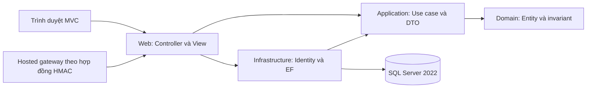
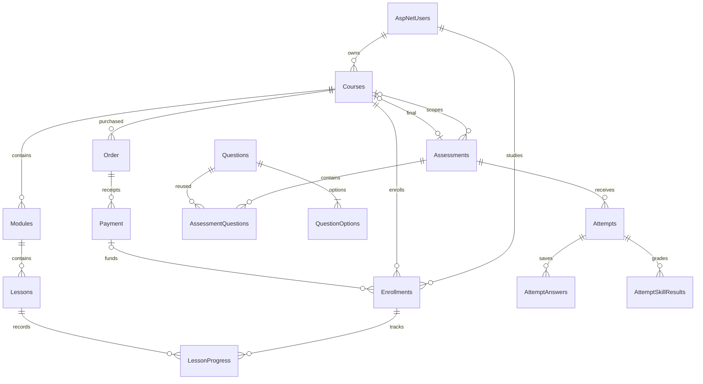

# SP13 · Tài liệu kỹ thuật và vận hành

Nền tảng học tập và đánh giá năng lực tiếng Anh trực tuyến

Ngày soạn: 11/10/2026 (Asia/Saigon). Phụ trách: Lê Hoàng Sơn — 3123560077. Đây là hướng dẫn vận hành bản ứng viên; lịch sử test/CI/UAT được tách trong SP14. Không sử dụng số lượng test trong kế hoạch như số lượng test thực tế của candidate.

## 1. Kiến trúc và nền tảng

Solution dùng .NET 10, ASP.NET Core MVC, EF Core 10, ASP.NET Core Identity và SQL Server 2022. Mô hình modular monolith giữ bốn project; một tiến trình web phục vụ các phân hệ.

| Lớp | Trách nhiệm |
| --- | --- |
| Domain | Entity, enum và ràng buộc nghiệp vụ nền, không phụ thuộc MVC/EF. |
| Application | Interface, DTO, validator, scoring contract và các use case. |
| Infrastructure | EF/SQL Server, migration, Identity, checkout, attempt và query service. |
| Web | Controller, view, request validation, middleware và DI. |

Luồng request: trình duyệt → middleware → authentication → authorization → MVC → service → EF/SQL Server → response. DbContext scoped theo request. Web gọi Application contract; Infrastructure triển khai persistence/transaction. Health check /health kiểm tra DbContext.

Sơ đồ nguồn kiến trúc:



## 2. Dữ liệu cốt lõi và ERD rút gọn

Khóa chính domain/Identity dùng GUID. Timestamp nghiệp vụ dùng DateTimeOffset UTC; ghi giờ diễn tập/nghiệm thu theo Asia/Saigon. Bảng nghiệp vụ hiện dùng Courses, Modules, Lessons, Enrollments, LessonProgress, Assessments, Attempts, AttemptAnswers, AttemptSkillResults; Order và Payment giữ tên mapping trong Commerce. Bảng AspNetUsers/AspNetRoles do Identity quản lý.



Unique Enrollment(StudentUserId, CourseId), LessonProgress(EnrollmentId, LessonId), Payment.ProviderTransactionId, AttemptAnswer(AttemptId, AssessmentQuestionId) và AttemptSkillResult(AttemptId, Skill) là hàng rào database. Filtered unique Attempt(StudentUserId, AssessmentId) với Status=InProgress ngăn hai lượt active. FK bảo vệ lịch sử; cần kiểm tra owner/course/status trong service vì FK riêng lẻ không chứng minh quyền hoặc nội dung Published.

CourseCompletion xét effective Lesson: Published trong Module Visible, tập không rỗng; nếu có Final phải hợp lệ và có graded result đạt theo điểm thô. Reconcile được gọi sau ghi progress và sau finalize; CompletedAtUtc chỉ ghi lần đầu. Serializable và thứ tự khóa Course → Assessment → Attempt bảo vệ thao tác xuyên module. Grade, breakdown và completion commit/rollback cùng giao dịch.

## 3. Cấu hình và quản lý secret

Không lưu mật khẩu hoặc SigningSecret thật trong tài liệu, Git, log, screenshot hay slide. Đặt cấu hình qua environment hoặc user-secrets local. File .env dùng cho Compose phải được gitignore. Giá trị trong .env.example là placeholder; đặt secret riêng trước khi chạy.

| Biến | Công dụng |
| --- | --- |
| ConnectionStrings__DefaultConnection | Chuỗi kết nối SQL Server của web và EF CLI. |
| MSSQL_SA_PASSWORD | Mật khẩu database của Compose local; lấy từ .env riêng. |
| ASPNETCORE_ENVIRONMENT / DOTNET_ENVIRONMENT | Development cho demo local; Production cho host HTTPS thật. |
| LearningDemo__Enabled / LearningDemo__Password | Opt-in seed Development; mật khẩu chỉ nhập kín. |
| CheckoutSandbox__Enabled | Bật local sandbox trong Development. |
| Payments__Enabled | Bật hosted gateway khi có cấu hình hợp lệ. |
| Payments__Provider | Provider ASCII hợp lệ; không dùng định danh local sandbox. |
| Payments__CheckoutUrl / Payments__PublicBaseUrl | URL HTTPS đã tin cậy, không suy ra từ Host header. |
| Payments__SigningSecret | Secret server/provider riêng, tối thiểu 32 ký tự. |
| Payments__CheckoutMinutes | Hạn Order, mặc định 30 phút. |

Local sandbox và hosted là hai adapter riêng. Khi hosted cấu hình hợp lệ, hosted được ưu tiên. Tắt hosted để demo local; không thể xác nhận Order hosted bằng local sandbox. HostedPaymentGateway chỉ triển khai hợp đồng HMAC của dự án, chưa có adapter provider thương mại thật.

## 4. Chạy ứng dụng với database Docker

Cài Git, Docker/Compose và .NET 10 SDK. SQL Server 2022 cần đủ tài nguyên và thời gian khởi động. Không reset/xóa database có dữ liệu học thật để làm demo.

1. Clone/switch đúng branch hoặc tag candidate, ghi SHA và kiểm tra working tree.
2. Tạo .env từ .env.example, đặt password local đủ mạnh. Nhập secret bằng editor hoặc prompt kín; không dán vào shell history.
3. Chạy database và chờ sẵn sàng.

```bash
docker compose up -d db
docker compose logs -f db
```

4. Thiết lập connection string bằng prompt (không ghi giá trị lên terminal). Trong connection string dùng Server=localhost,1433;Database=EnglishLearningDb và password đã cấu hình.

```bash
read -r -s -p 'Connection string local: ' ConnectionStrings__DefaultConnection
export ConnectionStrings__DefaultConnection
```

5. Restore, build và áp dụng migration đã commit.

```bash
dotnet restore EnglishLearningPlatform.sln
dotnet build EnglishLearningPlatform.sln -c Release --no-restore
dotnet ef database update --project src/EnglishLearningPlatform.Infrastructure --startup-project src/EnglishLearningPlatform.Web
dotnet ef migrations has-pending-model-changes --project src/EnglishLearningPlatform.Infrastructure --startup-project src/EnglishLearningPlatform.Web
```

6. Bật demo bằng password riêng, khởi chạy web.

```bash
read -r -s -p 'Mật khẩu demo local: ' LearningDemo__Password
export LearningDemo__Password
export LearningDemo__Enabled=true
export ASPNETCORE_ENVIRONMENT=Development DOTNET_ENVIRONMENT=Development
export Payments__Enabled=false CheckoutSandbox__Enabled=true
dotnet run --project src/EnglishLearningPlatform.Web --no-launch-profile --urls http://localhost:8081
```

7. Mở http://localhost:8081/health và /Courses. Health 200 chỉ xác nhận web/database hoạt động; không thay cho UAT. Sau khi dừng app, unset secret/cờ demo khỏi terminal.

```bash
unset LearningDemo__Password LearningDemo__Enabled CheckoutSandbox__Enabled Payments__Enabled
unset ConnectionStrings__DefaultConnection
```

Compose web dùng hostname db và cổng http://localhost:8080. Dùng docker compose up --build -d sau khi migrate đúng database; kiểm tra environment của service đã khai báo cờ demo/sandbox nếu cần. Shell export riêng không tự vào container trừ khi Compose khai báo truyền. Fresh setup cô lập của nhánh dùng script dưới. Project name phải bắt đầu elp-rc- và chưa có container/volume; script từ chối tái sử dụng dữ liệu. Mặc định SQL cổng 1434 và web 8081; migration service chạy trước web trong Compose. Kết quả thật phải lưu tại SP14.

```bash
read -r -s -p 'Mật khẩu SQL môi trường mới: ' MSSQL_SA_PASSWORD
export MSSQL_SA_PASSWORD
read -r -s -p 'Mật khẩu demo môi trường mới: ' LearningDemo__Password
export LearningDemo__Password
bash scripts/fresh-demo.sh elp-rc-candidate-check
unset MSSQL_SA_PASSWORD LearningDemo__Password
```

Script giữ môi trường mới để review, không reset database/volume hiện có. Có thể đổi ELP_SQL_PORT/ELP_WEB_PORT trước chạy nếu cổng bận.

## 5. Dữ liệu demo và khả năng chạy lại

Seeder chỉ được gọi khi Development và LearningDemo:Enabled=true; chưa có schema thì cần migrate trước. Có 5 tài khoản: admin1, teacher1, teacher2, student1, student2 tại domain demo.example.test. Guest không có tài khoản. student1 đã enroll Free; student2 chưa được seed Paid Enrollment.

Có Demo · Everyday English, Demo · Business English (199.000 VND) và một Course Draft. Free có Lesson Published cùng nội dung Draft/Hidden đối chứng; Final Published có 5 câu, 15 phút, MaxAttempts=3, PassingScore=80. Seeder tìm theo owner/title/email và bổ sung thiếu, giữ password/progress/attempt và nội dung đã sửa. Seed lại không reset lịch sử. Nếu tài khoản demo đã có role không đúng, seeder từ chối để tránh ghi đè.

Không sử dụng seeder Development trên production. Dùng database demo riêng cho mỗi rehearsal nếu cần lịch sử sạch; giữ bằng chứng candidate và lịch sử người học đã nghiệm thu.

## 6. Bảo mật và điểm kiểm soát

Identity quản lý hash password; account status và đúng một active role được kiểm tra qua policy/service/cookie event. Cookie dùng HttpOnly, SameSite=Lax và Secure Always ngoài Development và SameAsRequest chỉ trong Development; deployment thật phải HTTPS. Pipeline đặt authentication trước authorization.

Mutation MVC phải kiểm tra antiforgery. Webhook POST /payments/webhook là ngoại lệ cần thiết vì provider không có cookie/form token: nó xác thực HMAC-SHA256 đúng raw bytes, so thời gian cố định, giới hạn body 16 KiB và kiểm tra JSON/quote/provider/time sau khi xác thực. Tài liệu acceptance ghi ngoại lệ này riêng, không đếm webhook như form MVC.

Teacher bị giới hạn ownership; Student chỉ đọc tài nguyên Enrollment hợp lệ và Attempt của mình; Admin tra cứu quản trị, không sửa nội dung Teacher/đọc correct answer. View dùng DTO không chứa IsCorrect. Razor encode nội dung; truy vấn dùng EF parameterization. Không truyền giá tiền, owner hay StudentId từ browser thành dữ liệu tin cậy.

Log checkout chỉ ghi reference, phase và type/HResult/SQL number; không ghi body, signature hay Exception.Message. Release gate che best-effort Password/Pwd/SigningSecret ở console log; phải kiểm tra TRX/screenshot trước khi chia sẻ vì redaction log không sửa mọi artifact.

## 7. Test và release gate

Sau build đúng revision, chạy unit/integration. Integration dùng SQL Server thật: ELP_TEST_SQLSERVER nếu được cung cấp, hoặc Testcontainers khi bỏ biến. Fixture tạo database GUID riêng; không được đưa connection string production vào test.

```bash
dotnet test tests/EnglishLearningPlatform.UnitTests/EnglishLearningPlatform.UnitTests.csproj -c Release --no-build --logger 'trx;LogFileName=unit.trx'
dotnet test tests/EnglishLearningPlatform.IntegrationTests/EnglishLearningPlatform.IntegrationTests.csproj -c Release --no-build --logger 'trx;LogFileName=integration.trx'
env -u ELP_TEST_SQLSERVER dotnet test tests/EnglishLearningPlatform.IntegrationTests/EnglishLearningPlatform.IntegrationTests.csproj -c Release --no-build --filter 'FullyQualifiedName~LearningDemoSeederTests'
```

Chốt một committed candidate sạch, chạy bash scripts/son-release-gate.sh HEAD. Gate kiểm tra HEAD/working tree trước và sau, ghi SHA/SDK/log/TRX. Dùng ELP_RELEASE_RESULTS để chọn thư mục artifact. Không dùng --no-build trước khi đã build cùng code/configuration.

CI .github/workflows/ci.yml chạy restore, Release build, unit và integration trên PR/push main hoặc workflow_dispatch; artifact test-results có TRX, candidate SHA và SDK. Đối chiếu SHA thực được checkout vì PR CI có thể dùng merge SHA. CD build/push image lên GHCR; chưa đồng nghĩa deploy website. Kết quả local không được ghi thành remote CI xanh.

Tag RC chỉ gắn vào SHA đã gate/review theo chính sách dự án. Tách quyết định phát hành kỹ thuật khỏi nghiệm thu rehearsal người thật; giữ hồ sơ Pending khi chưa thực hiện. Ghi tag/SHA/run URL tại SP14, không sửa nhật ký để trông như đã có kết quả.

## 8. Backup SQL Server

Chọn thời điểm ít ghi dữ liệu. Dùng tài khoản SQL có quyền BACKUP; database demo/production phải ghi rõ. Giữ backup ngoài volume SQL và hạn chế quyền đọc. Không ghi password vào câu lệnh.

Ví dụ trong shell container db dùng sqlcmd có sẵn tại /opt/mssql-tools18/bin/sqlcmd (nếu image có bản cũ, kiểm tra /opt/mssql-tools/bin/sqlcmd). Nhập mật khẩu trong container qua read -s và export SQLCMDPASSWORD; sqlcmd không cần -P.

```bash
docker compose exec db bash
read -r -s -p 'SQL backup password: ' SQLCMDPASSWORD
export SQLCMDPASSWORD
mkdir -p /var/opt/mssql/backup
/opt/mssql-tools18/bin/sqlcmd -S localhost -U sa -C -b -Q "BACKUP DATABASE [EnglishLearningDb] TO DISK=N'/var/opt/mssql/backup/EnglishLearningDb.bak' WITH COPY_ONLY, INIT, CHECKSUM;"
/opt/mssql-tools18/bin/sqlcmd -S localhost -U sa -C -b -Q "RESTORE VERIFYONLY FROM DISK=N'/var/opt/mssql/backup/EnglishLearningDb.bak' WITH CHECKSUM;"
unset SQLCMDPASSWORD
exit
```

Copy file ra host: docker compose cp db:/var/opt/mssql/backup/EnglishLearningDb.bak /đường-dẫn-backup/EnglishLearningDb.bak. Đặt tên host kèm timestamp/candidate và checksum bằng sha256sum. Không commit .bak. VERIFYONLY kiểm tra backup đọc được; cần restore drill vào database riêng để xác minh khả năng phục hồi nghiệp vụ.

## 9. Restore và rollback

Restore vào database mới EnglishLearningRestoreCheck trước khi thay môi trường đang dùng. Dùng RESTORE FILELISTONLY để lấy LogicalName thật, rồi chọn MOVE cho từng data/log file. Không giả định tên logical file khớp database.

```sql
RESTORE FILELISTONLY FROM DISK=N'/var/opt/mssql/backup/EnglishLearningDb.bak';
-- Thay <DATA_LOGICAL_NAME> và <LOG_LOGICAL_NAME> bằng kết quả FILELISTONLY.
RESTORE DATABASE [EnglishLearningRestoreCheck]
FROM DISK=N'/var/opt/mssql/backup/EnglishLearningDb.bak'
WITH MOVE N'<DATA_LOGICAL_NAME>' TO N'/var/opt/mssql/data/EnglishLearningRestoreCheck.mdf',
     MOVE N'<LOG_LOGICAL_NAME>' TO N'/var/opt/mssql/data/EnglishLearningRestoreCheck_log.ldf',
     CHECKSUM, RECOVERY;
```

Chạy web kiểm tra bằng connection string trỏ bản restore riêng, tắt seeder và sandbox/hosted trong restore drill. Đối chiếu user, Order/Payment/Enrollment, AttemptSkillResults, CompletedAtUtc và bảng __EFMigrationsHistory. Kết quả drill ghi vào SP14. Không dùng WITH REPLACE hoặc SINGLE_USER trên database đang phục vụ nếu chưa có kế hoạch downtime và quyết định vận hành cụ thể.

Rollback ứng dụng bằng image/tag candidate trước. Migration rollback không mặc nhiên an toàn: đánh giá mất dữ liệu, backup, script SQL và tương thích code/schema trước khi thực hiện; ưu tiên fix forward khi schema đã ghi dữ liệu mới. Dừng/khởi động Compose không xóa volume. docker compose down -v xóa dữ liệu, chỉ dùng database demo đã được chủ đích bỏ.

## 10. Chẩn đoán và bàn giao

| Dấu hiệu | Kiểm tra |
| --- | --- |
| /health lỗi | Database ready, hostname/port, connection string, TLS TrustServerCertificate local. |
| Invalid column/schema | Migration của đúng startup project/database; không sửa migration đã áp dụng. |
| Seed không chạy | Development, flag opt-in, password đủ yêu cầu, role migration, email role cũ. |
| Checkout unavailable | Hosted valid hoặc local sandbox Development, provider stored trên Order. |
| CSRF 400 | Form có antiforgery token/cookie, phiên hợp lệ; không tắt global filter để chữa. |
| 403 hoặc Login | Account active, một role, Enrollment/payment/ownership/status đúng. |
| Deadline/result khác client | Server UTC là nguồn tin cậy; kiểm tra timezone hiển thị. |
| Build DLL bị khóa | Dừng dotnet run/debug trước build/migration. |

Hồ sơ vận hành cần commit/tag SHA, cấu hình đã che secret, migration list, restore drill, test artifact, UAT screenshot và người nhận bàn giao. Sơ đồ ERD đầy đủ tại docs/architecture/erd.md là thiết kế đích; SP13 nêu phần chạy của candidate và không suy ra mọi màn hình đích đã triển khai.
