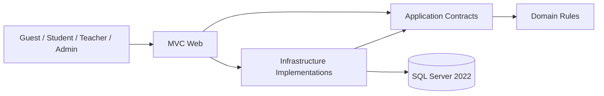

# Báo cáo đồ án ba môn

Nền tảng học tập và đánh giá năng lực tiếng Anh trực tuyến trên nền web .NET

Công nghệ .NET · Công nghệ lập trình hiện đại · Quản lý dự án phần mềm

Nhóm trưởng: Lê Hoàng Sơn — MSSV 3123560077. Nhóm triển khai theo kế hoạch: Sơn, Khánh, Hoàng, Khang và Dương. Ngày dự kiến bảo vệ: 16/10/2026. Bản tổng hợp: 11/10/2026 (Asia/Saigon). Thông tin lớp/giảng viên và MSSV các thành viên còn lại cần nhóm điền theo hồ sơ chính thức; không tự tạo thông tin chưa được cung cấp.

## Tóm tắt

Đồ án xây dựng ứng dụng ASP.NET Core MVC hỗ trợ người học tìm khóa, ghi danh hoặc mua khóa qua sandbox, học bài, lưu tiến độ, làm Assessment và xem kết quả. Teacher quản lý nội dung sở hữu; Admin tra cứu tài khoản/giao dịch. Tâm điểm hoàn thiện là luồng Payment → Enrollment → Learning → Assessment → Result, quy tắc Course Completion, security gate và hồ sơ ứng viên phát hành.

Một mã nguồn được phân tích theo ba góc nhìn: Công nghệ .NET tập trung framework/persistence/web; Công nghệ lập trình hiện đại tập trung kiến trúc, DI, async, test và CI; Quản lý dự án phần mềm tập trung phạm vi, phân công, phụ thuộc, rủi ro và nghiệm thu bằng bằng chứng. Báo cáo trình bày hành vi đã hiện thực và giới hạn thực nghiệm; không nhận provider thật, rehearsal tương lai hay remote CI chưa có là hoàn thành.

## 1. Bài toán, phạm vi và tiêu chí thành công

Người học cần nội dung và trạng thái rõ: khóa đã mua có mở quyền chưa, bài đã học có lưu không, Final đã đạt chưa và khi nào hoàn thành. Vấn đề dữ liệu khó nằm ở ranh giới module: callback thanh toán lặp, request Start/Submit đồng thời, deadline, điểm làm tròn và thay đổi nội dung sau khi đã hoàn thành.

Tiêu chí thành công của candidate: một luồng thao tác được trên browser; dữ liệu không nhân đôi; quyền kiểm tra tại server; điểm/lịch sử/completion không sai; setup tái lập; build/test và hồ sơ gắn đúng candidate. Trải nghiệm không ép học tuần tự; Final vẫn quyết định completion khi khóa yêu cầu.

| Actor | Kết quả mong đợi |
| --- | --- |
| Guest | Xem catalog/detail, đăng nhập khi vào protected Lesson. |
| Student mua khóa | Order sandbox → Payment verified → Enrollment → đọc bài. |
| Student thi | Effective Lessons complete + Final raw pass → Completion badge/date. |
| Teacher | Authoring/preview Course sở hữu, denied resource của Teacher khác. |
| Admin | Query payment/user, denied content mutation/correct answers. |

Phạm vi UI candidate được mô tả ở SP11/SP15. Practice, authoring Question Bank/Assessment/Final assignment/versioning và recommendation là thiết kế đích/dependency chưa được suy ra từ domain. Ngoài phạm vi: provider thu tiền thật, refund tự động, forum/livestream, AI Speaking/Writing và chứng chỉ quốc tế.

## 2. Kiến trúc tổng thể

Solution gồm Domain, Application, Infrastructure và Web, theo modular monolith. Domain giữ entity/enum; Application định nghĩa DTO/interface/use case; Infrastructure triển khai EF/Identity/transaction; Web xử lý request, policy và view. Ranh giới làm rõ ai quyết định business rule và giúp unit/integration kiểm thử độc lập.

Controller không chấm điểm hoặc tự cấp Enrollment. Student ID lấy từ claims; server quyết định amount/owner/deadline. DTO Student loại IsCorrect ngay từ query. Health endpoint kiểm tra database, không thay nghiệm thu business flow.

## 3. Báo cáo môn Công nghệ .NET

### 3.1. Framework và pipeline

Dự án dùng .NET 10, ASP.NET Core MVC, Razor, EF Core 10, Identity, SQL Server 2022. Program đăng ký Application/Infrastructure qua DI, MVC và health check. Middleware xử lý exception/HSTS ngoài Development, HTTPS redirect, static files, routing, authentication, authorization rồi endpoint. Thứ tự AuthN trước AuthZ bảo đảm policy nhận đúng principal.

DbContext scoped theo request phù hợp tracking/transaction. TimeProvider làm deadline có thể kiểm thử; không dùng đồng hồ browser làm nguồn grade. Controller/view tách input validation, service result và display; POST mutation dùng antiforgery. Hosted webhook là ngoại lệ server-to-server có HMAC và request size limit.

### 3.2. EF Core và mô hình dữ liệu

Course chứa Module/Lesson; Enrollment liên kết Student/Course/Payment; LessonProgress lưu trạng thái từng bài. Assessment chứa AssessmentQuestion/Question/Option; Attempt lưu deadline/status/score/pass, Answer và SkillResult. Identity GUID dùng cùng dạng khóa domain. SQL check/index/FK hỗ trợ invariant, nhưng owner/status cùng Course vẫn cần service validation.

Unique Enrollment(Student, Course), LessonProgress(Enrollment, Lesson) và Payment.ProviderTransactionId ngăn duplicate. Filtered unique one InProgress Attempt bảo vệ start race; unique skill/answer theo attempt giữ grade nhất quán. FK NoAction ở lịch sử tránh xóa dây chuyền do xóa khóa/user.

Migration đã commit được áp dụng bằng EF CLI; fresh database và pending-model check phải chạy trên candidate. Không sửa migration cũ để chữa schema đã deploy. Demo seeder chỉ Development opt-in, idempotent, tạo 5 user và dữ liệu Free/Paid/Final, giữ lịch sử khi chạy lại.

### 3.3. Authentication và authorization

Identity hash password, quản lý login/cookie; mỗi user một active role. Policy và cookie event từ chối Locked/Disabled hoặc role stale ở request kế tiếp. Cookie HttpOnly, SameSite=Lax; Secure Always ngoài Development và HTTP demo chỉ dùng môi trường local.

Teacher ownership kiểm tra tại server; Student không đọc attempt/Order của người khác; Admin read-only query và không mặc nhiên có quyền Teacher. Razor encode content, EF parameterization và DTO không chứa IsCorrect giảm XSS/SQL injection/leak. Secrets từ env/user-secrets, không ghi trong artifact.

### 3.4. Luồng dữ liệu và transaction

Payment verified tạo Enrollment trong transaction khi đủ điều kiện; return page không xác nhận. Finalize chấm weighted score, lưu breakdown và reconcile completion cùng transaction. Khi lỗi completion, rollback grade và timestamp để retry scope mới không còn trạng thái nửa chừng.

Serializable cùng thứ tự khóa Course → Assessment → Attempt làm Start/Save/Finalize/progress nhất quán. Request replay đọc kết quả cũ; completion giữ marker lần đầu. Điểm đạt so với raw score trước làm tròn để 69,996% hiển thị 70,00% không thành đạt ngưỡng 70%.

### 3.5. Kết quả và giới hạn của môn

Sản phẩm thực thi core .NET MVC/EF/Identity/DI/migration và UI xuyên module. Minh chứng định lượng lấy từ TRX cuối ở SP14; không hardcode tổng 331. Hosted payment hiện là custom contract, chưa provider thật; nhiều host/load/production deployment chưa được nghiệm thu. Teacher assessment authoring/versioning cần acceptance riêng.

## 4. Báo cáo môn Công nghệ lập trình hiện đại

### 4.1. Modular monolith và hợp đồng

Bốn project kiểm soát phụ thuộc. Application DTO giảm coupling view với entity tracked và correct answers. IAttemptService xử lý lifecycle; IAssessmentQueryService đọc safe overview/taking/result. Infra implementations được DI vào controller, giúp một contract thống nhất thay các logic checkout/UI trùng.

Mô hình này vừa sức nhóm, dễ trace và test hơn chia service triển khai độc lập khi chưa cần. Dependency vẫn phải review; database transaction xuyên module được giữ một nơi để tránh inconsistency.

### 4.2. Async, cancellation và thời gian

I/O SQL/Identity dùng async/await, CancellationToken truyền theo request. Transaction helper giữ lỗi chính khi rollback/dispose phát sinh lỗi; không nuốt cancellation hoặc trả success khi chưa xác nhận commit. Deadline UTC và TimeProvider tạo khả năng kiểm thử ranh giới chính xác; client countdown chỉ trình bày.

### 4.3. Kiểm thử như bằng chứng hành vi

Unit kiểm tra rule/scoring/validator; integration chạy SQL Server thật bằng cấu hình riêng hoặc Testcontainers. Fixture tạo database GUID và migrate; không reset database ứng dụng. Case tiêu biểu: forbidden owner/role, stale cookie, missing CSRF, raw body HMAC tamper, duplicate webhook, start/finalize race, rounding boundary, historical completion, atomic rollback và skill persistence.

Negative test quan trọng vì hidden UI button không chứng minh quyền. Nộp lặp/concurrency tests chứng minh service/DB trên môi trường cụ thể; không nâng thành multi-host hoặc outage thật. Query legacy graded without skill rows trả empty thay vì tự sửa lịch sử.

### 4.4. CI/CD và Git

CI trên PR/push main/workflow_dispatch thực hiện restore, Release build, unit và integration; lưu candidate-sha, SDK và TRX. Release gate local yêu cầu committed clean tree và đối chiếu HEAD trước/sau. PR merge SHA phải được phân biệt với branch SHA.

CD đóng container image lên GHCR, chưa tự deploy host. Branch riêng của đợt thực thi giữ thay đổi reviewable. Tag RC trỏ revision cụ thể; mỗi source change sau gate cần gate lại. Remote run xanh cần run URL/artifact, không thể thay bằng local log.

### 4.5. Bài học kỹ thuật

Hợp đồng DTO và service giúp nối UI nhanh mà không rò đáp án. Timestamp completion là sự kiện lịch sử, khác progress đo hiện tại. Raw score và display score cần tách. Transaction và idempotency phải được thiết kế ngay ở dữ liệu lẫn code; retry sau lỗi không được đổi lịch sử. Evidence cần ràng buộc SHA để chặn dùng binary/log cũ.

## 5. Báo cáo môn Quản lý dự án phần mềm

### 5.1. Phạm vi và WBS đợt chốt

Kế hoạch người dùng xác định Công việc 10, 11 và 12 đang làm, tổng trọng số cá nhân 26,9%. Công việc 10 chiếm 10%, Công việc 11 8%, Công việc 12 8,9%. Việc đóng không chỉ code: cần AC, test, browser, fresh setup, CI, rehearsal, tag, tài liệu và cập nhật spreadsheet.

| Gói việc | Đầu ra |
| --- | --- |
| CV10 | Final link/overview/taking/result, completion badge và regression xuyên module. |
| CV11 | Secret/endpoint audit, auth/CSRF/cookie/webhook tests, CI artifact. |
| CV12 | Fresh setup/seeder, UAT matrix, rehearsal, RC tag và SP11–SP15/deck/báo cáo. |

### 5.2. Phân công và phụ thuộc

Sơn tổng hợp contract/transaction/completion/security/release. Khánh Learning/Teacher; Hoàng Assessment/Question Bank/scoring; Khang/Dương UI Student/Admin và bấm demo theo kế hoạch. Đây là phân vai dự kiến, không thay log đóng góp thật từ commit/PR/issue. Mỗi người phải trace được luồng của mình và người cover.

Dependencies chính: Final UI gọi service hiện có; Admin query cần payment/user metadata; gate cần candidate committed; tag cần evidence/review; rehearsal cần người thật và cùng cấu hình demo. Chốt contract trước giảm code cạnh tranh và mở rộng ngoài phạm vi.

### 5.3. Timeline và lịch tổng duyệt

| Ngày (Asia/Saigon) | Kế hoạch |
| --- | --- |
| 11/10 | Đối chiếu kế hoạch/hiện trạng, branch riêng, triển khai và tài liệu. |
| 12/10 | Hoàn thiện CV10/Student Assessment UI và contract. |
| 13/10 | CV11 security/CI, review source và gate. |
| 14/10 | Fresh setup và Browser UAT 5 hành trình. |
| 15/10, 09:00–11:30 | Rehearsal 1: lỗi setup/mạng/deadline/fallback. |
| 15/10, 14:00–16:30 | Rehearsal 2: thuyết trình/live demo/phân vai. |
| 15/10 tối | Chốt RC/hồ sơ/slide và tiến độ theo evidence. |
| 16/10 | Bảo vệ dự kiến. |

Lịch này là kế hoạch, không phải dữ liệu hoạt động đã diễn ra. Báo cáo nghiệm thu giữ Pending cho rehearsal tương lai và remote actions chưa có. Tiến độ theo AC thực tế, không theo số giờ đã làm.

### 5.4. Rủi ro và ứng phó

| Rủi ro | Biện pháp |
| --- | --- |
| UI owner chưa kịp merge | Fallback Student controller gọi service contract; regression lại UI. |
| Provider ngoài không sẵn | Local sandbox Development được ghi rõ; không tự nhận provider thật. |
| SQL/schema/seeder lỗi | Fresh migration riêng, health check, seed idempotency, giữ DB có lịch sử. |
| Media/mạng demo lỗi | Dùng Lesson Text và Final Grammar/Vocabulary không phụ thuộc media ngoài. |
| Hết attempt/deadline | Giữ lịch sử; dùng actor/database demo riêng, không sửa score/time. |
| Artifact sai SHA | Clean candidate gate, manifest/run SHA, rerun sau source change. |
| Secret rò qua evidence | Secret scan và artifact review; không in env/body/signature. |
| Rehearsal chưa đủ | Giữ Pending, chủ trì tổ chức đúng lịch và điền biên bản người thật. |

### 5.5. Chất lượng, nghiệm thu và bàn giao

SP14 liên kết AC-10.1–10.5, AC-11.1–11.5 và AC-12.1–12.5 tới evidence. Có bốn nhóm actor nhưng năm UAT journey vì Student chia hai tài khoản; seeder có thêm Teacher 2 đối chứng. Rehearsal logs phải có tên/giờ/SHA/kết quả/evidence thật.

Cập nhật spreadsheet cần đúng file và R17/R18/R19 Sheet 2, cột Sơn tuần 5/6 Sheet 1 theo kế hoạch sau nghiệm thu. Không tự sửa trọng số/công thức hay sheet thành viên khác. Nếu file/account không truy cập được, ghi cell update dự kiến và yêu cầu owner thực hiện, không báo đã cập nhật.

Bàn giao gồm code branch/candidate, migration, cấu hình không secret, SP11 manual, SP13 ops/backup/restore, SP14 acceptance, SP15 requirements/design, báo cáo ba môn, deck 28 slide và SHA256 manifest. Binaries DOCX/PDF/PPTX xuất từ nguồn để người nhận chỉnh nội dung dễ dàng.

## 6. Thực nghiệm và hướng đánh giá

Người chốt candidate chạy restore/Release build/unit/integration; fresh Docker migrate/seed; browser UAT; secret/endpoint audit; remote CI nếu có quyền; đối chiếu tag/SHA. Báo số từ TRX thật và đường dẫn đã che nhạy cảm. Không tạo screenshot placeholder hoặc kết quả giả để lấp mục chưa chạy.

| Mảng | Nguồn kiểm chứng |
| --- | --- |
| Tự động | Build/test TRX candidate và security audit log. |
| Fresh môi trường | Docker/migration/seed/health evidence. |
| Giao diện | Browser screenshots và actual outcome từng UAT. |
| Release ngoài repo | GitHub run/artifact/tag URL, spreadsheet cell update evidence. |
| Người dùng/nhóm | Biên bản nghiệm thu và rehearsal có người thật. |

Kết quả cuối không được hardcode vào nguồn báo cáo trước khi root chạy. Cập nhật SP14/evidence ledger để báo cáo trỏ tới trạng thái đầy đủ. Local gate pass có giá trị local; remote CI/rehearsal/demonstration cần từng evidence riêng.

## 7. Định hướng phát triển

Sau candidate, ưu tiên complete Teacher Assessment/Question Bank authoring và versioning bảo toàn đề; Practice feedback/recommendation có threshold hợp lệ; Admin mutations với active-admin invariants và audit; provider adapter thật qua sandbox chính thức; browser/load/multi-host/outage tests và deployment HTTPS có monitoring/backup restore drill. Mỗi phần là scope mới cần use case/AC và owner rõ.

## 8. Tài liệu tham chiếu nội bộ

SP11-user-manual.md: hành trình người dùng. SP13-technical-operations.md: vận hành, cấu hình, backup/restore. SP14-test-acceptance.md: AC/UAT/rehearsal. SP15-requirements-design.md: contract/invariant/use case. docs/architecture/assessment-student-queries.md: query DTO Student. docs/architecture/payment-sandbox.md: hosted HMAC. docs/project/son-demo-fallback.md: demo và sự cố. docs/acceptance/evidence/son-sprint-16-10-evidence.md: kết quả thực tế.

## Phụ lục · Câu hỏi vấn đáp gợi ý

- Vì sao DbContext scoped và authentication đứng trước authorization?
- Vì sao progress 100% chưa đủ completion khi khóa có Final?
- Vì sao server không tin status/price/StudentId từ browser?
- HMAC ký raw bytes khác ký JSON deserialize/serialize như thế nào?
- Hai request Start/Submit đồng thời có làm vượt lượt hoặc chấm hai lần không?
- Điểm hiển thị bằng ngưỡng có chắc Passed không?
- Thêm bài sau completion ảnh hưởng timestamp và progress ra sao?
- CI artifact chứng minh SHA nào? GHCR image có phải đã deploy không?
- Rehearsal/test automation có thể thay chữ ký nghiệm thu người thật không?
